

# UNIVERSIDAD DE SAN CARLOS DE GUATEMALA

## PROYECTO PORTUS - FASE 1

# BITÁCORA DE DESARROLLO Y EVIDENCIAS

### Registro del avance del proyecto desde el diseño inicial hasta la versión funcional

  

## INTEGRANTES

| No. | Nombre completo | Carnet |
|---:|---|---:|
| 1 | Juan Manuel de León Martínez | 202300755 |
| 2 | Axel David González Molina | 202402074 |
| 3 | Dorbal Emilio Aldana Ramos | 202400388 |
| 4 | Fernando Josúe López Iboy | 202300840 |
| 5 | Erick Vinicio Carbonell Esquite | 202405365 |

  

**Curso:** Lab. Arquitectura de computadores y ensambladores  2

**Sección:** B

   

**Guatemala, 2026**

# BITÁCORA DE DESARROLLO  
# Y EVIDENCIAS

## Proyecto PORTUS - Fase 1

### Registro del proceso de construcción, montaje, cableado y pruebas de integración

 

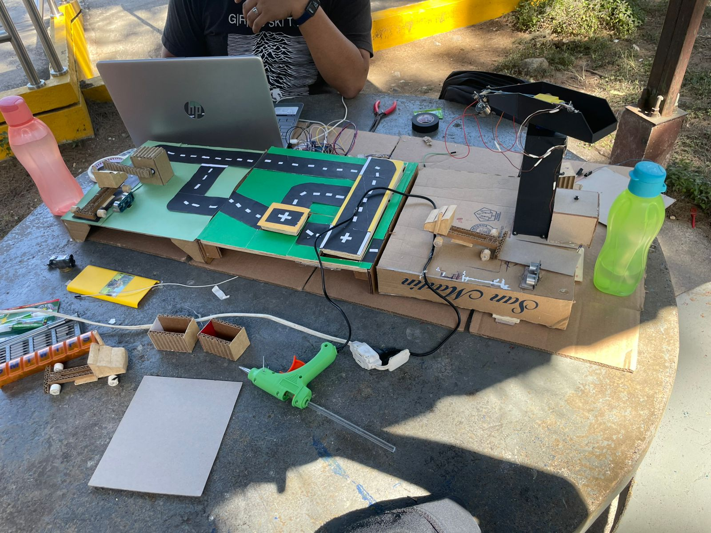

*Vista general de la maqueta durante la etapa de integración.*

# Propósito de la bitácora

Esta bitácora registra la evolución del prototipo desde la fabricación de los primeros elementos físicos hasta la integración de la grúa, el patio, la estación de pesaje, el cableado y el control electrónico. El objetivo es dejar evidencia del trabajo realizado, de los ajustes efectuados durante el desarrollo y de los resultados obtenidos en las pruebas funcionales.

El desarrollo se realizó de forma iterativa. Cada subsistema fue construido y probado por separado antes de incorporarse a la maqueta completa. Las correcciones se concentraron principalmente en la estabilidad mecánica, la alineación de los vehículos con las estaciones, la organización del cableado y la calibración de los movimientos de la grúa para que pudiera recoger, trasladar y depositar cargas en posiciones definidas.

## Resumen del avance

| Etapa | Actividad principal | Resultado |
|---|---|---|
| 1 | Diseño y construcción de vehículos y cargas | Se definió la escala física del proyecto. |
| 2 | Construcción del patio y distribución de rutas | Se establecieron zonas de circulación, parada y operación. |
| 3 | Montaje de la estación de pesaje | Se integró una plataforma de pesaje dentro del recorrido. |
| 4 | Construcción y montaje de la grúa | Se obtuvo el mecanismo de giro, elevación y manipulación de carga. |
| 5 | Cableado y control electrónico | Se integraron servo, actuadores, electroimán y módulos de control. |
| 6 | Pruebas de movimiento y lógica de operación | Se ajustaron posiciones y secuencias de trabajo. |
| 7 | Integración final | Se probaron conjuntamente patio, pesaje, grúa y electrónica. |

# Etapa 1. Diseño y construcción de vehículos y cargas

El trabajo inició con la fabricación de vehículos, remolques y contenedores a escala utilizando cartón corrugado y piezas ligeras. Estos elementos permitieron validar de forma temprana el tamaño de las vías, la altura de las estaciones y el espacio necesario para realizar maniobras dentro del patio.

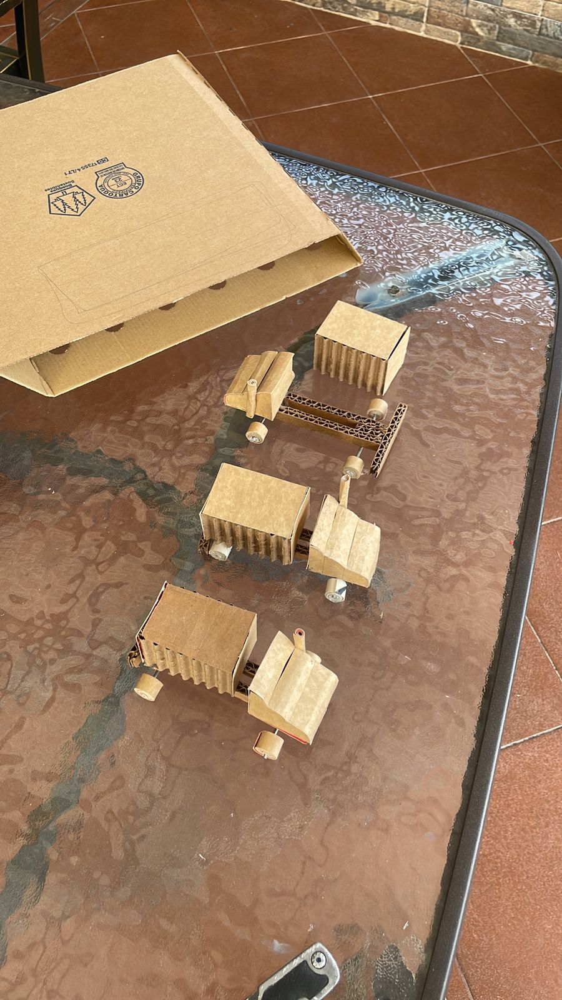

**Figura 1.** Prototipos de camiones, remolques y contenedores utilizados para definir la escala del sistema.

### Problema detectado

Las primeras piezas debían ser suficientemente livianas para que la grúa pudiera manipularlas, pero al mismo tiempo debían conservar rigidez para mantener su forma durante las pruebas.

### Decisión y corrección

Se simplificó la geometría de los vehículos y se reforzaron las zonas que soportaban ruedas, ejes y cargas. También se mantuvieron dimensiones similares entre los contenedores para facilitar las pruebas de transferencia.

### Resultado

Se obtuvieron vehículos y cargas de peso reducido, adecuados para probar el recorrido del patio y la operación de carga y descarga con la grúa.

# Etapa 2. Construcción del patio y distribución de rutas

Con los vehículos disponibles se construyó la base del patio. Primero se definió la posición general de la vía y de los puntos de operación; posteriormente se agregaron superficies de circulación, señalización y espacios reservados para sensores y estaciones. Esta etapa fue importante porque la posición física de cada elemento condicionaba el recorrido de los camiones y el alcance útil de la grúa.

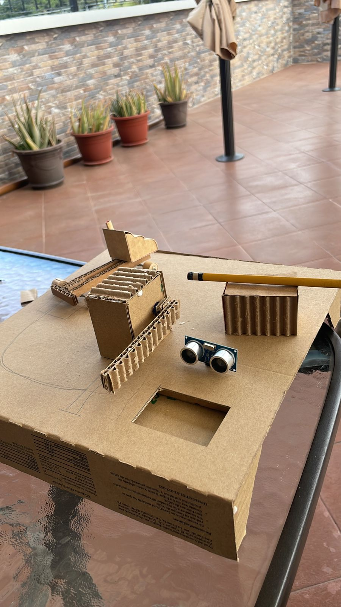

**Figura 2.** Construcción inicial de la base y ubicación preliminar de los elementos del patio.

 

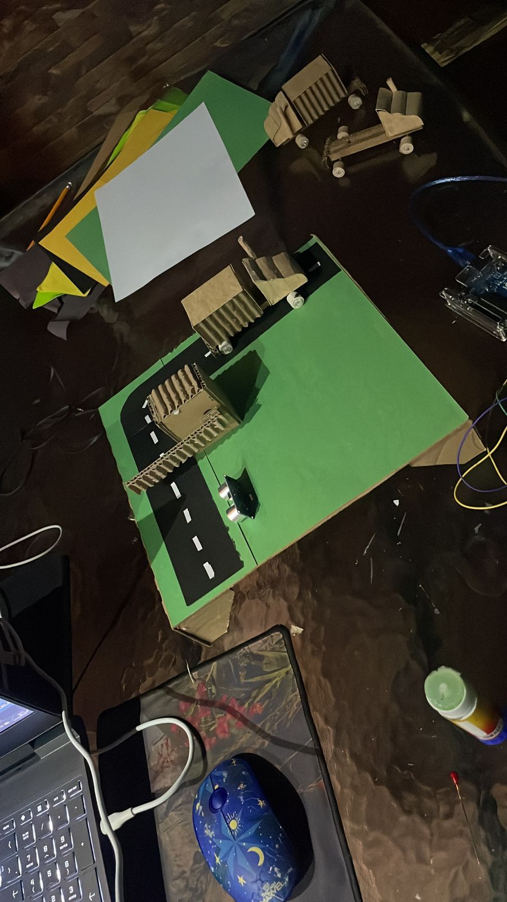

**Figura 3.** Distribución de rutas, zonas de circulación y puntos de operación.

### Problema detectado

Al ubicar las estaciones sobre la primera distribución, algunos giros quedaban reducidos y el espacio útil para detener un camión frente a cada punto era limitado.

### Decisión y corrección

Se reajustó la trayectoria de las vías y se desplazaron elementos para mantener un recorrido continuo. El sensor de distancia se colocó orientado hacia la zona de aproximación para facilitar la detección de presencia.

### Resultado

El patio quedó organizado con un recorrido visualmente claro y con áreas suficientes para aproximación, pesaje y transferencia de carga.

# Etapa 3. Montaje de la estación de pesaje

La estación de pesaje se incorporó como parte del recorrido del vehículo. El objetivo mecánico fue que el camión pudiera quedar colocado sobre una sección estable de la vía mientras los elementos de medición permanecían protegidos debajo de la plataforma. La construcción también debía permitir el paso del cableado sin interferir con las ruedas ni deformar la superficie superior.

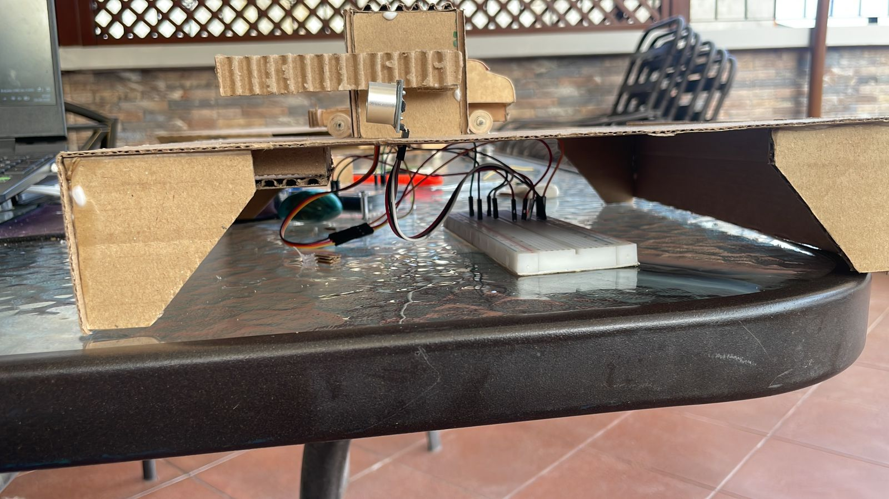

**Figura 4.** Camión ubicado sobre la plataforma de la estación de pesaje durante una prueba de montaje.

 

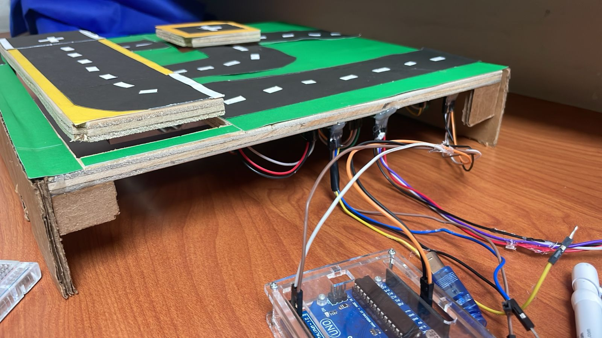

**Figura 5.** Cableado y control electrónico instalados bajo la base del patio para las estaciones de sensado y pesaje.

### Problema detectado

La plataforma podía flexionarse y las conexiones quedaban expuestas al movimiento de la maqueta, lo que generaba riesgo de lecturas inestables o desconexiones durante las pruebas.

### Decisión y corrección

Se reforzó la base, se fijaron los elementos de medición y se guiaron los cables hacia la parte inferior. El control se mantuvo accesible para poder realizar calibraciones y revisar conexiones sin desmontar todo el patio.

### Resultado

La estación quedó integrada físicamente al flujo del camión y preparada para realizar pruebas de medición junto con el resto del sistema.

# Etapa 4. Construcción y montaje de la grúa

La grúa se desarrolló como el mecanismo encargado de trasladar la carga entre el punto de atención del camión y distintas posiciones de depósito. Su estructura combina una torre vertical, un mecanismo de giro horizontal, un brazo superior y un sistema de elevación mediante carrete y cable. El extremo de carga utiliza un electroimán para recoger y liberar el contenedor.

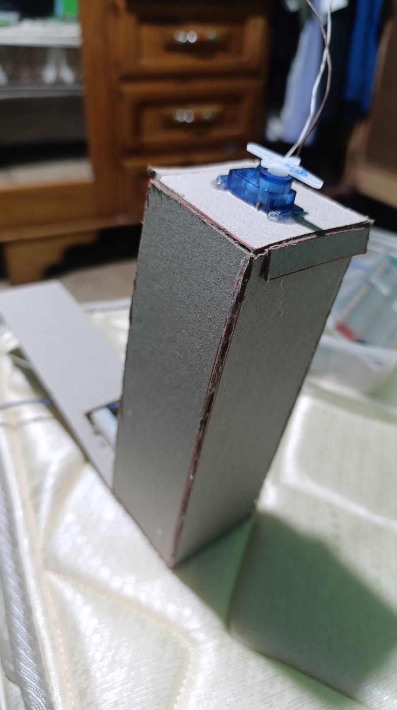

**Figura 6.** Servomotor instalado en la parte superior de la torre para realizar el movimiento horizontal.

 

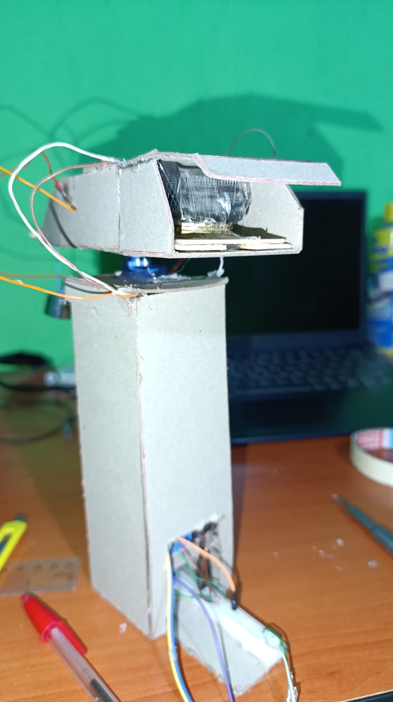

**Figura 7.** Mecanismo de carrete utilizado para controlar la subida y bajada del cable.

 

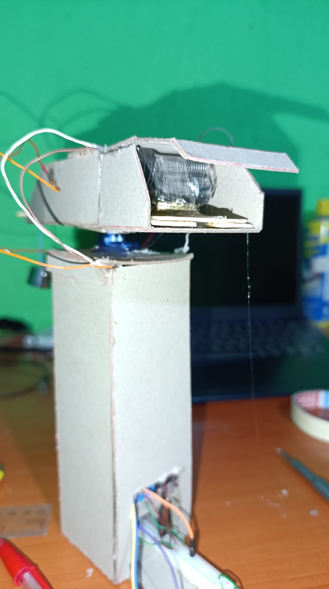

**Figura 8.** Vista del brazo, carrete y salida del cable durante el ajuste mecánico.

### Problema detectado

El movimiento debía cubrir varias posiciones sin que el brazo golpeara la estructura ni que el cable quedara demasiado flojo o tensionado. Además, la altura de descenso requerida en HOME no era exactamente la misma que en los puntos de depósito.

### Decisión y corrección

Se definieron posiciones de referencia para el giro y se calibraron recorridos verticales diferentes para la zona HOME y para las posiciones de trabajo. El desplazamiento se ajustó de forma progresiva para reducir movimientos bruscos.

### Resultado

La grúa logró desplazarse entre una posición de origen y tres posiciones de operación, ejecutando ciclos de bajar, tomar o soltar la carga y volver a subir.

# Etapa 5. Cableado y control electrónico de la grúa

Después de validar la estructura mecánica se instalaron los elementos de control dentro de la torre. El cableado incluye las conexiones del servo de giro, el sistema de subida y bajada, el control del electroimán y el módulo encargado de manejar las cargas que no pueden conectarse directamente al microcontrolador. Se utilizó una protoboard para distribuir señales y alimentación durante la etapa de pruebas.

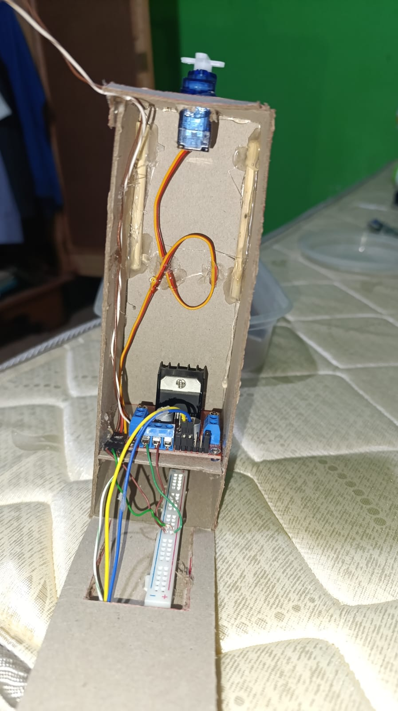

**Figura 9.** Interior de la torre con el servo, módulo de potencia, protoboard y cableado de control.

### Problema detectado

Durante el montaje, la cantidad de conductores dentro de una estructura estrecha dificultaba la revisión de conexiones y podía provocar que un cable interfiriera con el mecanismo de giro o con el movimiento del carrete.

### Decisión y corrección

Se separaron las conexiones por función, se fijaron los módulos a la estructura y se dejó holgura únicamente en los conductores que debían acompañar un movimiento. Las pruebas se hicieron primero por actuador y luego de forma combinada.

### Resultado

El sistema quedó cableado de manera suficientemente ordenada para controlar el giro, la elevación y el electroimán como una secuencia única de trabajo.

# Etapa 6. Pruebas de movimiento y lógica de operación

Con la grúa ensamblada se realizaron pruebas repetidas para ajustar la lógica de operación. Se definió una posición **HOME** para carga o descarga frente al vehículo y tres posiciones adicionales para el depósito. Cada orden inicia con el desplazamiento horizontal y, al llegar al punto seleccionado, continúa con el ciclo vertical.

La secuencia de trabajo se estableció de forma controlada:

1. Selección del destino.
2. Movimiento horizontal del brazo hasta la posición definida.
3. Descenso del sistema de elevación.
4. Activación o desactivación del electroimán, según corresponda.
5. Espera breve para estabilizar la carga.
6. Elevación del mecanismo.
7. Finalización del ciclo antes de aceptar una nueva orden.

Mientras esta secuencia está activa no se permite iniciar otro movimiento, lo que evita superponer órdenes y reduce el riesgo de que dos actuadores queden trabajando de forma contradictoria.

### Problemas encontrados durante las pruebas

- Los tiempos de descenso y subida no funcionaban de igual forma en HOME y en los puntos de depósito.
- La altura alcanzada inicialmente no siempre coincidía con la posición del contenedor.
- Era necesario evitar que la grúa aceptara un nuevo comando mientras todavía se encontraba ejecutando un ciclo.
- La carga debía mantenerse asegurada durante el traslado horizontal.
- La liberación del contenedor requería que el electroimán se desactivara únicamente en el momento correcto.

### Correcciones realizadas

Se ajustaron los tiempos de movimiento vertical y se utilizaron secuencias de estados para controlar el orden de las operaciones. También se incorporó un intervalo de espera para permitir que el electroimán terminara de sujetar o liberar la carga antes de iniciar el movimiento de subida.

### Resultado

La grúa consiguió ejecutar ciclos de recogida y entrega de forma controlada entre HOME y las posiciones definidas, reduciendo los movimientos incorrectos observados durante las primeras pruebas.

# Etapa 7. Integración del patio, la grúa y la electrónica

La etapa de integración consistió en colocar el patio, los vehículos, las estaciones y la grúa dentro de una misma maqueta y verificar que las dimensiones y recorridos fueran compatibles. Durante esta fase se realizaron ajustes directamente sobre el montaje, ya que la interacción entre subsistemas evidenció problemas que no eran visibles en las pruebas individuales.

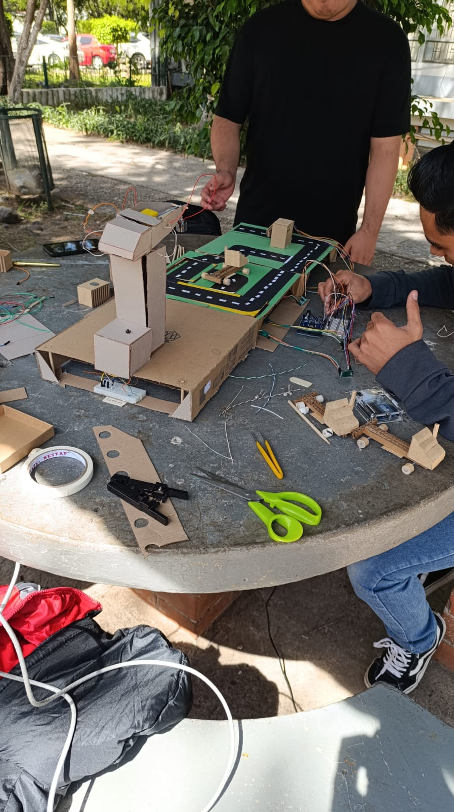

**Figura 10.** Jornada de integración: conexión del patio, la grúa y los módulos electrónicos.

### Problema detectado

Al unir todos los componentes aparecieron diferencias de alineación entre la posición del camión, el punto HOME de la grúa y las áreas de depósito. También se incrementó la cantidad de cables alrededor de la maqueta.

### Decisión y corrección

Se reposicionaron módulos, se ajustaron rutas de cable y se repitieron los ciclos de movimiento hasta que el punto de recogida coincidiera con la ubicación prevista del contenedor. Las pruebas se ejecutaron de forma secuencial: detección o posicionamiento del vehículo, estación de pesaje, llegada al punto de transferencia y operación de la grúa.

### Resultado

Se obtuvo una integración funcional en la que los principales subsistemas podían operar dentro de la misma distribución física sin interferencias mecánicas importantes.

# Pruebas finales y resultados

**Figura 11.** Versión integrada del prototipo con patio, vías, vehículos, estación de operación y grúa.

Las pruebas finales se concentraron en verificar el funcionamiento completo del prototipo y no únicamente el movimiento aislado de cada componente. Se comprobó el paso del vehículo por las zonas definidas, la permanencia sobre la estación de pesaje, la disponibilidad del punto de transferencia y el ciclo de la grúa desde HOME hacia las posiciones de depósito.

Durante las pruebas se verificó:

- Recorrido del vehículo por las vías definidas.
- Posicionamiento del vehículo en la estación de pesaje.
- Disponibilidad del área de transferencia de carga.
- Movimiento horizontal de la grúa.
- Descenso y elevación del mecanismo de carga.
- Activación y desactivación del electroimán.
- Traslado de contenedores entre HOME y los puntos de operación.
- Funcionamiento conjunto del cableado, sensores y actuadores.

El resultado principal fue una maqueta capaz de representar de manera física el flujo previsto para PORTUS: un vehículo ingresa al patio, se posiciona en las estaciones definidas y puede interactuar con un sistema automatizado de manipulación de carga. La grúa conserva una secuencia controlada de movimientos y el montaje permite observar el cableado, los sensores y los actuadores utilizados para automatizar el proceso.

# Maqueta final terminada

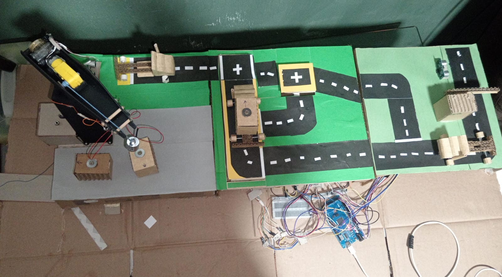

**Figura 12.** Maqueta final del proyecto PORTUS completamente terminada y decorada.

# Problemas principales y correcciones consolidadas

| Problema | Corrección realizada | Resultado |
|---|---|---|
| Rigidez de la maqueta | Se reforzaron zonas de cartón y puntos de apoyo. | Se redujeron deformaciones durante el movimiento de vehículos y grúa. |
| Alineación de estaciones | Se movieron vías y componentes hasta ajustar las posiciones reales. | Se obtuvo una trayectoria compatible con HOME y las áreas de operación. |
| Recorrido vertical de la grúa | Se ajustaron tiempos diferentes para HOME y los puntos de depósito. | La carga alcanza mejor la altura requerida en cada zona. |
| Estabilidad del electroimán | Se añadió un intervalo de espera antes de iniciar la subida. | La carga puede sujetarse o liberarse antes del siguiente movimiento. |
| Movimientos simultáneos | Se estableció una secuencia de estados. | La grúa termina un ciclo antes de aceptar otro destino. |
| Cableado expuesto | Se reorganizaron conexiones y se fijaron módulos. | Se redujeron falsos contactos e interferencias con piezas móviles. |
| Integración física | Se realizaron pruebas con la maqueta completa. | Se ajustaron las posiciones según las condiciones reales del prototipo. |

# Estado alcanzado

La versión documentada corresponde a un prototipo funcional de **Fase 1**. La evidencia fotográfica muestra la evolución desde piezas individuales hasta una maqueta integrada, incluyendo el patio, los vehículos, la estación de pesaje, el montaje interno y externo de la grúa, el cableado y las pruebas de integración.

Los ajustes realizados durante el desarrollo permitieron obtener un funcionamiento repetible para demostración y dejaron una base clara para futuras mejoras de precisión, robustez mecánica y automatización.

# Conclusión

El desarrollo de PORTUS requirió integrar construcción física, electrónica y control de actuadores dentro de una misma maqueta. La estrategia de construir y probar cada subsistema por separado permitió detectar problemas antes de la integración general; sin embargo, las pruebas conjuntas fueron indispensables para corregir diferencias de alineación, recorrido, cableado y tiempos de movimiento.

La versión final demuestra el funcionamiento básico del proceso planteado para la Fase 1 y documenta, mediante evidencias fotográficas, el avance desde los primeros prototipos hasta una maqueta integrada y funcional.

---

> 
