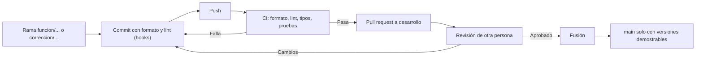

# PORTUS — Fase 2 · Guía de estilo de código (CODESTYLE.md)

**Versión 1.0** · Complementa a `SPECS.md` y `ROADMAP.md`. Aplica a **todo** lo que entra al repositorio: firmware, puente serial, servicios web, bot de Telegram, JavaScript del sinóptico, SQL, scripts y documentación.

---

## 0. Cómo usar esta guía

- Cada regla lleva un **ID** (`I-1`, `N-3`, `FW-4`…) para citarla en las revisiones: «viola FW-2».
- Todas las reglas son **obligatorias**, salvo las marcadas *Recomendado*.
- **Jerarquía:** enunciado > `SPECS.md` > esta guía. Si el enunciado o el SPECS fijan un nombre (tópicos, comandos, códigos `RT01`/`AL01`, estados del turno, causas de rechazo), se usa **tal cual**, aunque contradiga esta guía.
- **El formato y el análisis estático los decide una herramienta**, no una persona. Si `ruff` o `clang-format` lo cambian, no se discute en la revisión.
- Los cambios a esta guía se hacen por *pull request*, como cualquier otro archivo.

## 1. Principios

| # | Principio | Qué significa en PORTUS |
|:-:|---|---|
| 1 | **Español consistente** | Código, comentarios, logs, errores, commits y documentación en español (sección 2). |
| 2 | **El código se explica solo** | Nombres precisos y funciones pequeñas antes que comentarios (sección 5). |
| 3 | **Depurable** | Todo fallo deja rastro: qué pasó, dónde y con qué datos (sección 6). |
| 4 | **Determinista y no bloqueante** | En el firmware no hay esperas bloqueantes (−15 % en la rúbrica; sección 8). |
| 5 | **Formato automático** | Un solo formato en todo el repositorio, verificado antes de cada commit y en CI (sección 4). |
| 6 | **Estructura por capas** | Rutas → servicios → repositorios; la lógica de negocio no depende de Flask, MQTT ni SQL (sección 7). |
| 7 | **Listo para producción** | En `main` no hay prototipos, `print` de depuración, código comentado ni secretos (sección 16). |

---

## 2. Idioma

- **I-1.** Todo en **español**: identificadores, comentarios, mensajes de log, mensajes de error, textos de interfaz, mensajes de commit, nombres de ramas, documentación y bitácora.
- **I-2.** Los **identificadores y nombres de archivo** usan español **sin tildes ni `ñ`** (ASCII): `anio`, `pequenio`, `descripcion`. Los comentarios, textos de usuario y logs sí llevan tildes (UTF-8).
- **I-3.** Se permiten estas excepciones, y solo estas:
  1. Palabras reservadas y API del lenguaje, librería o plataforma (`setup`, `loop`, `__init__`, `self`, `Serial`, métodos HTTP).
  2. Nombres exigidos por el enunciado o el SPECS (`portus/evt/garita`, `AbrirTalanquera`, `EnGarita`, `VEH_BAJO_TALANQUERA`).
  3. Siglas y términos técnicos sin traducción de uso común: `CRC`, `ACK`, `NAK`, `MQTT`, `JSON`, `HTTP`, `UART`, `QoS`, `SQL`, `token`, `hash`, `bot`, `broker`.
- **I-4.** **Frontera de traducción:** los nombres en inglés de APIs externas (`chat_id`, `callback_data`, `retry_after` de Telegram) se aceptan **solo en la capa que las lee** y se convierten a nombres en español al entrar (`chat_id` → `id_chat`).
- **I-5.** Prohibido mezclar idiomas dentro de un mismo nombre (`get_peso`, `pesoMax_value`). Se escribe `obtener_peso`, `peso_maximo`.
- **I-6.** Los términos técnicos usan un solo equivalente en todo el proyecto (tabla de N-8).
- **I-7.** Textos de interfaz y mensajes al usuario: español neutral, sin anglicismos innecesarios, con los textos literales que fije el enunciado.
- **I-8.** Fechas y horas: en datos y logs, **ISO 8601 en UTC** (`2026-09-20T14:03:22.418Z`, como en el envoltorio MQTT). En pantalla, hora local de Guatemala (UTC−6, sin horario de verano) en formato `dd/mm/aaaa HH:MM`, 24 h.

---

## 3. Nombres

- **N-1.** El nombre dice **qué es o qué hace**, sin necesitar comentario: `peso_declarado_g`, `validar_ingreso_en_garita`.
- **N-2.** **Unidades en el nombre** cuando la magnitud las tenga: `_g`, `_ms`, `_s`, `_mm`, `_pct`. Sin unidad no se acepta un número que represente una magnitud física.
- **N-3.** **Funciones y métodos** con verbo en infinitivo: `calcular_diferencia_pct`, `enviar_trama`, `reconocer_alarma`. Las consultas booleanas usan `es_`, `esta_`, `hay_`, `tiene_`: `hay_plaza_libre`.
- **N-4.** **Prohibidos** los nombres de una letra (salvo índices `i`, `j` en bucles cortos), `dato`, `valor`, `temp`, `x`, `cosa`, `aux`, `obj`, `manejador2`.
- **N-5.** Abreviaturas **solo** las del glosario del proyecto: `g`, `ms`, `pct`, `seq`, `crc`, `cmd`, `evt`, `id`. En el código no se usa `veh`, `pos` ni `tol` aunque el protocolo serial los use para ahorrar bytes; el conversor los expande en la frontera.
- **N-6.** Cada lenguaje respeta su convención idiomática, pero en español:

| Elemento | Python | C/C++ (firmware) | JavaScript | SQL / JSON |
|---|---|---|---|---|
| Variables y funciones | `snake_case` | `snake_case` | `camelCase` | `snake_case` |
| Clases y tipos | `PascalCase` | `PascalCase` | `PascalCase` | — |
| Constantes | `MAYUSCULAS_CON_GUION_BAJO` | `MAYUSCULAS_CON_GUION_BAJO` | `MAYUSCULAS_CON_GUION_BAJO` | — |
| Variables globales | — | prefijo `g_` | — | — |
| Tablas y columnas | — | — | — | `snake_case`, tablas en singular (`turno`, `retencion`) |
| Archivos | `snake_case.py` | `snake_case.h` / `.cpp` | `snake_case.js` | `NNN_descripcion.sql` |

- **N-7.** Estados, causas y códigos con nombre fijado por el SPECS se copian **exactamente**: estados del turno en `PascalCase` (`EnPesajeEntrada`), causas en `MAYUSCULAS_CON_GUION_BAJO` (`PARQUEO_LLENO`), códigos `RT01`–`RT06`, `AL01`–`AL14`. Se definen **una sola vez** como constantes o enumeraciones, nunca como texto suelto repetido.
- **N-8.** Equivalentes de uso obligatorio:

| Concepto | Usar | Evitar |
|---|---|---|
| queue | `cola` | `queue` |
| buffer | `bufer` | `buffer` |
| timeout | `tiempo_limite_ms` | `timeout` |
| retry | `reintento` | `retry` |
| heartbeat | `latido` | `heartbeat`, `hb` |
| handler | `manejador` | `handler` |
| frame | `trama` | `frame` |
| payload | `datos` (o `carga_util` si es binario) | `payload` |
| thread | `hilo` | `thread` |
| state machine | `maquina_de_estados` | `fsm`, `state_machine` |
| log | `registro` | `log` (salvo el módulo `logging` de Python) |

- **N-9.** Los nombres de archivos, carpetas, servicios y tablas de la arquitectura también van en español (`puente/`, `mensajeria/`, `pruebas/`, `portus-puente`). Los nombres por convención de herramienta se conservan (`pyproject.toml`, `.editorconfig`, `requirements.txt`).
- **N-10.** Un concepto = un nombre en todo el sistema. Si el SPECS dice `retencion`, no aparecen `bloqueo`, `hold` ni `detencion` para lo mismo.

---

## 4. Formato automático

- **F-1.** El repositorio incluye `.editorconfig`, la configuración de cada formateador y un `.pre-commit-config.yaml`. **Ningún commit** debe saltarse los hooks (`--no-verify` está prohibido).
- **F-2.** CI ejecuta en modo verificación (`--check`); un archivo mal formateado **falla** el pipeline.
- **F-3.** Herramientas: Python → `ruff format` y `ruff check`; C/C++ → `clang-format`; JavaScript/JSON/CSS/HTML → `prettier` y `eslint`; SQL → `sqlfluff` (*Recomendado*).
- **F-4.** Límite de **100 columnas** en todo el código. UTF-8, finales de línea LF, un salto de línea al final del archivo, sin espacios al final de línea. Sangría con **espacios, nunca tabuladores**.
- **F-5.** Un cambio de formato **masivo** va en un commit propio (`formato: ...`) y nunca mezclado con cambios de lógica. Así la revisión y `git blame` siguen siendo útiles. Esto incluye el código heredado de la Fase 1.
- **F-6.** Se formatea al guardar (configurar el editor) y de nuevo en el hook. Nadie corrige formato a mano.

**`.editorconfig`**

```ini
root = true

[*]
charset = utf-8
end_of_line = lf
insert_final_newline = true
trim_trailing_whitespace = true
indent_style = space
indent_size = 4
max_line_length = 100

[*.{js,json,html,css,yml,yaml}]
indent_size = 2

[*.md]
trim_trailing_whitespace = false
```

**`pyproject.toml` (fragmento)**

```toml
[tool.ruff]
line-length = 100
target-version = "py311"          # ajustar a la versión de Python del SBC

[tool.ruff.lint]
select = ["E", "F", "W", "I", "B", "UP", "N", "S", "T20", "C90", "RUF"]

[tool.ruff.lint.mccabe]
max-complexity = 10

[tool.ruff.lint.per-file-ignores]
"pruebas/**" = ["S101"]           # assert permitido solo en pruebas

[tool.mypy]
strict = true

[tool.pytest.ini_options]
testpaths = ["pruebas"]
```

**`.clang-format`**

```yaml
BasedOnStyle: Google
IndentWidth: 4
ColumnLimit: 100
PointerAlignment: Left
AllowShortFunctionsOnASingleLine: None
AllowShortIfStatementsOnASingleLine: Never
AllowShortLoopsOnASingleLine: false
```

**`.pre-commit-config.yaml`** (fijar cada `rev` con `pre-commit autoupdate`)

```yaml
repos:
  - repo: https://github.com/pre-commit/pre-commit-hooks
    rev: FIJAR_VERSION
    hooks:
      - id: trailing-whitespace
      - id: end-of-file-fixer
      - id: check-yaml
      - id: check-merge-conflict
      - id: check-added-large-files
      - id: detect-private-key
  - repo: https://github.com/astral-sh/ruff-pre-commit
    rev: FIJAR_VERSION
    hooks:
      - id: ruff
        args: [--fix]
      - id: ruff-format
  - repo: https://github.com/pre-commit/mirrors-clang-format
    rev: FIJAR_VERSION
    hooks:
      - id: clang-format
        files: \.(h|cpp)$
```

---

## 5. Comentarios

El código se explica solo con buenos nombres. Un comentario es una **excepción justificada**, no un hábito.

- **C-1.** Solo se comenta cuando el código **no puede** expresar por sí mismo una razón técnica: el **porqué**, nunca el **qué**.
- **C-2.** Todo comentario es **técnico y concreto**. Permitidos:
  - Restricciones de hardware, temporización o memoria («el UART no admite más de N bytes pendientes»).
  - Unidades, fórmulas e invariantes que no caben en el nombre.
  - Decisiones no evidentes y su motivo, con referencia al documento (`SPECS §4.2`, `A5`).
  - Advertencias de concurrencia o de contexto de interrupción.
  - Rodeos a errores de una librería, con versión y enlace.
- **C-3.** **Prohibidos:**
  - Comentarios vagos o de relleno («arreglar luego», «esto es raro», «lógica del turno»).
  - Comentarios que repiten el código (`# suma uno`).
  - Comentarios de historial o autoría (`# corregido por Juan el 3/5`); para eso está `git`.
  - **Código comentado.** Se borra; queda en el historial.
  - Separadores decorativos, banners y firmas.
- **C-4.** Una línea siempre que sea posible, en español, en tono declarativo y sin adjetivos vagos.
- **C-5.** **Docstrings** solo en funciones, clases y módulos **públicos** cuyo contrato no quede claro con el nombre y los tipos: qué devuelve, unidades, errores que lanza y efectos secundarios. Una línea si basta.
- **C-6.** Los `TODO` llevan referencia (`TODO(A9): ...`) y **no puede quedar ninguno** en `main` al momento de la entrega.
- **C-7.** Si un comentario explica un bloque confuso, primero se intenta **extraer una función con nombre claro**; el comentario es el último recurso.
- **C-8.** Un comentario desactualizado es un defecto: se corrige o se borra en el mismo cambio que modifica el código.

**Mal**

```python
def calc(a, b):  # calcula
    x = abs(a - b) / b * 100  # porcentaje
    return x
```

**Bien**

```python
def calcular_diferencia_pct(peso_medido_g: int, peso_declarado_g: int) -> float:
    """Diferencia porcentual respecto al peso declarado (SPECS §10.4)."""
    if peso_declarado_g <= 0:
        raise ErrorValidacion("peso_declarado_g debe ser mayor que 0")
    return abs(peso_medido_g - peso_declarado_g) / peso_declarado_g * 100
```

**Comentario técnico válido**

```cpp
// La resta sin signo sigue siendo correcta cuando millis() desborda (~49,7 días).
if (static_cast<uint32_t>(millis() - instante_inicio_ms) >= DURACION_PULSO_MS) {
```

---

## 6. Depuración y manejo de errores

Un fallo en la demo se resuelve leyendo el registro, no adivinando.

- **D-1.** Python usa el módulo `logging`; `print` está prohibido (regla `T20` de `ruff`). JavaScript no deja `console.log` de depuración en `main`.
- **D-2.** Formato de registro uniforme: `hora UTC · nivel · módulo · mensaje`. Mensajes en español, con **contexto identificable**: `turno_id`, `cmd_id`, `seq`, `id` del evento, `id_transportista`.
- **D-3.** Niveles con criterio fijo:

| Nivel | Uso |
|---|---|
| `DEBUG` | Detalle de tramas y decisiones internas; apagado en la demo |
| `INFO` | Hechos de negocio: turno creado, comando aceptado, retención resuelta |
| `WARNING` | Situación anómala recuperable: trama con CRC inválido, reintento de envío |
| `ERROR` | Operación fallida que requiere atención: NAK inesperado, fallo de BD |
| `CRITICAL` | El servicio no puede continuar (enlace serial perdido sin recuperación) |

- **D-4.** **Nunca** se registran contraseñas, hashes, el token del bot ni códigos de vinculación vigentes.
- **D-5.** Las excepciones son **específicas** y con nombre propio (`ErrorProtocolo`, `PermisoDenegado`, `ErrorValidacion`). Prohibido `except:` desnudo y `except Exception: pass`. Al reenviar una excepción se usa `raise ... from causa`.
- **D-6.** **Ningún error se traga.** Se maneja (con acción concreta), se registra y se propaga, o se convierte en la respuesta exacta que exige el SPECS (`NAK` con causa, `403` con `ACCION_NO_PERMITIDA`).
- **D-7.** Los mensajes de error dicen **qué falló, con qué valor y qué se esperaba**: `peso_declarado_g debe ser mayor que 0 (recibido: -5)`.
- **D-8.** Un identificador de correlación viaja de extremo a extremo: `cmd_id` en comando, respuesta, log y base de datos; `id` y `seq` en cada evento. Con uno se reconstruye todo el camino.
- **D-9.** Los intervalos se miden con **reloj monotónico** (`time.monotonic()`, `millis()`); las marcas de tiempo de negocio, con reloj de pared en UTC.
- **D-10.** Ante un valor desconocido, un estado imposible o un comando sin identificar, el sistema **falla a un estado seguro y lo registra**: `NAK`, rechazo o modo degradado; nunca continúa en silencio.
- **D-11.** *Recomendado:* una utilidad que **reproduzca una captura de tramas** del enlace serial contra el puente, para depurar sin la maqueta.

---

## 7. Estructura del repositorio y capas

**A-1.** Estructura raíz (nombres en español; alinear con `SPECS §19.2`, que usa `bridge/`):

```
portus/
├── firmware/                 # extensión del firmware de la Fase 1
│   ├── portus.ino            # solo setup() y loop(); delega en los módulos
│   └── src/
│       ├── comunicacion/     # tramas, CRC, cola de salida
│       ├── pesaje/  grua/  aguja/  parqueo/  enclavamientos/
│       └── modo_degradado/
├── puente/                   # puente serial <-> MQTT
│   ├── protocolo.py          # tipos de mensaje, CRC, secuencia
│   └── puente.py
├── web/
│   ├── rutas/                # HTTP: valida entrada, llama a servicios
│   ├── servicios/            # lógica de negocio (turnos, retenciones, citas, alarmas)
│   ├── repositorios/         # único lugar con SQL
│   ├── modelos/              # entidades y enumeraciones
│   ├── seguridad/            # sesión, hash, @requiere_rol
│   ├── configuracion/        # lectura de portus.env, TOPIC_PREFIX
│   └── interfaz/             # JavaScript, HTML y CSS del sinóptico y las pestañas
├── mensajeria/               # bot de Telegram y planificador de recordatorios
├── db/
│   ├── esquema.sql
│   ├── migraciones/          # 001_descripcion.sql, 002_...
│   └── semilla.sql
├── config/                   # mosquitto.conf, portus.env.ejemplo
├── pruebas/                  # espejo de la estructura, más escenarios E01–E15
├── fabricacion3d/            # archivos editables y de fabricación (STL/3MF)
├── docs/                     # protocolo serial, tópicos, bitácora, evidencias
└── herramientas/             # scripts auxiliares
```

- **A-2.** **Capas en Python:** `rutas` → `servicios` → `repositorios`. Las rutas no contienen lógica de negocio ni SQL; los repositorios no conocen HTTP; los servicios no importan Flask, FastAPI, paho ni la librería de Telegram (se les inyecta lo que necesitan).
- **A-3.** Sin **dependencias circulares** entre módulos.
- **A-4.** Un módulo tiene **una responsabilidad**. Funciones de hasta ~40 líneas y **complejidad ciclomática ≤ 10** (lo verifica `C90`). Archivos de hasta ~400 líneas (*Recomendado*).
- **A-5.** Sin **números ni textos mágicos**: constantes con nombre y unidad (`PERIODO_LATIDO_MS`, `CAPACIDAD_FRANJA = 2`, `VENTANA_TOLERANCIA_MIN = 5`).
- **A-6.** **Una sola fuente de verdad** para códigos, estados, tipos de trama y prefijo de tópicos. El prefijo `portus` vive en `TOPIC_PREFIX`; los tópicos se construyen con un ayudante (`topico("evt", "garita")`), nunca concatenando texto a mano.
- **A-7.** La configuración (puerto serie, credenciales, token, política de asignación) sale de `config/portus.env`, no del código. El repositorio incluye `portus.env.ejemplo` sin valores reales.
- **A-8.** Las dependencias se declaran con versión fija (`requirements.txt` o `pyproject.toml` con *lock*). No se agrega una librería que la biblioteca estándar ya resuelve.

---

## 8. Firmware (C/C++)

Estas reglas protegen el determinismo que exige el SPECS §3.2 y la rúbrica.

- **FW-1.** **Prohibido `delay()`**, lecturas bloqueantes y `while` de espera en tareas críticas (pulsos de motor, pesaje, paro de emergencia, enclavamientos, comunicación). Se revisa por código fuente; penaliza −15 %.
- **FW-2.** Los tiempos se controlan con **temporizadores o `millis()` sin bloqueo**, con la comparación por resta sin signo (ejemplo de la sección 5).
- **FW-3.** Las **rutinas de interrupción (ISR)** son mínimas: activan una bandera `volatile` y salen. Sin `Serial`, sin asignación dinámica y sin bucles.
- **FW-4.** Variables compartidas con una ISR: `volatile` y **acceso atómico** (`noInterrupts()`/`interrupts()` de la menor duración posible) cuando midan más que la palabra de la placa (en placas de 8 bits, todo lo mayor a 1 byte).
- **FW-5.** El envío por serial es **no bloqueante**: cola circular y escritura solo si `availableForWrite()` indica espacio.
- **FW-6.** El puerto del enlace con el servidor es **exclusivo del protocolo**. Ninguna traza de depuración se imprime por él: corrompería tramas. La depuración usa un macro `DEPURAR(...)` que compila a nada salvo con `-DDEPURACION` y escribe por **otro UART** (p. ej. `Serial1`), o se expone como contadores en el latido `EST`.
- **FW-7.** **Sin `String`** ni `malloc`/`new` en tiempo de ejecución: búferes de tamaño fijo (`char[]`) con el tamaño como constante nombrada y comprobación de límites en cada escritura.
- **FW-8.** Los **estados** son `enum class` y las máquinas de estados usan `switch` **completo** con `default` que registra y pasa a un estado seguro (D-10).
- **FW-9.** Manipulación directa de puertos solo con comentario técnico que indique el registro, el bit y por qué se necesita (C-2).
- **FW-10.** La lógica sin dependencia de hardware (CRC, análisis de tramas, máquina de estados, cálculo de meseta) va en `.h/.cpp` **sin** `Arduino.h`, para probarla en un PC. El `.ino` se mantiene mínimo.
- **FW-11.** Cada mensaje entrante se valida (longitud, CRC, tipo) **antes** de usarse; una trama inválida se descarta y se cuenta (SPECS §4.2).
- **FW-12.** El firmware nuevo **extiende** la estructura de control de la Fase 1; no la reescribe. Todo cambio sobre código heredado va en un commit aparte y se prueba en la maqueta antes de fusionarse.

**Mal**

```cpp
digitalWrite(PIN_PULSO, HIGH);
delay(500);                       // espera bloqueante
digitalWrite(PIN_PULSO, LOW);
```

**Bien**

```cpp
enum class FasePulso : uint8_t { REPOSO, ALTO };

void actualizar_pulso(uint32_t ahora_ms) {
    switch (fase_pulso) {
        case FasePulso::REPOSO:
            break;
        case FasePulso::ALTO:
            if (static_cast<uint32_t>(ahora_ms - instante_inicio_ms) >= DURACION_PULSO_MS) {
                digitalWrite(PIN_PULSO, LOW);
                fase_pulso = FasePulso::REPOSO;
            }
            break;
        default:
            registrar_fallo(CausaFallo::ESTADO_PULSO_INVALIDO);
            fase_pulso = FasePulso::REPOSO;
    }
}
```

---

## 9. Python (puente, web y bot)

- **PY-1.** **Anotaciones de tipo** en todas las firmas; `mypy --strict` sin errores. Sin `Any` salvo en la frontera con una librería sin tipos.
- **PY-2.** Los mensajes que cruzan una frontera (MQTT, serial, HTTP, Telegram) se **validan y convierten** a modelos tipados (`dataclass` o `pydantic`) al entrar. Dentro del sistema no circulan diccionarios sin forma.
- **PY-3.** **Cada endpoint** declara su rol con `@requiere_rol(...)` y aplica el filtro de **propiedad en la consulta SQL** (SPECS §7.5). Ocultar un botón no es control de permisos.
- **PY-4.** El servicio de mensajería y el puente son **asíncronos o multihilo sin bloqueo cruzado**: el *polling* de Telegram, la escucha MQTT y los temporizadores no se esperan entre sí.
- **PY-5.** Fechas con zona horaria explícita (`datetime.now(timezone.utc)`); nunca fechas ingenuas.
- **PY-6.** Los recursos (conexiones, archivos, puerto serie) se abren con `with` o se cierran en `finally`.
- **PY-7.** Sin estado global mutable; lo compartido se inyecta o vive en una clase con un dueño claro.
- **PY-8.** Comparaciones de secretos y códigos con `hmac.compare_digest`; los códigos de vinculación se generan con `secrets`, no con `random`.

## 10. JavaScript (sinóptico e interfaces)

- **JS-1.** Módulos ES; `const` por defecto, `let` si se reasigna, **nunca `var`**. `eslint` con `eqeqeq`, `no-var`, `prefer-const`, `no-unused-vars` y `no-console` (advertencia).
- **JS-2.** El sinóptico se actualiza **solo por suscripción MQTT sobre WebSocket**; prohibido `setInterval` que consulte al servidor (−10 %).
- **JS-3.** Todo dato que venga del servidor o del usuario se inserta con `textContent`, **nunca con `innerHTML`**.
- **JS-4.** El prefijo de tópicos viene de la configuración compartida (`TOPIC_PREFIX`), no de cadenas repetidas.
- **JS-5.** Cuando el enlace se pierde, la interfaz deja de mostrar los datos como actuales y muestra la marca de tiempo del último estado (SPECS §14.1).

## 11. SQL y base de datos

- **BD-1.** Consultas **siempre parametrizadas**; prohibido construir SQL con f-strings o concatenación.
- **BD-2.** Cambios de esquema con **migraciones numeradas** (`db/migraciones/003_agregar_politica_a_reporte.sql`); `esquema.sql` se regenera a partir de ellas.
- **BD-3.** Restricciones en la base y no solo en el código: `PRIMARY KEY`, `FOREIGN KEY`, `UNIQUE`, `CHECK`, `NOT NULL` (SPECS §17.3).
- **BD-4.** Nada de `SELECT *`. Las escrituras de inventario, plazas y franjas van dentro de **transacciones**.
- **BD-5.** Marcas de tiempo en UTC; los estados y causas se guardan con los valores exactos del SPECS.
- **BD-6.** Un índice se justifica por una consulta real y se nombra por su función: `ix_turno_estado`.

## 12. Protocolo y mensajes

- **P-1.** El protocolo serial, los tópicos y el envoltorio JSON están documentados en `docs/` y son la **única referencia**. Cualquier cambio actualiza el documento **en el mismo commit**.
- **P-2.** Las constantes del protocolo (tipos de trama, causas, códigos) existen **una vez por lenguaje** y hay una **prueba de paridad** que verifica que firmware y puente coinciden.
- **P-3.** Claves JSON en `snake_case` español con unidad (`peso_g`, `ts`, `origen`, `tipo`, `seq`, `datos`); el formato es el mismo en **todos** los tópicos.
- **P-4.** Todo consumidor MQTT es **idempotente**: deduplica por `id` del evento (SPECS §5.5).
- **P-5.** Un mensaje desconocido o mal formado se registra a nivel `WARNING` con su contexto y se descarta; nunca detiene al consumidor.

---

## 13. Git y revisión



- **G-1.** Ramas: `main` (siempre demostrable), `desarrollo` (integración) y ramas cortas `funcion/<tema>`, `correccion/<tema>`, `docs/<tema>`. En español y sin tildes.
- **G-2.** **Nadie** hace *push* directo a `main` ni a `desarrollo`; todo entra por *pull request*.
- **G-3.** Cada PR lo revisa **otra persona**, preferentemente de un carril distinto: la revisión cruzada sirve también para que todos conozcan todos los módulos (barrera 🔴 9 del ROADMAP).
- **G-4.** Commits **pequeños y atómicos**; cada uno compila y pasa las pruebas.
- **G-5.** Mensaje de commit en español, en imperativo, con tipo y ámbito:

```
tipo(ambito): resumen en imperativo, hasta 72 caracteres

Cuerpo opcional: qué cambia y por qué. Referencia al SPECS o al escenario.
```

  Tipos: `nuevo`, `correccion`, `refactor`, `formato`, `docs`, `pruebas`, `config`.
  Ejemplo: `correccion(puente): descartar trama con CRC inválido sin cerrar el puerto (§4.2)`.
- **G-6.** **No se versionan:** `portus.env`, tokens, contraseñas, bases de datos (`*.db`), artefactos de compilación ni `__pycache__`. Sí se versionan `portus.env.ejemplo` y los archivos de fabricación 3D.
- **G-7.** Un PR describe: qué cambia, cómo se probó (y en hardware real si toca el enlace o la maqueta) y qué escenarios o secciones del SPECS afecta.

---

## 14. Pruebas

- **T-1.** Nombres de prueba en español que describen el comportamiento: `test_rechaza_comando_con_vehiculo_bajo_talanquera`.
- **T-2.** Estructura **Preparar / Ejecutar / Verificar**, un comportamiento por prueba.
- **T-3.** Pruebas **deterministas**: sin `sleep`, con un **reloj inyectable**. Ninguna prueba depende del orden de otras.
- **T-4.** Obligatorias, además de las P01–P14 del SPECS §21:
  - Vector estándar del CRC (`123456789` → `29B1`).
  - Los 13 comandos, cada uno en su condición de rechazo.
  - Cada retención RT01–RT06 con su rol facultado y el rol que **no** puede resolverla (`403`).
  - Aislamiento entre navieras y entre transportistas.
  - Métricas sobre la serie conocida de SPECS §16.2.
  - Paridad de constantes firmware–puente (P-2).
- **T-5.** La lógica de negocio se cubre con pruebas unitarias sin base de datos real ni broker; las pruebas de integración usan BD y broker de prueba.
- **T-6.** Los escenarios E01–E15 tienen un guion ejecutable o un procedimiento escrito en `pruebas/escenarios/`.
- **T-7.** *Recomendado:* cobertura de la lógica de negocio ≥ 80 %.

---

## 15. Seguridad y configuración

- **S-1.** Secretos solo en `config/portus.env`, fuera del repositorio. Si un secreto se filtra, se **rota** de inmediato (token del bot con @BotFather, credenciales del broker).
- **S-2.** **Toda entrada externa es hostil:** HTTP, MQTT, serial y Telegram se validan en la frontera. Un `chat_id` o un contenedor escritos por el usuario nunca se usan sin comprobar propiedad.
- **S-3.** Contraseñas con hash y sal (bcrypt o argon2); nunca en texto plano ni en logs.
- **S-4.** Mínimo privilegio: credenciales y ACL de Mosquitto por servicio; el navegador, solo lectura.
- **S-5.** Errores hacia el cliente **explícitos pero sin detalles internos** (sin trazas de pila ni rutas del servidor).

---

## 16. Definición de «listo para producción»

Un cambio se fusiona a `desarrollo`, y una versión pasa a `main`, solo si cumple **todo**:

- [ ] Formateado (`--check` limpio) y sin advertencias de `ruff`, `eslint` ni `clang-format`.
- [ ] `mypy --strict` sin errores.
- [ ] Todas las pruebas pasan; se añadieron las del comportamiento nuevo.
- [ ] Sin `print`, `console.log`, código comentado, `TODO` sin referencia ni `delay()`.
- [ ] Sin secretos, credenciales ni datos de prueba en el repositorio.
- [ ] Errores manejados con causa exacta; nada tragado en silencio.
- [ ] Los registros permiten reconstruir la operación con `cmd_id`, `turno_id` y `seq`.
- [ ] Nombres en español, sin abreviaturas fuera del glosario, con unidades.
- [ ] Documentación de `docs/` actualizada (protocolo, tópicos, modelo de datos) si cambió algo de ello.
- [ ] Revisado y aprobado por otra persona.
- [ ] Probado en el SBC y en la maqueta real cuando el cambio toca el enlace, el firmware o el despliegue.

---

## 17. Mantenimiento de esta guía

- Si una regla estorba de forma repetida, se propone cambiarla por PR; no se ignora.
- Si el enunciado o el SPECS cambian un nombre, este documento no se contradice: se aplica lo del enunciado y se anota aquí la excepción.
- Los archivos de configuración de la sección 4 son la versión **ejecutable** de esta guía: si difieren del texto, se corrige el texto o la configuración en el mismo commit.

---

*Fin del documento — CODESTYLE.md v1.0.*
