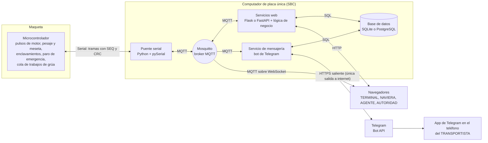
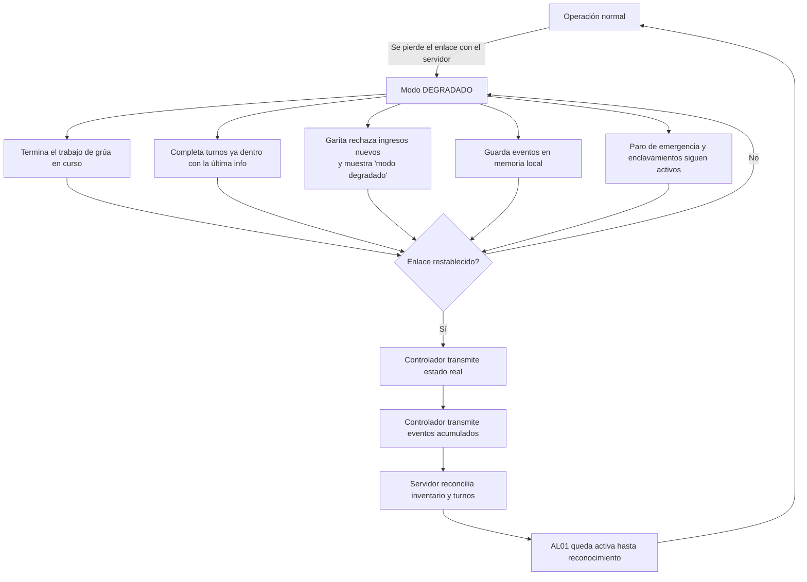
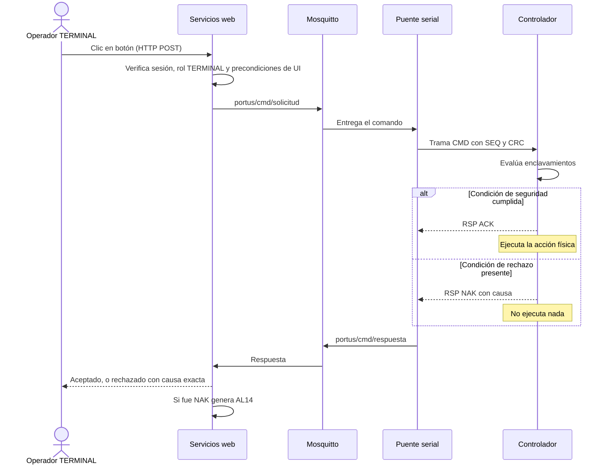
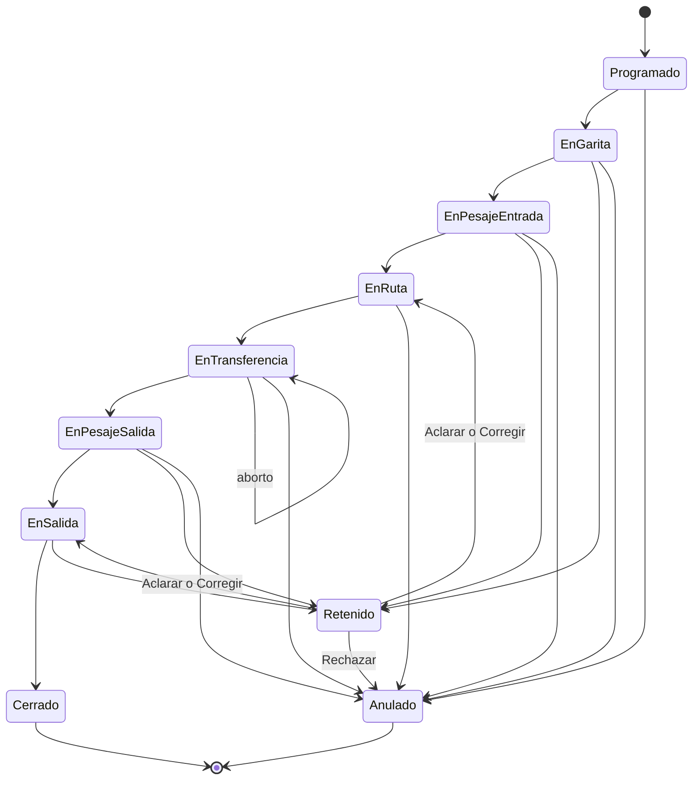
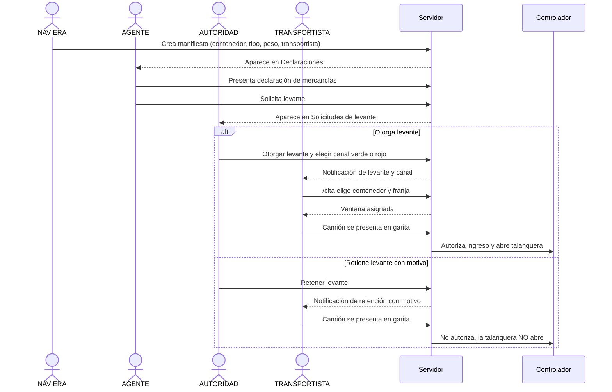
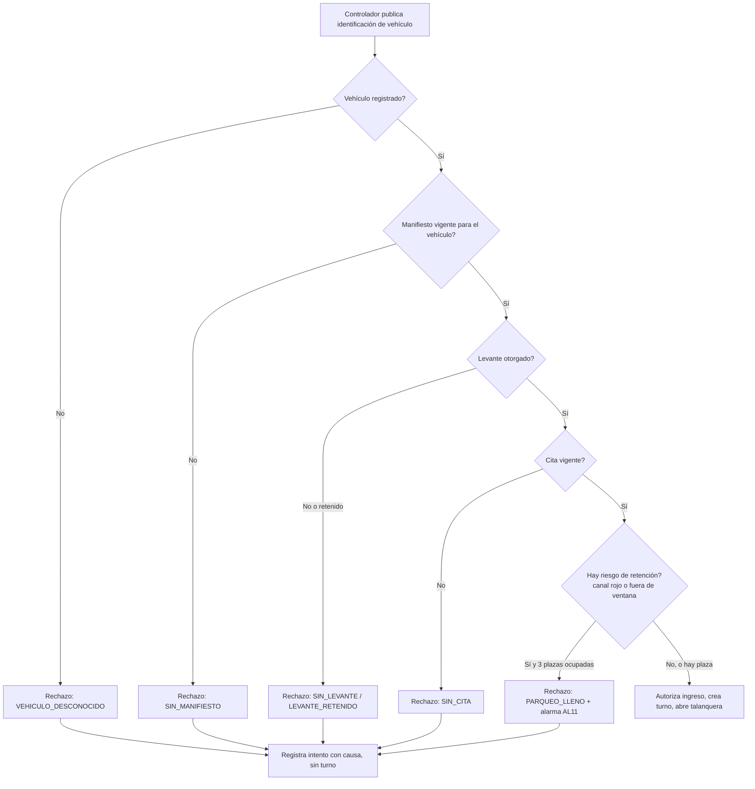
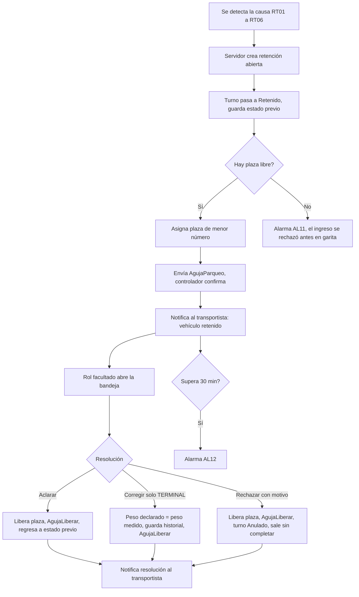
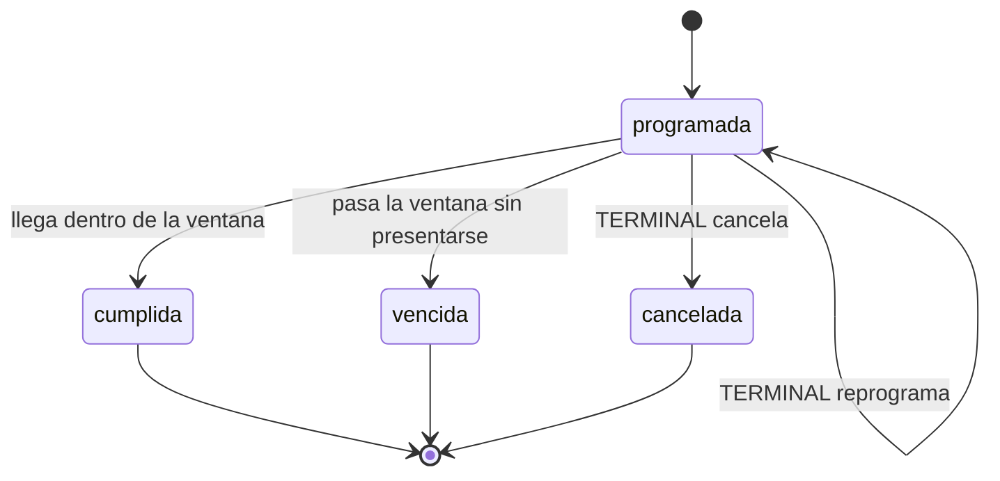
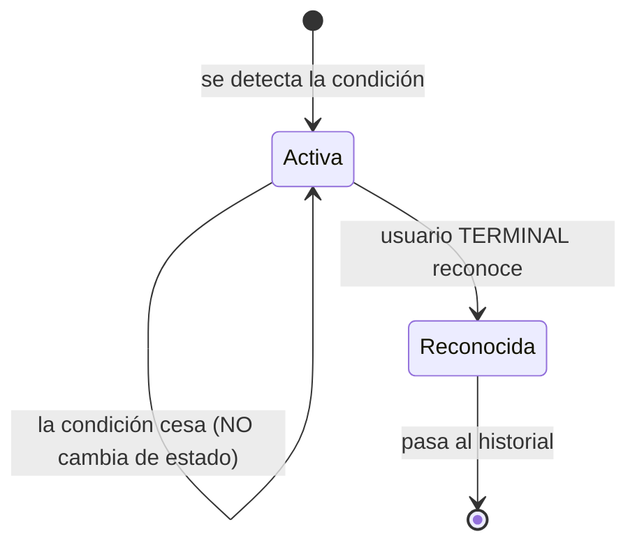
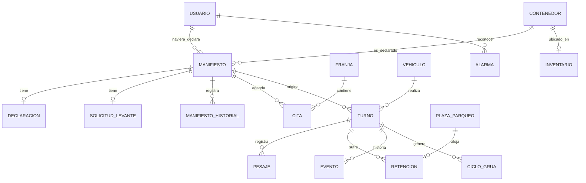

# PORTUS — Fase 2 · Especificación técnica (SPECS.md)

**Manual técnico preliminar** · Versión 0.3 (borrador) · *Cambios v0.2: canal de mensajería = bot de Telegram (§15.4). Cambios v0.3: prefijo de tópicos `portus` exacto (§5.1); `AUT` con rechazo y causa (§4.4, §9.4); verificación de salida (§8.6); panel de vinculación, A17 (§14.5, §25); política de asignación registrada en cada reporte (§12.4, §16.3, §17)*
**Fuente:** `Fase_2_portus.md` — USAC, Facultad de Ingeniería, Ingeniería en Ciencias y Sistemas, *Arquitectura de Computadoras y Ensambladores 2* · Ponderación 15 pts · ~100 h estimadas

---

## 0. Cómo leer este documento

Este manual reúne todo lo técnico del enunciado en un solo lugar y lo complementa con propuestas de diseño para las partes que el enunciado deja abiertas a cada grupo. Para no mezclar lo exigido con lo sugerido, cada bloque relevante lleva una etiqueta:

| Etiqueta | Significado |
|---|---|
| **[REQ]** | Requisito tomado del enunciado. Nombres, valores, formatos y textos literales se implementan **exactamente** como están escritos. |
| **[PROP]** | Propuesta de diseño que **no** está en el enunciado. Es una decisión del grupo y puede cambiarse. |
| **[AMB]** | Ambigüedad o contradicción detectada en el enunciado. Se recopilan en la [sección 25](#25-ambigüedades-y-decisiones-pendientes). |
| **[DEC]** | Decisión ya tomada por el grupo. No la exige el enunciado, pero el resto del manual la da por hecha. |

**Reglas de interpretación del enunciado [REQ]**

1. Donde se indica un nombre, valor, formato o texto literal → se implementa tal cual.
2. Donde se indica una cantidad mínima → puede superarse, nunca reducirse.
3. Ningún requisito es opcional, salvo los del alcance opcional (sección 23.4).
4. Cada escenario de evaluación se califica como *cumplido* o *no cumplido*, sin grados intermedios.

### Índice

1. [Visión general](#1-visión-general)
2. [Arquitectura](#2-arquitectura)
3. [Reparto controlador–servidor y autonomía](#3-reparto-controladorservidor-y-autonomía)
4. [Enlace serial y protocolo](#4-enlace-serial-y-protocolo)
5. [Intermediario MQTT](#5-intermediario-mqtt)
6. [Comandos remotos](#6-comandos-remotos)
7. [Roles, autenticación y permisos](#7-roles-autenticación-y-permisos)
8. [Máquina de estados del turno](#8-máquina-de-estados-del-turno)
9. [Cadena documental: levante y selectivo](#9-cadena-documental-levante-y-selectivo)
10. [Retenciones y parqueo](#10-retenciones-y-parqueo)
11. [Programación de citas](#11-programación-de-citas)
12. [Patio, inventario y grúa](#12-patio-inventario-y-grúa)
13. [Alarmas](#13-alarmas)
14. [Interfaces web por rol](#14-interfaces-web-por-rol)
15. [Servicio de mensajería del transportista](#15-servicio-de-mensajería-del-transportista)
16. [Métricas y reportes](#16-métricas-y-reportes)
17. [Modelo de datos](#17-modelo-de-datos)
18. [API HTTP](#18-api-http)
19. [Despliegue en el computador de placa única](#19-despliegue-en-el-computador-de-placa-única)
20. [Requisitos técnicos transversales](#20-requisitos-técnicos-transversales)
21. [Plan de pruebas](#21-plan-de-pruebas)
22. [Escenarios de evaluación y flujos de demostración](#22-escenarios-de-evaluación-y-flujos-de-demostración)
23. [Entregables, rúbrica y penalizaciones](#23-entregables-rúbrica-y-penalizaciones)
24. [Plan de implementación](#24-plan-de-implementación)
25. [Ambigüedades y decisiones pendientes](#25-ambigüedades-y-decisiones-pendientes)
26. [Glosario](#26-glosario)

---

## 1. Visión general

### 1.1 Objetivo

Conectar la maqueta de la Fase 1 (terminal portuaria inspirada en Puerto Quetzal) a una plataforma de supervisión, control remoto y gestión documental que corre sobre un **computador de placa única (SBC)**. La plataforma debe permitir que **una decisión tomada por una persona en una pantalla produzca un efecto físico verificable en la maqueta**.

### 1.2 Qué cambia respecto a la Fase 1

| Aspecto | Fase 1 | Fase 2 |
|---|---|---|
| Datos de operación | Registros precargados en el controlador | Originados desde la plataforma |
| Discrepancia de peso | Rechazo directo | Retención en parqueo y resolución administrativa |
| Ramal de la aguja | Camino a báscula estática | **Parqueo de retención** de 3 plazas (lógicas) |
| Autorización de carga | Local | Cadena naviera → agente → autoridad, con efecto sobre la talanquera |
| Supervisión | Pantallas físicas y serial | Sinóptico en tiempo real, alarmas, historial y reportes |
| Ingreso de transportistas | Sin cita | Cita en franjas de 15 min vía mensajería |

### 1.3 Qué se conserva y qué no se requiere

**Se conserva íntegro [REQ]** (su pérdida cuenta como incumplimiento de la Fase 2):

- Identificación de vehículos y control de acceso en garita.
- Pesaje dinámico con detección de meseta y decisión de ruta.
- Aguja desviadora y señalización luminosa.
- Zona de transferencia con guía asistida y detección de movimiento.
- Grúa de dos grados de libertad con referenciado, marcas de posición y confirmación de agarre.
- Patio lineal apilable a dos niveles con inventario consistente.
- Concurrencia de al menos tres vehículos y cola de trabajos de grúa.
- Paro de emergencia con rearme explícito.

**No se requiere en esta fase [REQ]:** báscula estática (descartada definitivamente), galera de carga especial, instrumentación ambiental (temperatura/gases), instrumentación física de plazas, instrumentación meteorológica, visión por computadora, asignación optimizada de posiciones, predicción de permanencia, reordenamiento del patio en tiempo ocioso y asignación automática de ventanas para aplanar picos.

**Los camiones siguen siendo desplazados manualmente por el operador [REQ].** El sistema identifica, autoriza, determina ruta, administra transferencia, controla la grúa y permite la salida.

### 1.4 Cadena de actores

```
NAVIERA → AGENTE → AUTORIDAD → TRANSPORTISTA → GARITA → PESAJE ENTRADA
        → TRANSFERENCIA / GRÚA → PESAJE SALIDA → SALIDA → CIERRE Y REPORTE
```

| Actor | Responsabilidad | Interfaz |
|---|---|---|
| Naviera | Declara el manifiesto y consulta sus contenedores | Web |
| Agente aduanero | Presenta la declaración de mercancías y solicita el levante | Web |
| Autoridad aduanera | Otorga/retiene levante, asigna canal de selectivo, resuelve retenciones aduaneras | Web |
| Transportista | Solicita citas, consulta estado, recibe notificaciones | Canal de mensajería (sin web) |
| Terminal | Supervisa, comanda, resuelve retenciones operativas | Web |

---

## 2. Arquitectura

### 2.1 Diagrama de despliegue [PROP]

El enunciado exige diagrama de despliegue (sección 5.2 del documento original); este es el punto de partida.



### 2.2 Componentes [REQ]

| Servicio | Función |
|---|---|
| **Puente de comunicación** | Enlace serial con el controlador. Traduce eventos del controlador a mensajes MQTT y comandos de la plataforma a instrucciones del controlador. |
| **Intermediario de mensajería (MQTT)** | Distribuye eventos a todos los consumidores interesados. Herramienta indicada: Mosquitto. |
| **Servicios web** | Atienden las interfaces de los actores por HTTP, con autenticación y control de permisos. |
| **Base de datos** | Usuarios, manifiestos, declaraciones, turnos, inventario, pesajes, citas, retenciones, alarmas, eventos y telemetría. SQLite o PostgreSQL. |
| **Servicio de mensajería** | Atiende comandos del transportista y envía notificaciones automáticas. Implementado como **bot de Telegram** [DEC]. |

### 2.3 Un protocolo distinto por enlace [REQ]

Usar **un solo protocolo para todo se evalúa como incumplimiento** (penalización −10 %).

| Enlace | Protocolo obligatorio |
|---|---|
| Controlador ↔ Servidor | **Serial** con protocolo propio del grupo |
| Distribución de eventos dentro de la plataforma | **MQTT** |
| Interfaces de los actores | **HTTP** |
| Transportista ↔ Plataforma | Canal de mensajería. El enunciado admite cualquier plataforma con servicio automatizado; **[DEC] el grupo usa un bot de Telegram** (Bot API sobre HTTPS) |

### 2.4 Principios de diseño

1. **El control determinista vive en el microcontrolador [REQ].** El servidor nunca genera pulsos de motor, procesa el pesaje ni atiende el paro de emergencia (si ocurre, el proyecto **no se califica**).
2. **La plataforma solicita; el controlador decide [REQ].** Toda orden se evalúa contra los enclavamientos vigentes y se acepta o rechaza con causa.
3. **El tablero se alimenta por suscripción, no por consulta [REQ].** Prohibido el polling a base de datos o servidor (−10 %).
4. **El permiso se aplica en el servidor [REQ].** Ocultar un botón no es control de permisos (−10 %).
5. **El inventario refleja la realidad física [REQ].** Solo se modifica tras confirmación física del controlador, nunca al emitir el comando.
6. **La red es local [REQ].** Solo el canal de mensajería puede requerir internet.
7. **Degradación segura [REQ].** La terminal nunca se detiene a media operación ni queda con inventario indeterminado.

---

## 3. Reparto controlador–servidor y autonomía

### 3.1 Tabla de reparto [REQ]

| Función | Dónde se ejecuta |
|---|---|
| Generación de pulsos de los motores | **Controlador** |
| Muestreo y filtrado del pesaje | **Controlador** |
| Detección de la meseta de pesaje | **Controlador** |
| Enclavamientos de seguridad de la grúa | **Controlador** |
| Altura de pila y confirmación de agarre | **Controlador** |
| Paro de emergencia | **Controlador** |
| Cola de trabajos de la grúa | **Controlador** |
| Validación de acceso en garita | **Servidor** |
| Asignación de posición de patio | **Servidor** |
| Asignación de plaza de parqueo | **Servidor** |
| Resolución de retenciones | **Servidor** |
| Programación de citas | **Servidor** |
| Historial de operaciones y métricas | **Servidor** |

### 3.2 Requisitos del firmware [REQ]

- Las tareas críticas (pulsos de motor, muestreo de pesaje, paro de emergencia, enclavamientos) se resuelven con **interrupciones, temporizadores y manipulación directa de puertos**.
- **No se aceptan esperas bloqueantes** (`delay()`, lecturas bloqueantes, `while` de espera). Se comprueba por **revisión del código fuente**. Penalización: −15 %.
- El envío de mensajes **no puede bloquear** la generación de pulsos, el muestreo del pesaje ni la atención del paro de emergencia.
- La estructura de control de la Fase 1 no se altera; el firmware se **extiende**.

**Adiciones mínimas al firmware [REQ]:**

1. Capa de comunicación con el servidor: envío de eventos, recepción de comandos, confirmación de cada comando.
2. Latido periódico de estado cada cinco segundos como máximo.
3. Validación de comandos remotos contra las condiciones de seguridad vigentes.
4. Administración de las plazas del parqueo y del tercer estado de la aguja.
5. Modo de operación degradada ante pérdida de comunicación, con registro local de eventos.
6. Reporte de estado real y de eventos acumulados al restablecerse el enlace.

### 3.3 Autonomía ante pérdida de comunicación [REQ]

Procedimiento que el controlador ejecuta al perder el servidor:

1. Completar de forma segura la operación de grúa en ejecución.
2. Completar los turnos que ya están dentro de la terminal, con la última información recibida.
3. **Rechazar todo ingreso nuevo**, mostrando en la pantalla de garita que el sistema opera en **modo degradado**.
4. Conservar en memoria local los eventos ocurridos durante la desconexión.
5. Seguir atendiendo el paro de emergencia y todos los enclavamientos.
6. Al restablecerse el enlace, transmitir el estado real y los eventos acumulados para que el servidor los **reconcilie**.



### 3.4 Detección de pérdida de enlace

- **Lado servidor [REQ]:** si el latido de `portus/evt/estado` deja de llegar durante **tres periodos consecutivos**, el servidor declara enlace perdido y genera **AL01**. Con periodo de 5 s → 15 s de detección máxima.
- **Lado controlador [AMB → PROP]:** el enunciado no dice cómo el controlador detecta que perdió al servidor. Propuesta: el servidor envía un mensaje de vigilancia (`PING`, ver 4.3) cada 2–5 s; si el controlador no recibe ningún mensaje válido del servidor durante 3 periodos, entra en modo degradado.

### 3.5 Memoria local de eventos [PROP]

- Búfer circular en RAM con capacidad dimensionada según la memoria libre de la placa (documentar el tamaño elegido).
- Cada evento conserva su número de secuencia original y se marca como *diferido* al retransmitirse.
- Si el búfer se llena, se descartan primero eventos de baja prioridad (latidos, telemetría) y **nunca** confirmaciones físicas de movimiento de inventario, alarmas ni cambios de estado de turno. Se lleva un contador de eventos descartados que se informa en la reconciliación.

---

## 4. Enlace serial y protocolo

### 4.1 Requisitos del protocolo [REQ]

El grupo define un protocolo propio. Debe cumplir:

1. **Delimitación inequívoca**: una pérdida parcial no debe corromper el mensaje siguiente.
2. **Verificación de integridad** en cada mensaje.
3. **Número de secuencia creciente** en cada mensaje del controlador, para que el servidor detecte pérdidas.
4. **Confirmación** (aceptación o rechazo) del controlador para cada comando del servidor.
5. **No bloqueante**: el envío no puede detener las tareas críticas.

### 4.2 Trama propuesta [PROP]

Formato de una línea ASCII legible con un monitor serial, resincronizable en el siguiente delimitador:

```
^ SEQ | TIPO | CAMPOS # CRC \n
```

| Elemento | Descripción |
|---|---|
| `^` | Delimitador de inicio. Al verlo, el receptor descarta lo acumulado y reinicia el análisis. |
| `SEQ` | Entero decimal sin signo de 32 bits. Controlador→servidor: secuencia creciente de eventos. Servidor→controlador: identificador del comando (se repite en la respuesta). |
| `TIPO` | Código de 3 letras (ver 4.3). |
| `CAMPOS` | Pares `clave=valor` separados por `,`. Los caracteres reservados `^ \| # , \n \r %` se escapan como `%HH`. |
| `#` | Separador antes del CRC. |
| `CRC` | CRC-16/CCITT-FALSE (polinomio `0x1021`, valor inicial `0xFFFF`) calculado sobre los bytes entre `^` y `#` (exclusivos). 4 dígitos hexadecimales en mayúscula. |
| `\n` | Delimitador de fin. |

Ejemplos con CRC calculado (verificados contra el vector de prueba estándar `123456789 → 29B1`):

```
^1042|PES|veh=V02,g=38500,n=12,meseta=1#58B2            evento de pesaje (controlador → servidor)
^2210|EST|modo=NORMAL,grua=REPOSO,link=1#A60E            latido de estado
^57|CMD|nombre=AbrirTalanquera#9F98                      comando (servidor → controlador)
^57|RSP|estado=ACK#C4D8                                  comando aceptado
^58|RSP|estado=NAK,causa=VEH_BAJO_TALANQUERA#3B92        comando rechazado con causa
```

**Reglas de recepción [PROP]:**

- Trama con CRC inválido, longitud fuera de rango o campos mal formados → se descarta y se incrementa un contador de errores (visible en telemetría).
- Buffer de recepción acotado; si se desborda sin `\n`, se descarta y se espera el siguiente `^`.
- **Detección de pérdida:** el servidor compara `SEQ` recibido con `SEQ_anterior + 1`. Un salto genera un evento de diagnóstico y una solicitud de retransmisión (`SYN`, ver 4.3).
- **Envío no bloqueante en el controlador:** cola circular de salida y escritura solo cuando `Serial.availableForWrite()` indica espacio; nunca esperar a que se vacíe el UART.
- Velocidad sugerida: 115200 baudios. Una trama típica de ~60–120 bytes ocupa ~5–10 ms de línea.

### 4.3 Tipos de mensaje [PROP]

| Tipo | Dirección | Uso | Tópico MQTT asociado |
|---|---|---|---|
| `GAR` | C→S | Identificación de vehículo, resultado de validación, causa de rechazo | `portus/evt/garita` |
| `PES` | C→S | Peso medido, muestras de la meseta, resultado de la comparación | `portus/evt/pesaje` |
| `AGU` | C→S | Estado de la aguja (recta / parqueo / liberando) | `portus/evt/aguja` |
| `TRF` | C→S | Alineación, inicio, aborto, fin de transferencia | `portus/evt/transferencia` |
| `GRU` | C→S | Cada paso del ciclo de grúa: posición, agarre, resultado | `portus/evt/grua` |
| `PAT` | C→S | Cambio de estado de una posición: nivel y contenedor | `portus/evt/patio` |
| `SAL` | C→S | Identificación de vehículo y resultado de verificación de salida | `portus/evt/salida` |
| `ALM` | C→S | Código de alarma, severidad, datos | `portus/evt/alarma` |
| `EST` | C→S | Latido con estado general | `portus/evt/estado` |
| `CMD` | S→C | Comando remoto (los 13 de la sección 6) | ← `portus/cmd/solicitud` |
| `RSP` | C→S | Aceptación (`ACK`) o rechazo (`NAK`) con causa | `portus/cmd/respuesta` |
| `AUT` | S→C | Resultado de la validación de garita: autorización con los datos del turno, o rechazo con su causa (ver 4.4) | — (interno) |
| `JOB` | S→C | Trabajo de grúa: origen, destino, nivel (ver 4.4) | — (interno) |
| `PING` | S→C | Vigilancia del servidor (ver 3.4) | — (interno) |
| `SYN` | S→C | Pide reenviar desde un `SEQ` y/o volcar estado actual | — (interno) |

### 4.4 Mensajes de servicio no listados en el enunciado [AMB → PROP]

El catálogo de 13 comandos remotos no cubre cómo el servidor le entrega al controlador los datos que este necesita para operar (y para **completar turnos en modo degradado** con "la última información recibida"). Se proponen mensajes internos, distintos de los comandos del operador:

- **`AUT`** — respuesta del servidor a **toda** identificación en garita (`GAR`). Campos:
  - `resultado` = `AUTORIZADO` o `RECHAZADO`.
  - Si `AUTORIZADO`: `turno`, `veh`, `tipo_op`, `peso_decl_g`, `tol_pct`, `canal` y `pos_asignada`. La talanquera abre solo con este resultado.
  - Si `RECHAZADO`: `causa` (código de 9.4: `VEHICULO_DESCONOCIDO`, `SIN_MANIFIESTO`, `SIN_LEVANTE`, `LEVANTE_RETENIDO`, `SIN_CITA`, `PARQUEO_LLENO`). El controlador la muestra en la **pantalla de garita** (E03 y E11).
- **`JOB`** — trabajo de grúa: `tipo` (depósito/retiro/remoción), `origen`, `destino`, `nivel`.

### 4.5 Comportamiento de comandos [REQ + PROP]

- Todo comando recibe `ACK` o `NAK` **[REQ]**.
- Timeout de respuesta en el puente (propuesta: 2 s). Sin respuesta → el puente publica un rechazo sintético con causa `SIN_RESPUESTA` y el servidor lo trata como comando fallido.
- Un comando con `SEQ` repetido (reintento) no debe ejecutarse dos veces: el controlador responde con el mismo resultado y no vuelve a actuar (idempotencia).

---

## 5. Intermediario MQTT

### 5.1 Espacio de tópicos [REQ]

El prefijo `portus` es obligatorio: se usa **exactamente** `portus` (p. ej. `portus/evt/garita`), **sin sufijos de grupo** como `portus_g11`, porque un suscriptor a `portus/#` no recibiría tópicos con otro primer nivel. Buena práctica [PROP]: definirlo en una constante `TOPIC_PREFIX` compartida por el puente, la web, el bot, el JavaScript del sinóptico y las ACL de Mosquitto.

| Tópico | Dirección | Contenido |
|---|---|---|
| `portus/evt/garita` | Del controlador | Identificación de vehículo, resultado de validación y causa de rechazo |
| `portus/evt/pesaje` | Del controlador | Peso medido, cantidad de muestras de la meseta, resultado de la comparación |
| `portus/evt/aguja` | Del controlador | Estado de la aguja desviadora |
| `portus/evt/transferencia` | Del controlador | Alineación, inicio, aborto y fin de la transferencia |
| `portus/evt/grua` | Del controlador | Cada paso del ciclo de grúa, con posición, estado de agarre y resultado |
| `portus/evt/patio` | Del controlador | Cambio de estado de una posición, con su nivel y el contenedor involucrado |
| `portus/evt/salida` | Del controlador | Identificación de vehículo y resultado de la verificación de salida |
| `portus/evt/alarma` | Del controlador | Código de alarma, severidad y datos asociados |
| `portus/evt/estado` | Del controlador | Latido periódico con el estado general del sistema |
| `portus/cmd/solicitud` | Hacia el controlador | Comando remoto emitido desde la plataforma |
| `portus/cmd/respuesta` | Del controlador | Aceptación o rechazo del comando, con la causa del rechazo |

### 5.2 Formato del mensaje [REQ mínimo + PROP]

**Obligatorio:** todo mensaje contiene, como mínimo, **identificador único, marca de tiempo, origen, tipo de evento y datos propios**, y el formato es **el mismo en todos los tópicos**.

Envoltorio JSON propuesto:

```json
{
  "id": "b7f3c2e0-5a1d-4c8e-9f21-3d6e8a90c411",
  "ts": "2026-09-20T14:03:22.418Z",
  "origen": "controlador",
  "tipo": "pesaje.medicion",
  "seq": 1042,
  "datos": {
    "veh": "V02",
    "peso_g": 38500,
    "muestras": 12,
    "meseta": true
  }
}
```

Para comandos, `datos` incluye `cmd_id` (correlación con la respuesta), `nombre`, parámetros y `usuario` que lo emitió. La respuesta repite `cmd_id` con `estado: "ACK" | "NAK"` y `causa`.

### 5.3 Tópicos adicionales del servidor [AMB → PROP]

El espacio de tópicos exigido solo cubre eventos **del controlador** y los comandos. El tablero también necesita reflejar en vivo cambios que origina el **servidor** (retenciones, estados de turno, alarmas AL01/AL11/AL12/AL13/AL14, citas). Como el prefijo `portus` es obligatorio pero no se prohíbe ampliar, se propone añadir (manteniendo el mismo envoltorio):

`portus/srv/turno` · `portus/srv/retencion` · `portus/srv/alarma` · `portus/srv/cita` · `portus/srv/enlace`

### 5.4 Latido [REQ]

- Periodo **≤ 5 s** en `portus/evt/estado`.
- Tres periodos consecutivos sin latido → servidor declara **enlace perdido** y genera **AL01**.
- El sinóptico muestra "Conectado/Desconectado" y la **marca de tiempo del último mensaje**; al desconectarse, deja de presentar datos como actuales.

Contenido propuesto del latido [PROP]: modo del sistema (normal/mantenimiento/degradado), estado de grúa, estado de aguja, cantidad de trabajos en cola, cantidad de vehículos en espera, contadores de errores de trama y de eventos diferidos.

### 5.5 Configuración sugerida [PROP]

| Aspecto | Propuesta |
|---|---|
| QoS eventos | 1 (al menos una vez) con deduplicación por `id` en consumidores |
| QoS latido | 0 |
| QoS comandos y respuestas | 1 |
| Retain | Activado en `portus/evt/estado` para que un navegador nuevo reciba el último estado |
| Last Will del puente | Publica `portus/srv/enlace` con `puente=caido` si el puente se desconecta |
| Navegador | Suscripción con **MQTT sobre WebSocket** (listener adicional de Mosquitto), porque un navegador no habla MQTT sobre TCP |
| Autenticación del broker | Usuario/contraseña por servicio; ACL que limite a cada cliente a los tópicos que le corresponden (el navegador solo lectura) |

### 5.6 Presupuesto de latencia hacia el sinóptico [PROP]

Límite exigido: evento físico → pantalla en **≤ 2 s**.

| Tramo | Presupuesto |
|---|---|
| Evento en controlador → trama serial enviada | < 100 ms |
| Trama → puente → publicación MQTT | < 100 ms |
| MQTT → WebSocket → navegador | < 100 ms |
| Renderizado del sinóptico | < 200 ms |
| **Margen para reintentos y carga** | ~1.5 s |

### 5.7 Consumidores por tópico [PROP]

| Consumidor | Qué escucha | Qué hace |
|---|---|---|
| Sinóptico / tablero (navegador) | `portus/evt/#`, `portus/srv/#`, `portus/cmd/respuesta` | Actualiza la vista sin consultar la base de datos |
| Persistencia | `portus/#` | Guarda eventos, telemetría y línea de tiempo por turno |
| Lógica de negocio | Eventos del controlador | Avanza la máquina de estados del turno, genera retenciones y alarmas |
| Servicio de mensajería | `portus/srv/turno`, `retencion`, `cita` | Envía notificaciones al transportista propietario |
| Vigilante de enlace | `portus/evt/estado` | Declara AL01 tras 3 periodos sin latido |

---

## 6. Comandos remotos

### 6.1 Catálogo [REQ]

Se implementan **exactamente estos 13 comandos**. El controlador evalúa cada uno y responde aceptando o rechazando con su causa.

| # | Comando | Efecto | El controlador **debe rechazarlo** si |
|---|---|---|---|
| 1 | `AbrirTalanquera` | Abre la talanquera de ingreso | Hay un vehículo detectado bajo la talanquera |
| 2 | `CerrarTalanquera` | Cierra la talanquera de ingreso | Hay un vehículo detectado bajo la talanquera |
| 3 | `AbrirPuertaSalida` | Abre la puerta de salida | Hay un vehículo detectado bajo la puerta |
| 4 | `AgujaRecta` | Aguja hacia transferencia | Hay un vehículo sobre la aguja |
| 5 | `AgujaParqueo` | Aguja hacia el parqueo | Hay un vehículo sobre la aguja |
| 6 | `AgujaLiberar` | Aguja para devolver un vehículo del parqueo al carril principal | Hay un vehículo sobre la aguja **o** no hay vehículo en el parqueo |
| 7 | `GruaReferenciar` | Ejecuta el procedimiento de referenciado | La grúa tiene carga adherida **o** hay un trabajo en ejecución |
| 8 | `GruaSuspender` | Impide que la grúa tome nuevos trabajos | **Nunca se rechaza.** El movimiento en curso se completa antes de suspender |
| 9 | `GruaReanudar` | Permite que la grúa vuelva a tomar trabajos | La grúa está en falla sin rearme |
| 10 | `PosicionBloquear` | Marca una posición del patio como bloqueada | La posición es origen o destino de un trabajo en ejecución |
| 11 | `PosicionLiberar` | Quita el bloqueo de una posición | La inconsistencia física que originó el bloqueo persiste |
| 12 | `ModoMantenimiento` | Activa/desactiva el modo mantenimiento | Hay un trabajo de grúa en ejecución **o** un vehículo en transferencia |
| 13 | `AlarmaSilenciar` | Silencia la señal sonora sin borrar la alarma | **Nunca se rechaza** |

### 6.2 Reglas obligatorias [REQ]

1. Todo comando muestra al usuario la **respuesta del controlador** (aceptado / rechazado).
2. Un comando rechazado muestra la **causa exacta** y **genera AL14**.
3. El **paro de emergencia NO es un comando remoto**: no se acciona ni se rearma desde la plataforma.
4. En **modo mantenimiento** el controlador no admite trabajos de grúa originados por turnos, pero **sí** admite `GruaReferenciar`.
5. Un comando que se ejecuta pese a cumplirse su condición de rechazo → penalización −10 %.

### 6.3 Controles de UI vinculados [REQ]

| Control (pestaña) | Comando | Disponibilidad | Confirmación |
|---|---|---|---|
| Suspender grúa (Operación) | `GruaSuspender` | Siempre | No |
| Reanudar grúa (Operación) | `GruaReanudar` | Solo si la grúa está suspendida | No |
| Referenciar grúa (Operación) | `GruaReferenciar` | Solo si la grúa está en reposo o suspendida | No |
| Abrir talanquera (Operación) | `AbrirTalanquera` | Siempre | **Sí** |
| Abrir puerta de salida (Operación) | `AbrirPuertaSalida` | Siempre | **Sí** |
| Liberar parqueo (Operación) | `AgujaLiberar` (plaza seleccionada) | Solo si la plaza está ocupada y su retención fue resuelta | No |
| Modo mantenimiento (Operación) | `ModoMantenimiento` (activar/desactivar) | — | **Sí** |
| Bloquear posición (Patio) | `PosicionBloquear` | — | No |
| Liberar posición (Patio) | `PosicionLiberar` | Solo si la posición está bloqueada | No |

> **[AMB]** Cuatro comandos no tienen botón asignado en el enunciado: `CerrarTalanquera`, `AgujaRecta`, `AgujaParqueo` y `AlarmaSilenciar`. Como los 13 se evalúan, hay que decidir dónde exponerlos (p. ej. un panel de "comandos manuales" en Operación y un botón "Silenciar" en Alarmas). Ver sección 25.

### 6.4 Flujo de un comando [PROP]



### 6.5 Causas de rechazo [PROP]

Códigos legibles para mostrar al usuario ("causa exacta" [REQ]):

| Código | Texto sugerido |
|---|---|
| `VEH_BAJO_TALANQUERA` | Hay un vehículo detectado bajo la talanquera |
| `VEH_BAJO_PUERTA` | Hay un vehículo detectado bajo la puerta de salida |
| `VEH_SOBRE_AGUJA` | Hay un vehículo sobre la aguja |
| `PARQUEO_VACIO` | No hay vehículo en el parqueo |
| `GRUA_CON_CARGA` | La grúa tiene carga adherida |
| `GRUA_EN_TRABAJO` | Hay un trabajo de grúa en ejecución |
| `GRUA_EN_FALLA` | La grúa está en falla sin rearme |
| `POS_EN_TRABAJO` | La posición es origen o destino de un trabajo en ejecución |
| `INCONSISTENCIA_PERSISTE` | La inconsistencia física que originó el bloqueo persiste |
| `VEH_EN_TRANSFERENCIA` | Hay un vehículo en transferencia |
| `SIN_RESPUESTA` | El controlador no respondió (generado por el puente) |

---

## 7. Roles, autenticación y permisos

### 7.1 Roles [REQ]

**Cinco roles y ningún otro.** Cuatro operan en la web; uno solo por mensajería.

| Rol | Identificador | Interfaz |
|---|---|---|
| Terminal | `TERMINAL` | Aplicación web |
| Naviera | `NAVIERA` | Aplicación web |
| Agente aduanero | `AGENTE` | Aplicación web |
| Autoridad aduanera | `AUTORIDAD` | Aplicación web |
| Transportista | `TRANSPORTISTA` | Canal de mensajería (sin acceso web) |

### 7.2 Usuarios mínimos [REQ]

Deben entregarse creados y funcionales, con credenciales en la documentación.

| Usuario | Rol | Cantidad mínima |
|---|---|---|
| Operador de terminal | TERMINAL | 1 |
| Naviera | NAVIERA | **2 distintas** |
| Agente aduanero | AGENTE | 1 |
| Autoridad aduanera | AUTORIDAD | 1 |
| Transportista | TRANSPORTISTA | **2 distintos** |

Total = **7 usuarios**. Se exigen dos navieras y dos transportistas para demostrar que un usuario no ve ni modifica información de otro del mismo rol.

> **[AMB]** La rúbrica menciona "seis usuarios mínimos", pero la tabla suma siete. Implementar los siete.

### 7.3 Autenticación y sesión [REQ]

1. Acceso web con usuario y contraseña.
2. Contraseñas **nunca en texto plano** en la base de datos (propuesta [PROP]: hash con bcrypt o argon2, con sal por usuario).
3. Nombre del usuario en sesión y su rol **visibles de forma permanente** en la interfaz.
4. El canal de mensajería requiere **vinculación previa** con un código generado por TERMINAL.

Propuesta de sesión [PROP]: cookie de sesión firmada (`HttpOnly`, `SameSite=Lax`) o token JWT de vida corta; expiración por inactividad; cierre de sesión explícito.

### 7.4 Matriz de permisos [REQ — cumplimiento obligatorio]

**S** = puede · **N** = no puede.

| Acción | TERMINAL | NAVIERA | AGENTE | AUTORIDAD | TRANSPORTISTA |
|---|:-:|:-:|:-:|:-:|:-:|
| Crear manifiesto | N | **S** | N | N | N |
| Ver manifiesto completo | S | Solo los propios | S | S | N |
| Presentar declaración y solicitar levante | N | N | **S** | N | N |
| Otorgar o retener levante | N | N | N | **S** | N |
| Asignar canal de selectivo | N | N | N | **S** | N |
| Solicitar cita | N | N | N | N | **S** |
| Ver agenda completa de citas | **S** | N | N | N | N |
| Ver sinóptico de la terminal | **S** | N | N | N | N |
| Emitir comandos remotos | **S** | N | N | N | N |
| Reconocer alarmas | **S** | N | N | N | N |
| Resolver retención de causa operativa | **S** | N | N | N | N |
| Resolver retención de causa aduanera | N | N | N | **S** | N |
| Corregir peso declarado en manifiesto | **S** | N | N | N | N |
| Consultar ubicación de un contenedor | S | Solo los propios | S | S | Solo los propios |
| Generar reporte de corrida | **S** | N | N | N | N |
| Generar código de vinculación de transportista | **S** | N | N | N | N |

### 7.5 Aplicación en el servidor [REQ + PROP]

**[REQ]** El control se aplica **en el servidor**. Un intento no permitido debe ser **rechazado por el servidor** y devolver un **mensaje de error explícito**.

Propuesta de implementación [PROP]:

1. **Autorización por rol:** decorador/middleware por endpoint (`@requiere_rol("TERMINAL")`). Rol no permitido → `403` con cuerpo `{"error": "ACCION_NO_PERMITIDA", "mensaje": "El rol NAVIERA no puede resolver retenciones."}`.
2. **Autorización por propiedad:** para NAVIERA y TRANSPORTISTA, toda consulta filtra por `naviera_id` / `transportista_id` del usuario en sesión **dentro de la consulta SQL**, no en el cliente. Recurso ajeno → `403` (o `404` para no revelar existencia; decidirlo y documentarlo).
3. **Autorización por causa:** al resolver una retención, el servidor compara `retencion.rol_facultado` con el rol del usuario (tabla RT01–RT06, sección 10.2).
4. **Estado de la retención:** una retención ya resuelta no puede volver a resolverse (`409`).
5. **Auditoría:** cada intento rechazado se registra (usuario, acción, recurso, momento). Sirve para la demostración de E12/R13.
6. El mismo control aplica al **servicio de mensajería**: cada consulta se filtra por el transportista vinculado a la cuenta.

### 7.6 Pestañas por rol [REQ]

Cantidad y nombres de pestañas son obligatorios. Se permite **agregar** pestañas, no eliminar ni fusionar.

| Rol | Pestañas |
|---|---|
| TERMINAL | 1. Operación · 2. Turnos · 3. Retenciones · 4. Patio · 5. Grúa · 6. Alarmas · 7. Citas · 8. Reportes |
| NAVIERA | 1. Manifiestos · 2. Mis contenedores |
| AGENTE | 1. Declaraciones · 2. Seguimiento |
| AUTORIDAD | 1. Solicitudes de levante · 2. Retenciones aduaneras · 3. Consulta de carga |
| TRANSPORTISTA | Sin interfaz web (canal de mensajería) |

---

## 8. Máquina de estados del turno

### 8.1 Estados y transiciones [REQ]

**Exactamente estos diez estados.** No se pueden añadir estados intermedios que los sustituyan (sí subestados internos del controlador).

| Estado | Significado | Transiciones posibles |
|---|---|---|
| `Programado` | La cita fue asignada y el vehículo aún no se presenta | → `EnGarita` · → `Anulado` |
| `EnGarita` | Vehículo identificado y en validación | → `EnPesajeEntrada` · → `Retenido` · → `Anulado` |
| `EnPesajeEntrada` | Cruza la plataforma de pesaje al ingreso | → `EnRuta` · → `Retenido` · → `Anulado` |
| `EnRuta` | Se dirige a la zona de transferencia | → `EnTransferencia` · → `Anulado` |
| `EnTransferencia` | Posicionado y con trabajo de grúa asignado | → `EnPesajeSalida` · → `EnTransferencia` (tras aborto) · → `Anulado` |
| `EnPesajeSalida` | Cruza la plataforma de pesaje antes de salir | → `EnSalida` · → `Retenido` · → `Anulado` |
| `EnSalida` | Espera autorización de salida | → `Cerrado` · → `Retenido` |
| `Retenido` | En el parqueo esperando resolución | → `EnRuta` o → `EnSalida` (si se aclara o corrige) · → `Anulado` (si se rechaza) |
| `Cerrado` | Operación completada correctamente | **Final** |
| `Anulado` | Operación cancelada sin completarse | **Final** |



### 8.2 Reglas obligatorias [REQ]

1. **Un turno solo se crea cuando la garita autoriza el ingreso.** Un ingreso rechazado no crea turno pero **sí genera un registro de intento** con su causa.
2. El inventario del patio **solo se modifica cuando el controlador confirma físicamente** el movimiento, nunca al emitir el comando.
3. Un turno que pasa a `Retenido` **conserva toda la información acumulada** (incluidos pesajes ya realizados).
4. Un turno anulado **después** de que la grúa movió el contenedor deja el inventario reflejando la **posición física real**.
5. Ningún turno puede quedar en un estado distinto de `Cerrado` o `Anulado` cuando el vehículo **ya salió** de la terminal.

### 8.3 Estados auxiliares [PROP y REQ parcial]

**Cita [REQ]:** `programada` · `cumplida` · `vencida` · `cancelada`.

**Retención [REQ parcial]:** `abierta` · `resuelta` (con resolución `Aclarar` | `Corregir` | `Rechazar`).

**Manifiesto [PROP]** — el enunciado nombra "estado documental" y "estado operativo" sin enumerarlos:

| Estado documental | Se entra cuando |
|---|---|
| `declarado` | La naviera crea el manifiesto |
| `declaracion_presentada` | El agente presenta la declaración de mercancías |
| `levante_solicitado` | El agente solicita el levante |
| `levante_otorgado` (canal verde/rojo) | La autoridad otorga el levante |
| `levante_retenido` | La autoridad retiene el levante (con motivo) |
| `anulado` | La naviera anula un manifiesto que aún no tiene turno |

| Estado operativo | Significado |
|---|---|
| `sin_turno` | Aún no hay operación física |
| `en_curso` | Existe un turno activo |
| `completado` | El turno se cerró |
| `anulado` | El turno se anuló |

### 8.4 Turno [PROP]: datos de soporte

Cada turno guarda `estado`, `estacion_actual`, `estado_previo_retencion` (para regresar tras Aclarar/Corregir), `peso_declarado_g`, `peso_entrada_g`, `peso_salida_g`, `posicion_patio`, `creado_en`, `cerrado_en`, `motivo_anulacion` y un enlace a su **línea de tiempo** (eventos, sección 14.2).

### 8.5 Ambigüedades de esta sección [AMB]

- **Programado vs. regla 1.** El estado `Programado` implica que el turno existe desde que se asigna la cita, pero la regla 1 dice que el turno se crea solo al autorizar el ingreso. *Propuesta:* la cita tiene su propio estado (`programada`); el turno se crea en `EnGarita`. `Programado` queda como estado válido que el turno adopta si el grupo decide crearlo con la cita (documentar la decisión).
- **A qué estado regresa un turno retenido.** La tabla dice `Retenido → EnRuta | EnSalida`, pero 8.3 y 10.4 dicen "regresa al estado que tenía antes de la retención". Los casos RT04 (en garita) y RT05/RT06 (en cualquier momento) pueden partir de `EnGarita`, `EnPesajeEntrada` o `EnPesajeSalida`, que no figuran como destino. *Propuesta:* mapa de regreso — retención generada tras `EnPesajeEntrada` (RT01, RT03) → `EnRuta`; tras `EnPesajeSalida` (RT02) → `EnSalida`; retención generada en `EnGarita` (RT04) → se continúa hacia el pesaje de entrada; RT05/RT06 → estado previo guardado.
- **`Retener` desde Turnos** solo tiene sentido "antes de la transferencia" (envía al parqueo), pero la máquina de estados también permite `Retenido` desde `EnPesajeSalida` y `EnSalida`. Ver la pregunta física del parqueo en la sección 25.

### 8.6 Verificación de salida y cierre [PROP]

1. El controlador publica `SAL` (`portus/evt/salida`) con la identificación del vehículo que llegó al punto de salida.
2. El servidor la compara con el vehículo del turno en `EnSalida`:
   - **Coincide:** envía `AbrirPuertaSalida`; cuando el controlador confirma la salida (nuevo `SAL`), el turno pasa a `Cerrado` y se envía la notificación 8.
   - **No coincide:** se genera **AL10**, no se autoriza la salida y el turno permanece en `EnSalida` hasta corregirlo (R14).
3. **Anulación o rechazo de una retención:** el servidor autoriza la salida sin completar la operación con el mismo `AbrirPuertaSalida`; el turno pasa a `Anulado` y se envía la notificación 9.

---

## 9. Cadena documental: levante y selectivo

### 9.1 Secuencia [REQ]



### 9.2 Efectos físicos obligatorios [REQ]

| Situación del manifiesto | Efecto en la maqueta |
|---|---|
| Sin levante otorgado (o levante retenido) | La **talanquera no abre**; la pantalla de garita indica la causa; el transportista recibe aviso |
| Levante otorgado, **canal verde** | Flujo normal (sujeto a cita y pesaje) |
| Levante otorgado, **canal rojo** | Ingresa, pero es **enviado al parqueo inmediatamente después del pesaje de entrada** (retención RT03). Solo AUTORIDAD la resuelve |

### 9.3 Formularios y validaciones [REQ]

**Manifiesto (NAVIERA)**

| Campo | Tipo | Validación |
|---|---|---|
| Identificador del contenedor | Texto | Obligatorio; debe existir en el catálogo de contenedores de la maqueta |
| Tipo de operación | Selección | Obligatorio: Depósito o Retiro |
| Peso declarado | Entero, gramos | Obligatorio; > 0 |
| Tolerancia | Número, % | Opcional; **5 %** por omisión |
| Transportista asignado | Selección | Obligatorio; uno de los registrados |
| Observaciones | Texto libre | Opcional |

**Regla:** un contenedor **no puede tener dos manifiestos pendientes** a la vez; el sistema rechaza e informa la causa.

**Declaración de mercancías (AGENTE)**

| Campo | Tipo | Validación |
|---|---|---|
| Número de declaración | Texto | Obligatorio; **único** en el sistema |
| Régimen | Selección | Obligatorio: Importación definitiva o Depósito temporal |
| Descripción de la mercancía | Texto libre | Obligatorio; mínimo **10 caracteres** |
| Valor declarado | Número | Obligatorio; > 0 |

### 9.4 Validación de ingreso en la garita [PROP]

La validación corre en el servidor (reparto de la sección 3.1). Orden sugerido y causa registrada en el intento rechazado:



Además: si el sistema está en **modo degradado** → rechazo automático desde el controlador (sección 3.3) sin depender del servidor.

En los demás casos el servidor responde **siempre** al controlador con un mensaje `AUT` (`AUTORIZADO` con los datos del turno, o `RECHAZADO` con la `causa`), para que la pantalla de garita la muestre y la talanquera abra solo con una autorización (4.4).

> Fuera de ventana **no** es un rechazo por sí mismo: genera **RT04** y el vehículo se retiene (R02) siempre que haya plaza libre.

---

## 10. Retenciones y parqueo

### 10.1 Parqueo de retención [REQ]

El ramal de la Fase 1 pasa a ser un **parqueo de 3 plazas administradas de forma lógica**; no se instrumentan las plazas porque el sistema conoce la identidad del vehículo que envió allí.

**Funcionamiento paso a paso:**

1. Un turno pasa a `Retenido` → el sistema asigna la **plaza libre de menor número** y envía `AgujaParqueo`.
2. La plaza queda ocupada por ese vehículo hasta resolverse la retención.
3. El sistema lleva el **tiempo de retención** por plaza y lo muestra en el sinóptico y en la bandeja.
4. Al resolverse: envía `AgujaLiberar`, la plaza queda libre y el vehículo **regresa al carril principal por el mismo recorrido por el que entró**.
5. La aguja opera en **tres estados**: recta hacia transferencia · desviada hacia el parqueo · liberación del parqueo.
6. **Parqueo lleno (3/3):** la garita rechaza el ingreso de cualquier vehículo con **riesgo de retención** (canal rojo asignado **o** llegada fuera de la ventana) y se genera **AL11**.

### 10.2 Causas de retención [REQ]

| Código | Causa | Se genera | Rol facultado |
|---|---|---|---|
| **RT01** | Discrepancia de peso al ingreso | Tras el pesaje de entrada, si la diferencia supera la tolerancia | TERMINAL |
| **RT02** | Discrepancia de peso a la salida | Tras el pesaje de salida, antes de autorizar el cierre | TERMINAL |
| **RT03** | Canal rojo de selectivo | Inmediatamente después del pesaje de entrada | AUTORIDAD |
| **RT04** | Llegada fuera de la ventana asignada | Al presentarse en la garita | TERMINAL |
| **RT05** | Retención documental | En cualquier momento, ordenada por la autoridad | AUTORIDAD |
| **RT06** | Retención manual operativa | En cualquier momento, ordenada por la terminal | TERMINAL |

Origen: **operativo** = RT01, RT02, RT04, RT06 (TERMINAL) · **aduanero** = RT03, RT05 (AUTORIDAD). Las retenciones aduaneras (canal rojo y documental) son las que ve la pestaña *Retenciones aduaneras*.

### 10.3 Resoluciones [REQ]

| Resolución | Quién | Qué hace el sistema |
|---|---|---|
| **Aclarar** | El rol facultado según la causa | Libera la plaza, envía `AgujaLiberar` y devuelve el turno al estado previo. **No modifica el manifiesto.** Observación opcional |
| **Corregir** | **Solo TERMINAL** | Sustituye el peso declarado por el **peso realmente medido**, guarda el valor anterior en el **historial del manifiesto**, libera la plaza, envía `AgujaLiberar` y devuelve el turno al estado previo |
| **Rechazar** | El rol facultado según la causa | **Exige motivo.** Libera la plaza, envía `AgujaLiberar`, pasa el turno a `Anulado` y autoriza la salida del vehículo sin completar. El inventario conserva la posición física real |

Reglas comunes [REQ]:

- Solo **Rechazar** exige motivo (en Aclarar/Corregir es opcional una observación).
- Una retención **resuelta no puede volver a resolverse**.
- Un rol no facultado no ve los botones y, si intenta ejecutar la acción, el servidor la rechaza (penalización −10 % si un rol no autorizado logra resolverla).
- Toda resolución genera **notificación automática** al transportista propietario del turno.
- La autoridad **no** dispone de *Corregir*.

### 10.4 Evidencia de peso [PROP: fórmulas]

Se muestra solo cuando la causa es de peso (RT01/RT02):

```
diferencia_abs  = | peso_medido − peso_declarado |          [g]
diferencia_pct  = diferencia_abs / peso_declarado × 100     [%]
hay_discrepancia = diferencia_pct > tolerancia_pct           (5 % por omisión)
```

*Corregir* solo aplica coherentemente a causas de peso. Para el resto de causas, la interfaz debe ocultarlo (y el servidor rechazar la acción).

### 10.5 Ciclo de vida de una retención [PROP]



### 10.6 Asignación concurrente de plazas [PROP]

- La asignación y la liberación se ejecutan dentro de **una transacción** con bloqueo sobre la tabla `plaza_parqueo` para que dos turnos retenidos casi simultáneos no obtengan la misma plaza.
- Consulta de asignación: la plaza libre con `numero` mínimo.
- Al liberar: `turno_id = NULL` y registro del tiempo total de retención (alimenta la métrica de tiempo promedio de retención).

### 10.7 Notificaciones asociadas [REQ]

- **Vehículo retenido:** vehículo, contenedor, causa; si es de peso: declarado, medido y diferencia.
- **Retención resuelta:** vehículo, contenedor, tipo de resolución; si *Corregir*: nuevo peso declarado; si *Rechazar*: motivo.

---

## 11. Programación de citas

La cita se solicita **exclusivamente desde el canal de mensajería** antes de presentarse en la terminal.

### 11.1 Reglas [REQ]

1. La agenda se divide en **franjas de 15 minutos**.
2. Cada franja admite **máximo 2 citas**.
3. Solo puede solicitarse cita para un contenedor con **levante otorgado**.
4. Un contenedor **no puede tener dos citas vigentes** a la vez.
5. Una franja llena **no se ofrece**; se ofrece la siguiente con capacidad.
6. Un vehículo está **dentro de su ventana** si se presenta entre la **hora de inicio** de la franja y **hasta 5 minutos después de la hora de fin**.
7. Fuera de ese rango → **RT04**.
8. El cumplimiento de ventana se registra **por cada cita** y alimenta la métrica correspondiente.

Ejemplo: franja 10:00–10:15 → ventana válida **[10:00, 10:20]**.

No incluido en esta fase [REQ]: asignación automática de ventanas para aplanar picos (Fase 3). Aquí solo se asigna por capacidad de franja.

### 11.2 Estados y transiciones de la cita [PROP]



> **[AMB]** Un vehículo que llega fuera de ventana genera RT04 (retención), pero la cita no queda "cumplida en ventana". Hay que decidir si esa cita pasa a `vencida` o conserva `programada` con la marca de incumplimiento. Recomendación: registrar `cumplida_en_ventana = false` en la cita y dejar el estado en función de si la operación se completó.

### 11.3 Ofrecimiento de franjas [PROP]

1. Tomar el día actual y la hora actual redondeada al siguiente límite de franja.
2. Iterar franjas futuras; descartar las bloqueadas y las que ya tienen 2 citas.
3. Ofrecer las **próximas N** con capacidad (p. ej. 4), mostrando inicio y fin.
4. Al confirmar, reservar en una transacción que **vuelva a verificar la capacidad** (evita sobreasignación por concurrencia).

### 11.4 Acciones de TERMINAL [REQ]

Cancelar cita (notifica), reprogramar a otra franja con capacidad (notifica con la ventana nueva), bloquear franja (no admite nuevas citas), e indicador de cumplimiento del día.

### 11.5 Recordatorio [REQ]

Aviso automático **una hora antes** de la ventana asignada, con contenedor y ventana. Requiere un planificador (tarea periódica) en el servidor [PROP].

---

## 12. Patio, inventario y grúa

### 12.1 Posiciones del patio [REQ]

Cada posición se representa con uno de estos estados: **libre · reservada · ocupada nivel 1 · ocupada nivel 2 · bloqueada**, junto con el identificador del contenedor en cada nivel. El patio es **lineal, apilable a dos niveles**.

### 12.2 Inventario por contenedor [REQ]

| Campo | Detalle |
|---|---|
| Identificador | Del contenedor |
| Naviera propietaria | — |
| Posición y nivel | Dónde se encuentra |
| Peso declarado | Del manifiesto vigente |
| Estado de autorización | — |
| Fecha y hora de ingreso | A la terminal |
| Reloj de permanencia | Horas y minutos transcurridos |
| Remociones | Cantidad de veces movido por remociones |

Controles [REQ]: Bloquear posición (`PosicionBloquear`), Liberar posición (`PosicionLiberar`, solo si está bloqueada), ordenamiento por permanencia descendente, e **indicador de permanencia excesiva** que resalta contenedores con **más de 2 horas** (también genera **AL13**).

### 12.3 Consistencia del inventario [REQ]

- El inventario cambia **solo** con confirmación física del controlador (`portus/evt/patio`, `portus/evt/grua`).
- Tras un aborto o rechazo, el inventario debe coincidir con la ubicación física real (penalización −10 % si queda inconsistente).
- Discrepancia entre altura física medida e inventario → **AL07**.
- Tras cada escenario se comprueba que el inventario registrado coincide con la ubicación física.

### 12.4 Política de asignación de posiciones [REQ]

- La política de la **Fase 1 debe conservarse como modo seleccionable** del sistema.
- En la Fase 3 se implementará una política optimizada y ambas se compararán sobre el mismo escenario.
- Eliminar la política original = quedarse sin línea base.

Propuesta [PROP]: parámetro de configuración `politica_asignacion = FASE1 | (futura) OPTIMIZADA`, con `FASE1` por defecto, y una interfaz `asignar_posicion(contenedor, inventario) → (posicion, nivel)` para poder intercambiar implementaciones sin tocar el resto del código. Cada reporte registra qué política estaba activa (16.3).

### 12.5 Retiro con remociones [REQ + PROP]

Para un **retiro**, el servidor determina la posición del contenedor pedido y genera los trabajos de grúa necesarios; si hay contenedores encima o bloqueando, se realizan las **remociones** según la lógica de patio de la Fase 1.

```
Ejemplo (posición P3, nivel 2 encima del objetivo en nivel 1):
  trabajo 1: remoción  → mover contenedor de P3/N2 a una posición libre
  trabajo 2: retiro    → sacar contenedor objetivo de P3/N1 al vehículo
  Cada movimiento confirmado por el controlador:
    · actualiza el inventario
    · incrementa el conteo de remociones del contenedor removido
    · agrega una entrada a la línea de tiempo del turno
```

### 12.5.1 Trabajos de grúa [PROP: datos]

| Campo | Valores |
|---|---|
| `tipo` | `deposito` · `retiro` · `remocion` |
| `origen` / `destino` | Vehículo o posición + nivel |
| `turno_id` | Turno que originó el trabajo |
| `estado` | pendiente · en_curso · completado · abortado |

### 12.6 Grúa [REQ]

**Estados que el sinóptico debe representar:** en reposo · referenciando · desplazándose · izando · trasladando · depositando · suspendida · en falla. Con posición actual y trabajo en curso.

**Cola de trabajos:** vive en el **controlador** [REQ]; el sinóptico muestra la cantidad pendiente y el tipo del trabajo en curso.

**Pestaña Grúa [REQ]:**

- Posición actual y trabajo en ejecución.
- Cola pendiente con tipo y orden de atención.
- Gráfica de **tiempo de ciclo de las últimas 50** operaciones (selector de rango: 50, 100 o 200).
- Ciclos completados y **tiempo promedio de ciclo** en el rango mostrado.
- Historial de fallas: pérdida de referencia, agarre no confirmado, movimiento abortado, pérdida de carga.
- **Exportar historial** en CSV para el rango seleccionado.

**Semántica de suspender/reanudar [REQ]:**

```
GruaSuspender → termina el movimiento en curso, NO toma nuevos trabajos (nunca se rechaza)
GruaReanudar  → permite tomar trabajos de nuevo; continúa con la cola (se rechaza si hay falla sin rearme)
```

**Ciclo de grúa registrado [PROP: datos]:** `ts_inicio`, `ts_fin`, `tipo`, `distancia_traslacion`, `resultado` (completado/abortado), `turno_id`. De aquí salen las métricas de ciclos y distancia (sección 16).

---

## 13. Alarmas

### 13.1 Catálogo mínimo [REQ]

| Código | Descripción | Severidad | Origen sugerido [PROP] |
|---|---|---|---|
| AL01 | Enlace con el controlador perdido | Crítica | Servidor (vigilante de latido) |
| AL02 | Paro de emergencia accionado | Crítica | Controlador |
| AL03 | Pérdida de referencia de posición de la grúa | Crítica | Controlador |
| AL04 | Pérdida de carga durante el traslado | Crítica | Controlador |
| AL05 | Agarre de contenedor no confirmado | Alta | Controlador |
| AL06 | Trabajo de grúa abortado | Alta | Controlador |
| AL07 | Inconsistencia entre altura física e inventario | Alta | Controlador / servidor |
| AL08 | Movimiento del vehículo durante la transferencia | Alta | Controlador |
| AL09 | Pesaje fuera de tolerancia | Media | Servidor (compara con manifiesto) |
| AL10 | Vehículo incorrecto en la salida | Media | Controlador reporta, servidor genera |
| AL11 | Parqueo de retención lleno | Media | Servidor |
| AL12 | Retención que supera treinta minutos | Media | Servidor (temporizador) |
| AL13 | Permanencia de contenedor superior a dos horas | Baja | Servidor (tarea periódica) |
| AL14 | Comando remoto rechazado por el controlador | Baja | Servidor (al recibir NAK) |

### 13.2 Ciclo de vida [REQ]

**Una alarma no desaparece por sí sola** al cesar la condición. Permanece en la lista de **activas** hasta que un usuario la **reconoce explícitamente**.



### 13.3 Interfaz [REQ]

- Dos listas: **activas** e **históricas**.
- Por alarma: identificador, marca de tiempo de aparición, severidad, origen, descripción y estado de reconocimiento.
- **Reconocer** (comentario opcional).
- **Reconocer todas:** solo severidad **baja y media**. Las **críticas y altas se reconocen una por una**.
- Filtro por severidad.
- Solo **TERMINAL** puede reconocer alarmas (matriz de permisos).

### 13.4 Notas [PROP]

- Evitar duplicados: si una alarma del mismo código y origen ya está activa (no reconocida), incrementar un contador de repeticiones en lugar de crear otra fila. Decidirlo y documentarlo.
- `AlarmaSilenciar` (comando 13) silencia la señal sonora **sin** reconocer la alarma; son acciones independientes.
- AL01 permanece activa aunque el enlace se restablezca, hasta el reconocimiento (E14 pide "AL01 con su reconocimiento").

---

## 14. Interfaces web por rol

### 14.1 TERMINAL · pestaña **Operación** (sinóptico en vivo)

Representa el **estado físico real** de la maqueta en este momento. Es la interfaz principal y concentra la mayor parte de la evaluación.

**Elementos mínimos del sinóptico [REQ]**

| Elemento | Estados / datos que debe representar |
|---|---|
| Zona de espera | Cantidad de vehículos en espera |
| Garita | Libre · validando · autorizada · rechazada · vehículo presente |
| Talanquera | Abierta · cerrada · en movimiento |
| Plataforma de pesaje | Libre · midiendo · medición válida · medición fuera de tolerancia · último valor medido |
| Aguja desviadora | Recta · hacia parqueo · liberando parqueo |
| Parqueo de retención | Las 3 plazas: libre u ocupada, vehículo que la ocupa y su tiempo de retención |
| Zona de transferencia | Libre · vehículo posicionándose · alineado · transferencia en curso · operación abortada |
| Grúa | En reposo · referenciando · desplazándose · izando · trasladando · depositando · suspendida · en falla; posición y trabajo en curso |
| Cola de trabajos de grúa | Cantidad pendiente y tipo del trabajo en curso |
| Posiciones del patio | Libre · reservada · ocupada N1 · ocupada N2 · bloqueada; ID del contenedor por nivel |
| Puerta de salida | Abierta · cerrada · en movimiento |
| Estado del enlace | Conectado/desconectado + marca de tiempo del último mensaje del controlador |
| Modo del sistema | Operación normal · mantenimiento · degradado |

**Interacciones adicionales [REQ]**

| Acción | Resultado | Disponible |
|---|---|---|
| Clic en una posición del patio | Panel con el detalle y botones **Bloquear** / **Liberar** | Siempre |
| Clic en un vehículo del sinóptico | Abre el detalle del turno asociado | Si hay turno activo |

Los botones de comandos remotos están en la tabla de la sección 6.3.

**Comportamiento obligatorio [REQ]**

- Se actualiza **por suscripción a los eventos del broker**. **Prohibido** el polling a base de datos o servidor.
- Retardo evento físico → pantalla: **≤ 2 segundos**.
- Si el enlace se pierde: indicarlo de forma **visible**, dejar de presentar los datos como actuales y mostrar la marca de tiempo del **último estado conocido**.

### 14.2 TERMINAL · pestaña **Turnos**

Dos secciones separadas: **turnos activos** y **turnos históricos** [REQ].

**Columnas [REQ]:** ID del turno · vehículo y transportista · contenedor · tipo de operación (depósito/retiro) · estado actual · estación actual · peso declarado / medido entrada / medido salida · posición de patio · hora de creación y tiempo transcurrido.

| Control [REQ] | Efecto |
|---|---|
| Filtro por estado | Solo turnos en el estado elegido |
| Filtro por tipo de operación | Depósitos, retiros o ambos |
| Filtro por fecha | Acota los históricos a un rango |
| Búsqueda por contenedor o vehículo | Localiza un turno |
| **Ver detalle** | Abre la línea de tiempo completa |
| **Retener** | Retiene manualmente (RT06) y envía el vehículo al parqueo si está antes de la transferencia; observación opcional |
| **Anular** | Anula el turno y autoriza la salida sin completar la operación |

**Línea de tiempo del turno [REQ]:** todos los eventos del turno en orden cronológico. Por evento: **marca de tiempo con precisión de segundo**, **origen** (controlador / servidor / usuario), **descripción** y **valores asociados** cuando existan (p. ej. peso medido, posición asignada). Debe poder consultarse también para turnos **cerrados o anulados** mientras sigan en la base de datos.

### 14.3 TERMINAL · pestaña **Retenciones**

Bandeja de trabajo del operador: lista de retenciones **abiertas** y **resueltas**.

| Campo [REQ] | Contenido |
|---|---|
| Identificador | Consecutivo único |
| Turno y vehículo | IDs asociados |
| Contenedor | ID |
| Causa | RT01–RT06 |
| Momento | Estación y marca de tiempo |
| Plaza del parqueo | 1 a 3 |
| Tiempo de retención | Desde que se generó |
| Evidencia de peso | Declarado, medido, diferencia absoluta y porcentual (solo causas de peso) |
| Rol facultado | Quién puede resolverla |

Controles: **Aclarar**, **Corregir** (solo TERMINAL), **Rechazar** (con motivo), filtro por causa y filtro por estado. Reglas en 10.3.

### 14.4 TERMINAL · pestañas **Patio**, **Grúa**, **Alarmas**

Detallados en las secciones 12.2 (Patio), 12.6 (Grúa) y 13.3 (Alarmas).

### 14.5 TERMINAL · pestaña **Citas**

| Elemento [REQ] | Contenido |
|---|---|
| Vista de agenda del día | Franjas con hora de inicio, hora de fin, **capacidad máxima**, citas asignadas y lista (transportista, vehículo, contenedor) |
| Selector de fecha | Cambia el día |
| Cancelar cita | Notifica al transportista |
| Reprogramar cita | Mueve a otra franja con capacidad; notifica |
| Bloquear franja | Impide nuevas citas |
| Indicador de cumplimiento | % de citas del día cumplidas dentro de su ventana |
| **Vinculación de transportistas** [PROP, A17] | Panel con la lista de transportistas y su estado (vinculado / sin vincular) y el botón **Generar código**: 6 caracteres, un solo uso, vence a los 60 min; muestra el código y el tiempo restante e invalida el anterior del mismo transportista. Es el control del permiso «Generar código de vinculación» (7.4) |

### 14.6 TERMINAL · pestaña **Reportes**

| Elemento [REQ] | Contenido |
|---|---|
| Selector de rango | Fecha y hora de inicio/fin de la corrida |
| Generar | Calcula y muestra las **8 métricas** (sección 16) |
| Exportar | CSV con el reporte e **incluyendo el detalle de cada turno** del periodo |
| Etiqueta de corrida | Nombre libre (p. ej. "corrida de evaluación") |

El reporte generado durante la evaluación es la **línea base de la Fase 3** y se entrega como documentación.

### 14.7 NAVIERA

**Manifiestos [REQ]:** lista de manifiestos de esa naviera con ID, contenedor, tipo de operación, peso declarado, tolerancia, estado documental y estado operativo. Controles: **Nuevo manifiesto** (formulario en 9.3), **Ver detalle** (manifiesto completo e historial) y **Anular manifiesto** (solo si aún no tiene turno).

**Mis contenedores [REQ]:** únicamente los contenedores cuyos manifiestos declaró esa naviera, con ubicación actual, estado, autorización vigente y reloj de permanencia. Búsqueda por ID y filtro por estado; **sin controles de acción**. Una naviera **no puede ver los contenedores de la otra** (se demuestra en la evaluación).

### 14.8 AGENTE

**Declaraciones [REQ]:** manifiestos de **cualquier** naviera que aún no tienen levante, con ID, contenedor, naviera, tipo y peso declarado. Controles:

| Control | Efecto |
|---|---|
| Presentar declaración | Abre el formulario (9.3); al enviar, el manifiesto pasa a *declaración presentada* |
| Solicitar levante | Envía la solicitud a la autoridad; **solo si la declaración ya fue presentada**; pasa a *levante solicitado* |
| Adjuntar observación | Nota documental visible para la autoridad |

**Seguimiento [REQ]:** estado de todas las solicitudes del agente: pendientes, autorizadas o retenidas, con el canal asignado si corresponde y el motivo si fueron retenidas. Filtro por estado y búsqueda por número de declaración; sin controles de acción.

### 14.9 AUTORIDAD

**Solicitudes de levante [REQ]:** solicitudes pendientes, con manifiesto, contenedor, naviera, agente solicitante, declaración presentada y peso declarado. Controles:

| Control | Efecto |
|---|---|
| **Otorgar levante** | Autoriza el retiro/depósito; **obliga** a elegir el canal antes de confirmar |
| Selector de canal | **Verde** o **rojo** (obligatorio al otorgar) |
| **Retener** | Deniega temporalmente y pide indicar la causa |
| Ver declaración | Muestra la declaración de mercancías |

**Retenciones aduaneras [REQ]:** solo las de origen aduanero (**canal rojo** y **retención documental**), con la misma información de 14.3. Botones **Aclarar** y **Rechazar** (con motivo). **Sin** *Corregir*.

**Consulta de carga [REQ]:** ubicación, estado, autorización y reloj de permanencia de **cualquier** contenedor sin restricción de propietario. Búsqueda por ID, naviera y estado de autorización; sin controles de acción.

---

## 15. Servicio de mensajería del transportista

El transportista opera **solo** por mensajería; debe demostrarse **desde un teléfono** durante la evaluación. El enunciado admite cualquier plataforma que permita un servicio automatizado.

> **[DEC]** El grupo implementa el canal como un **bot de Telegram**. Encaja bien: la Bot API es HTTPS y sin costo, los `/comandos` son nativos de Telegram y los botones en línea facilitan elegir contenedor y franja en `/cita`. Es el **único componente que requiere internet** (conexión HTTPS saliente desde el SBC); el resto de la plataforma sigue en red local. Los detalles de implementación están en la sección 15.4.

### 15.1 Vinculación [REQ]

1. TERMINAL genera un **código de 6 caracteres** desde la web (panel de vinculación de la pestaña *Citas*, 14.5), asociado a un transportista registrado.
2. El transportista escribe `/vincular CODIGO`.
3. El sistema asocia la cuenta de mensajería al transportista y confirma.
4. El código es de **un solo uso** y **expira a los 60 minutos**.
5. Un usuario **no vinculado** que escriba **cualquier comando** recibe **siempre la misma respuesta** de solicitud de vinculación.

Propuesta [PROP]: alfabeto sin caracteres ambiguos (sin `0/O`, `1/I/L`), generado con fuente criptográfica; guardar `creado_en`, `expira_en`, `usado_en`; comparación en tiempo constante; invalidar códigos previos del mismo transportista al generar uno nuevo.

### 15.2 Comandos obligatorios [REQ]

| Comando | Qué hace | La respuesta debe contener como mínimo |
|---|---|---|
| `/inicio` | Presenta el servicio y lista comandos | Saludo, **nombre de la terminal** y lista completa de comandos con una línea de descripción |
| `/vincular CODIGO` | Asocia la cuenta a un transportista | Confirmación con el **nombre del transportista**, o error si el código es inválido o vencido |
| `/cita` | Inicia la solicitud de una cita | Lista de contenedores del transportista **con levante y sin cita**; tras elegir uno, ofrece las próximas franjas con capacidad (inicio y fin); al elegir una, confirma con **contenedor, fecha, hora de inicio y hora de fin** |
| `/miscitas` | Lista citas vigentes | Por cita: contenedor, fecha, ventana y estado (**programada / cumplida / vencida / cancelada**) |
| `/estado CONTENEDOR` | Consulta un contenedor | ID, estado actual, ubicación (si está en patio), reloj de permanencia (h y min), estado de autorización y canal. Si no es suyo: responde que **no tiene carga asociada a ese identificador** |
| `/misturnos` | Lista operaciones en curso | Por turno activo: vehículo, contenedor, tipo de operación, estado actual y estación |
| `/ayuda` | Repite la lista de comandos | Lista completa con su descripción |

**Reglas [REQ]**

- Texto que no sea un comando válido → respuesta de **comando no reconocido** que ofrece `/ayuda`. **El servicio nunca queda sin responder.**
- Un transportista **nunca** recibe información de carga que no le pertenece (se demuestra con los dos transportistas).

**Conversación multi-paso de `/cita` [PROP]:** mantener un estado de conversación por cuenta (`esperando_contenedor` → `esperando_franja`), con expiración por inactividad y cancelación si se escribe otro comando.

### 15.3 Notificaciones automáticas [REQ]

Nueve avisos, sin que el transportista los pida y **solo al transportista propietario** de la carga.

| # | Evento que lo dispara | Contenido mínimo |
|---|---|---|
| 1 | La autoridad **otorga el levante** | Contenedor, confirmación, canal asignado. Si es rojo: aviso de que el vehículo será enviado a verificación |
| 2 | La autoridad **retiene el levante** | Contenedor, indicación de retención y motivo registrado |
| 3 | Se **asigna una cita** | Contenedor, fecha, hora de inicio y de fin |
| 4 | **Falta una hora** para la ventana | Recordatorio con contenedor y ventana |
| 5 | El vehículo es **retenido** | Vehículo, contenedor, causa; si es de peso: declarado, medido y diferencia |
| 6 | La retención es **resuelta** | Vehículo, contenedor, tipo de resolución; si *Corregir*: nuevo peso declarado; si *Rechazar*: motivo |
| 7 | Cita **cancelada o reprogramada** | Contenedor y situación; si se reprogramó: ventana nueva |
| 8 | El turno **se cierra** | Vehículo, contenedor, tipo de operación y tiempo total en la terminal |
| 9 | El turno **se anula** | Vehículo, contenedor y causa de anulación cuando corresponda |

Propuesta [PROP]: tabla `notificacion` con `entregado` y reintentos, para no perder avisos si el canal externo falla momentáneamente.

### 15.4 Implementación con Telegram [DEC + PROP]

**Alta del bot [PROP]**

1. Crear el bot con **@BotFather** (`/newbot`): nombre visible (p. ej. «PORTUS Terminal») y usuario que termine en `bot`. BotFather entrega el **token**.
2. Registrar el menú de comandos con `/setcommands` (o `setMyCommands`): `inicio`, `vincular`, `cita`, `miscitas`, `estado`, `misturnos`, `ayuda`. Los siete son válidos: Telegram acepta nombres de 1 a 32 caracteres con minúsculas, dígitos y guion bajo.
3. Guardar el token **solo** en `config/portus.env` (`TELEGRAM_BOT_TOKEN`) y excluir ese archivo del repositorio (`.gitignore`). Si se filtra, regenerarlo con BotFather.

**Recepción de mensajes: long polling, no webhook [PROP]**

- El webhook exige una URL HTTPS pública (puertos 443, 80, 88 u 8443). El SBC está en red local sin IP pública, así que se usa **long polling** (`getUpdates`), que solo necesita conexión saliente.
- Long polling y webhook no funcionan a la vez: si alguna vez se configuró un webhook para el bot, eliminarlo con `deleteWebhook`.

**Cómo se resuelve cada requisito en Telegram**

| Requisito | Implementación con Telegram |
|---|---|
| Cuenta de mensajería | `chat_id` del chat privado usuario–bot (entero de 64 bits), guardado en `vinculo_mensajeria.telegram_chat_id` |
| `/vincular CODIGO` | Comando con argumento; el código se valida contra `codigo_vinculacion` (un uso, 60 min). Opcional [PROP]: enlace `https://t.me/<bot>?start=CODIGO`, que Telegram entrega como `/start CODIGO`; el alfabeto del código debe usar solo letras, dígitos, `_` o `-`. `/vincular` sigue siendo obligatorio |
| `/start` | Telegram lo envía al abrir el bot por primera vez. Tratarlo como `/inicio` (o como solicitud de vinculación si la cuenta no está vinculada) |
| Elegir contenedor y franja en `/cita` | Teclado en línea (`InlineKeyboardMarkup`) con `callback_data` corto (p. ej. `c:<id>`, `f:<id>`) y confirmación con `answerCallbackQuery`. El servidor **vuelve a validar propiedad y capacidad** al recibir el callback |
| Texto que no es comando | Handler genérico registrado **después** de los comandos: responde «comando no reconocido» y ofrece `/ayuda`. Ningún update queda sin respuesta |
| Notificaciones | `sendMessage(chat_id, texto)` desde `portus-msg` al recibir eventos `portus/srv/*` |
| Aislamiento entre transportistas | Toda consulta se filtra por el `transportista_id` ligado al `chat_id` del update; nunca se confía en un identificador escrito por el usuario (`/estado CONTENEDOR`) sin comprobar propiedad |

**Usuario no vinculado [REQ aplicado a Telegram]:** para un `chat_id` sin vincular, todo comando distinto de `/vincular` (incluidos `/start` e `/inicio`) recibe **la misma respuesta** de solicitud de vinculación. Es la lectura literal de la regla 5 de 15.1; conviene confirmar con el auxiliar si `/inicio` debe comportarse distinto y dejar la decisión en la bitácora.

**Envío robusto de notificaciones [PROP]**

- **Límites de Telegram:** alrededor de 1 mensaje por segundo en un mismo chat y ~30 por segundo en total. Al excederlos responde `429` con `retry_after`. Enviar desde una **cola** y respetar `retry_after`, sin reintentos en bucle.
- **Tamaño:** un mensaje admite hasta 4096 caracteres; recortar o dividir listas largas (`/miscitas`, `/misturnos`).
- **Formato:** si se usa `parse_mode=HTML`, **escapar** el texto libre (motivos, observaciones) para que un `<` no rompa el mensaje; alternativa: enviar sin `parse_mode`.
- **Persistencia:** cada aviso se guarda en `notificacion` con `entregado` y número de reintentos. Sin internet, el aviso queda pendiente y sale al volver la conexión, sin afectar al resto de la plataforma.
- **Idempotencia:** usar el `id` del evento MQTT como clave para no enviar dos veces el mismo aviso si el broker lo entrega duplicado.
- **Concurrencia:** el bot hace polling y a la vez escucha MQTT y atiende recordatorios; usar `asyncio` (o hilos separados) para que ninguna tarea bloquee a las otras.

**Librería [PROP]:** `python-telegram-bot` (v20 o superior, asíncrona) o `aiogram`; `pyTelegramBotAPI` es más simple pero síncrona.

**Demostración desde el teléfono [REQ + DEC]**

- El SBC necesita salida a internet durante la demo (Wi-Fi o *hotspot* móvil como plan B) y el teléfono, datos o Wi-Fi.
- Los dos transportistas de prueba son **dos cuentas de Telegram distintas** (dos teléfonos, o un teléfono más Telegram Web o Desktop).
- Documentar en la entrega: usuario del bot (`@...`), procedimiento de vinculación y las dos cuentas de prueba.

---

## 16. Métricas y reportes

### 16.1 Las ocho métricas [REQ]

Se calculan para el **rango seleccionado** en la pestaña Reportes.

| # | Métrica | Cómo se calcula | Datos necesarios [PROP] |
|---|---|---|---|
| 1 | Remociones por contenedor retirado | Total de movimientos de remoción ÷ retiros completados del periodo | `ciclo_grua.tipo='remocion'`; turnos `retiro` en `Cerrado` |
| 2 | Ciclos de grúa por operación completada | Total de ciclos de grúa ÷ turnos cerrados | `ciclo_grua` completados; turnos `Cerrado` |
| 3 | Distancia total recorrida por la grúa | Suma de la distancia de traslación de todos los ciclos | `ciclo_grua.distancia_traslacion` |
| 4 | Tiempo promedio de camión en la terminal | Promedio (creación → cierre), **solo turnos cerrados** | `turno.creado_en`, `turno.cerrado_en` |
| 5 | Tiempo promedio de retención | Promedio (generación → resolución) | `retencion.creada_en`, `retencion.resuelta_en` |
| 6 | Longitud máxima de la fila de espera | Máximo de vehículos en espera en el periodo | Telemetría de zona de espera |
| 7 | % de citas cumplidas en ventana | Citas cumplidas en ventana ÷ total de citas del periodo × 100 | `cita.cumplida_en_ventana` |
| 8 | Retenciones por causa y por resolución | Conteo agrupado por código de causa y tipo de resolución | `retencion.causa`, `retencion.resolucion` |

### 16.2 Ejemplo de serie conocida para probar el cálculo [PROP]

La prueba exigida es "cálculo correcto de cada métrica sobre una serie conocida". Ejemplo mínimo:

| Dato de entrada | Valor |
|---|---|
| Turnos cerrados | T1 = 4 min, T2 = 6 min, T3 = 5 min (todos depósito, 1 ciclo de grúa cada uno) |
| Retiro con remoción | T4 = 9 min (retiro cerrado) con 1 remoción y 2 ciclos de grúa (total de ciclos = 5) |
| Retenciones | 1 × RT01 resuelta con *Corregir* tras 8 min; 1 × RT03 resuelta con *Rechazar* tras 4 min |
| Citas | 5 citas, 4 cumplidas en ventana |
| Fila máxima | 3 vehículos |

Resultados esperados: métrica 1 = 1 ÷ 1 = **1.0** · métrica 2 = 5 ÷ 4 = **1.25** · métrica 4 = (4+6+5+9)/4 = **6 min** · métrica 5 = (8+4)/2 = **6 min** · métrica 6 = **3** · métrica 7 = 4 ÷ 5 = **80 %** · métrica 8 = {RT01/Corregir: 1, RT03/Rechazar: 1}. (La métrica 3 se completa con las distancias reales de traslación de cada ciclo.)

### 16.3 Reporte y exportación [REQ]

- Formulario de rango de fecha y hora + etiqueta de la corrida.
- Resultado con las ocho métricas.
- **Exportación CSV** con el detalle de cada turno del periodo.
- El reporte de la corrida de evaluación es entregable y **línea base** para la Fase 3.
- Cada reporte (y su CSV) registra la **política de asignación de posiciones** activa (12.4), para comparar corridas en la Fase 3 [PROP].

Propuesta [PROP]: guardar cada reporte generado en la tabla `reporte` (etiqueta, rango, resultado en JSON, quién lo generó) para poder recuperarlo y compararlo después.

---

## 17. Modelo de datos

El enunciado exige persistir: **usuarios, manifiestos, declaraciones, turnos, inventario, pesajes, citas, retenciones, alarmas, eventos y telemetría**. El siguiente esquema es una **propuesta [PROP]**.

### 17.1 Entidades

| Entidad | Campos principales | Notas |
|---|---|---|
| `usuario` | id, username, password_hash, rol, nombre_mostrado, activo | Hash con sal; rol ∈ los 5 |
| `contenedor` | id, descripcion | Catálogo de contenedores de la maqueta |
| `manifiesto` | id, contenedor_id, naviera_id, tipo_op, peso_declarado_g, tolerancia_pct, transportista_id, estado_documental, estado_operativo, observaciones, creado_en | Un solo manifiesto pendiente por contenedor |
| `manifiesto_historial` | id, manifiesto_id, campo, valor_anterior, valor_nuevo, motivo, retencion_id, usuario_id, ts | Conserva pesos anteriores tras *Corregir* |
| `declaracion` | id, manifiesto_id, numero (UNIQUE), regimen, descripcion, valor_declarado, agente_id, presentada_en | Descripción ≥ 10 caracteres |
| `solicitud_levante` | id, manifiesto_id, agente_id, estado, canal, motivo, autoridad_id, solicitada_en, resuelta_en | canal ∈ verde/rojo |
| `observacion_documental` | id, manifiesto_id, agente_id, texto, ts | Nota del agente para la autoridad |
| `vehiculo` | id, identificador (tarjeta/etiqueta), transportista_id | Identidad que reconoce la garita |
| `franja` | fecha, inicio, fin, capacidad (=2), bloqueada | Franjas de 15 min |
| `cita` | id, manifiesto_id, transportista_id, franja_fecha, franja_inicio, estado, cumplida_en_ventana, creada_en | Estado: programada/cumplida/vencida/cancelada |
| `turno` | id, vehiculo_id, manifiesto_id, cita_id, tipo_op, estado, estacion, posicion_patio, nivel, peso_entrada_g, peso_salida_g, estado_previo, creado_en, cerrado_en, motivo_anulacion | 10 estados |
| `intento_ingreso` | id, ts, vehiculo_id, causa, detalle | Ingresos rechazados sin turno |
| `pesaje` | id, turno_id, momento (entrada/salida), peso_g, muestras, dentro_tolerancia, ts | — |
| `retencion` | id, turno_id, causa (RT01..RT06), estacion, plaza, estado, peso_declarado_g, peso_medido_g, resolucion, motivo, observacion, resuelta_por, creada_en, resuelta_en | Consecutivo único |
| `plaza_parqueo` | numero (1..3), turno_id, ocupada_desde | Administración lógica |
| `posicion_patio` | id, estado (libre/reservada/bloqueada/ocupada) | Estado base |
| `inventario` | contenedor_id, posicion, nivel, ingreso_en, remociones, autorizacion | Actualizado solo con confirmación física |
| `ciclo_grua` | id, turno_id, tipo, ts_inicio, ts_fin, distancia, resultado | Alimenta métricas y gráfica |
| `alarma` | id, codigo, severidad, origen, descripcion, datos, ts, estado, reconocida_por, reconocida_ts, comentario | Persiste hasta reconocimiento |
| `evento` | id, turno_id (nullable), ts, origen, tipo, descripcion, valores_json, seq | Base de la línea de tiempo |
| `telemetria` | id, ts, tipo, valor | Espera, latidos, errores de trama, etc. |
| `comando` | id, ts, usuario_id, nombre, parametros, estado, causa | Trazabilidad de comandos remotos |
| `vinculo_mensajeria` | transportista_id, telegram_chat_id, vinculado_en | Un `chat_id` de Telegram ↔ un transportista |
| `codigo_vinculacion` | codigo, transportista_id, creado_en, expira_en, usado_en | Un solo uso, 60 min |
| `notificacion` | id, transportista_id, tipo, payload, ts, entregado | Las 9 notificaciones |
| `reporte` | id, etiqueta, desde, hasta, politica_asignacion, resultado_json, generado_por, generado_en | Línea base de Fase 3 |

### 17.2 Relaciones principales



### 17.3 Restricciones de integridad clave [PROP]

- `declaracion.numero` **UNIQUE**.
- Índice único parcial: **un manifiesto pendiente por contenedor**.
- `cita`: como máximo una `programada` por contenedor.
- Franja: `COUNT(citas programadas) ≤ 2`, verificado dentro de la transacción de reserva.
- `retencion`: una vez `resuelta`, no admite nueva resolución (comprobar `estado='abierta'` en el `UPDATE`).
- Todas las escrituras de inventario dentro de transacción, disparadas **solo** por eventos confirmados del controlador.

---

## 18. API HTTP

Propuesta [PROP] de endpoints REST. Toda ruta exige sesión salvo `/login`. Los roles indicados son los **únicos** autorizados; cualquier otro recibe `403` con mensaje explícito.

| Método y ruta | Rol(es) | Descripción |
|---|---|---|
| `POST /api/login` · `POST /api/logout` | Todos (web) | Sesión |
| `GET /api/sesion` | Todos (web) | Nombre y rol para mostrar de forma permanente |
| `POST /api/manifiestos` | NAVIERA | Crear manifiesto (valida catálogo y unicidad de pendiente) |
| `GET /api/manifiestos` | TERMINAL, NAVIERA (propios), AGENTE, AUTORIDAD | Lista |
| `GET /api/manifiestos/{id}` · `.../historial` | Ídem | Detalle e historial |
| `POST /api/manifiestos/{id}/anular` | NAVIERA (propio, sin turno) | Anular |
| `POST /api/manifiestos/{id}/declaracion` | AGENTE | Presentar declaración |
| `POST /api/manifiestos/{id}/levante/solicitar` | AGENTE | Solicitar levante |
| `POST /api/manifiestos/{id}/observacion` | AGENTE | Adjuntar observación |
| `POST /api/levantes/{id}/otorgar` (`canal`) | AUTORIDAD | Otorgar con canal obligatorio |
| `POST /api/levantes/{id}/retener` (`motivo`) | AUTORIDAD | Retener |
| `GET /api/contenedores/{id}/ubicacion` | TERMINAL, AGENTE, AUTORIDAD, NAVIERA (propios) | Consulta de carga |
| `GET /api/turnos` · `/{id}` · `/{id}/timeline` | TERMINAL | Turnos y línea de tiempo |
| `POST /api/turnos/{id}/retener` · `/anular` | TERMINAL | RT06 / anulación |
| `GET /api/retenciones` | TERMINAL, AUTORIDAD (solo aduaneras) | Bandeja |
| `POST /api/retenciones/{id}/aclarar` · `/corregir` · `/rechazar` | Según causa (`corregir` solo TERMINAL) | Resoluciones |
| `POST /api/comandos` (`nombre`, `params`) | TERMINAL | Emite comando remoto |
| `GET /api/alarmas` · `POST /api/alarmas/{id}/reconocer` · `POST /api/alarmas/reconocer-todas` | TERMINAL | Alarmas |
| `GET /api/patio/inventario` | TERMINAL | Inventario del patio |
| `GET /api/grua/ciclos?rango=50` · `GET /api/grua/historial.csv` | TERMINAL | Gráfica y exportación |
| `GET /api/citas?fecha=` | TERMINAL | Agenda completa |
| `POST /api/citas/{id}/cancelar` · `/reprogramar` · `POST /api/franjas/bloquear` | TERMINAL | Gestión de agenda |
| `POST /api/transportistas/{id}/codigo-vinculacion` | TERMINAL | Genera código de 6 caracteres |
| `POST /api/reportes` · `GET /api/reportes/{id}.csv` | TERMINAL | Reporte y exportación |

Códigos de estado sugeridos: `401` sin sesión · `403` rol/propiedad no permitidos · `404` inexistente · `409` conflicto de estado (retención ya resuelta, manifiesto duplicado) · `422` validación de campos.

Tiempo real: el navegador **no** usa esta API para refrescar el sinóptico; se suscribe al broker (5.5).

---

## 19. Despliegue en el computador de placa única

### 19.1 Requisitos [REQ]

- El servidor corre en un **SBC**. **No se acepta una PC durante la evaluación** salvo autorización expresa (penalización −15 %).
- Red **local**; no requiere internet salvo el canal de mensajería.
- Accesible desde la red local, con **instrucciones de despliegue** y **procedimiento de arranque desde cero**.

### 19.2 Servicios y estructura [PROP]

```
/opt/portus/
├── firmware/                # código Arduino del controlador (extensión de la Fase 1)
├── bridge/                  # puente serial <-> MQTT (Python + pySerial)
│   ├── protocolo.py         # tramas, CRC, secuencia, reintentos
│   └── puente.py
├── web/                     # servicios web (Flask o FastAPI)
│   ├── auth/  permisos/  api/  estatico/
│   └── logica/              # turnos, retenciones, citas, alarmas, métricas
├── mensajeria/              # bot de Telegram (long polling) + planificador de recordatorios
├── db/
│   ├── esquema.sql
│   └── portus.db            # SQLite (o esquema PostgreSQL)
├── config/
│   ├── mosquitto.conf       # listener 1883 + listener WebSocket
│   └── portus.env           # puerto serie, credenciales, token del bot, política de asignación
└── docs/                    # protocolo serial, tópicos, bitácora, evidencias
```

| Servicio (systemd) | Función |
|---|---|
| `mosquitto` | Broker MQTT |
| `portus-bridge` | Puente serial |
| `portus-web` | HTTP + lógica de negocio |
| `portus-msg` | Bot de Telegram, notificaciones y recordatorios |

Orden de arranque: `mosquitto` → `portus-web` → `portus-bridge` → `portus-msg`; cada servicio con reinicio automático.

### 19.3 Procedimiento de arranque desde cero [PROP]

1. Instalar SO del SBC y paquetes (`mosquitto`, Python, dependencias del proyecto).
2. Conectar el controlador por serial y verificar el puerto (`ls /dev/ttyUSB* /dev/ttyACM*`), con permisos del usuario de servicio.
3. Copiar la configuración y definir credenciales en `portus.env`, incluido `TELEGRAM_BOT_TOKEN` (el bot se crea una sola vez con @BotFather; ver 15.4).
4. Crear la base de datos con `esquema.sql` y cargar **datos semilla**: catálogo de contenedores, franjas, plazas 1–3, posiciones del patio y los **7 usuarios mínimos**.
5. Habilitar y arrancar los servicios de 19.2.
6. Verificar el latido en `portus/evt/estado` (p. ej. `mosquitto_sub -t "portus/#" -v`).
7. Abrir la web desde otro equipo de la red local y comprobar el sinóptico.
8. Cargar el firmware al controlador y ejecutar `GruaReferenciar`; confirmar que el inventario inicial coincide con la disposición física.

**Condición inicial recomendada para la demostración [REQ]:** controlador y SBC encendidos y comunicados; broker y servicios web disponibles; sinóptico mostrando el estado real; **grúa referenciada**; inventario inicial coincidiendo con la disposición física.

---

## 20. Requisitos técnicos transversales

| Área | Requisito |
|---|---|
| Determinismo | Interrupciones, temporizadores y acceso directo a puertos; **sin esperas bloqueantes** (revisión de código) |
| Tolerancia | Operación segura con el servidor **apagado** y reconciliación al reconectar |
| Origen de datos | Toda la operación demostrada nace en la plataforma, no en registros precargados en el controlador |
| Protocolos | Serial + MQTT + HTTP (no uno solo) |
| Tablero | Suscripción a eventos; prohibido el polling |
| Permisos | Aplicados en el servidor; error explícito en rechazo |
| Contraseñas | Nunca en texto plano |
| Red | Local; internet solo para el canal de mensajería (salida HTTPS hacia la Bot API de Telegram) |
| Estructura física | Estable, ordenada, cableado organizado y asegurado, sin conexiones expuestas ni elementos que interfieran con el recorrido del camión o de la grúa |
| Paro de emergencia | Local en el controlador; no accionable ni rearmable desde la plataforma |

### 20.1 Fabricación 3D (remediación de la maqueta) [REQ]

- Se mantiene el requisito de la Fase 1: al menos **40 %** de los componentes constructivos y mecánicos identificables, **diseñados o adaptados por el grupo** y fabricados por impresión 3D.
- La fase no añade módulos físicos; se aplica como **remediación** de piezas de las que depende la confiabilidad. Ejemplos indicados:
  - Contenedores con alojamiento integrado para la placa ferrosa en la cara superior.
  - Guías de autocentrado de cada celda del patio.
  - Vehículos con distancia entre ejes consistente y base estable para el pesaje.
  - Soporte del cabezal de la grúa y alojamiento del mecanismo de agarre.
  - Soportes de sensores, marcas ópticas del riel y alojamientos de lectores.
  - Estructura de señalización y soportes de pantallas.
- Grupos que ya alcanzaron el porcentaje en Fase 1: solo **documentar el inventario y entregar los archivos**.
- Condiciones: piezas **no decorativas**, conservar archivos editables y de fabricación, documentar **procedencia y adaptaciones** de modelos de terceros, y **prohibido dividir una pieza en elementos pequeños** solo para inflar el conteo.

---

## 21. Plan de pruebas

### 21.1 Pruebas individuales mínimas [REQ]

Cada prueba registra **condición evaluada, resultado esperado, resultado obtenido y correcciones aplicadas** (bitácora). Las columnas de resultado quedan en blanco para que el grupo las llene.

| # | Prueba [REQ] | Cómo provocarla [PROP] | Resultado esperado | Obtenido | Correcciones |
|---|---|---|---|---|---|
| P01 | Continuidad del enlace serial en operación prolongada | Dejar el sistema corriendo con latidos y tráfico durante un periodo largo (≥ 1 h) | Sin caídas del enlace; contador de errores de trama estable | | |
| P02 | Detección de pérdida de mensaje por secuencia | Inyectar/omitir una trama en el puente | El servidor detecta el salto de `SEQ` y solicita retransmisión | | |
| P03 | Recepción de eventos bajo carga, sin pérdida ni duplicación | Generar ráfaga de eventos simultáneos (pesaje + grúa + patio) | Todos persisten una sola vez (deduplicación por `id`) | | |
| P04 | Actualización del sinóptico por suscripción en ≤ 2 s | Medir marca de tiempo del evento vs marca de render | Retardo < 2 s en todos los eventos | | |
| P05 | Rechazo de cada comando en su condición de rechazo | Provocar cada condición de la tabla 6.1 y emitir el comando | `NAK` con causa exacta, sin acción física, AL14 generada | | |
| P06 | Operación de la maqueta con el servidor apagado | Apagar el servidor con vehículos y grúa en curso | Termina lo en curso, rechaza ingresos, conserva eventos | | |
| P07 | Reconciliación al restablecer el enlace | Reconectar tras P06 | Estado real transmitido, eventos acumulados aplicados, inventario coherente | | |
| P08 | Administración simultánea de las 3 plazas | Retener tres vehículos y resolver en distinto orden | Asignación de menor número libre; liberación correcta; sin plaza duplicada | | |
| P09 | Resolución de cada tipo de retención por el rol autorizado | Resolver RT01–RT06 con TERMINAL y AUTORIDAD | Solo el rol facultado puede; el otro recibe error del servidor | | |
| P10 | Rechazo de acción fuera de permisos | Llamar directamente a la API con un rol no autorizado (sin usar la UI) | `403` con mensaje explícito | | |
| P11 | Aislamiento entre navieras y entre transportistas | NAV-A consulta contenedores de NAV-B; TRANS-1 consulta carga de TRANS-2 | Acceso rechazado / "sin carga asociada" | | |
| P12 | Respuesta de cada uno de los 7 comandos del canal | Ejecutar `/inicio`, `/vincular`, `/cita`, `/miscitas`, `/estado`, `/misturnos`, `/ayuda` + texto inválido | Respuesta con el contenido mínimo exigido; nunca silencio | | |
| P13 | Envío de las 9 notificaciones automáticas | Disparar cada evento de la tabla 15.3 | Aviso al transportista propietario únicamente | | |
| P14 | Cálculo correcto de cada métrica sobre serie conocida | Cargar la serie de 16.2 y generar reporte | Ocho métricas coinciden con el cálculo manual | | |

### 21.2 Verificación tras cada escenario [REQ]

Después de cada uno de los escenarios E01–E15 comprobar:

1. El **inventario registrado coincide** con la ubicación física de los contenedores.
2. El flujo de la operación **terminó en el estado esperado**.
3. Las **métricas corresponden a lo realmente ocurrido**.

---

## 22. Escenarios de evaluación y flujos de demostración

### 22.1 Los quince escenarios mínimos [REQ]

Toda la operación debe originarse **desde la plataforma**. Cada uno se califica cumplido / no cumplido.

| Código | Condición que se provoca | Resultado que debe observarse |
|---|---|---|
| **E01** | Una naviera declara un manifiesto de depósito | Aparece en la pestaña *Declaraciones* del agente |
| **E02** | El agente presenta la declaración y solicita el levante | La solicitud aparece en *Solicitudes de levante* de la autoridad |
| **E03** | La autoridad **retiene** el levante con motivo; el camión se presenta en garita | La talanquera **no abre**, la pantalla indica la causa y el transportista recibe el aviso de retención documental |
| **E04** | La autoridad otorga levante **canal verde**; el transportista solicita cita por mensajería | Recibe su ventana asignada y la cita aparece en *Citas* de la terminal |
| **E05** | El camión se presenta **dentro** de su ventana | La talanquera abre, se crea el turno y el sinóptico refleja el cambio en **< 2 s** |
| **E06** | Un segundo camión se presenta **fuera** de su ventana | Se genera **RT04**, se asigna plaza de parqueo y se notifica al transportista |
| **E07** | Un camión con **peso alterado** cruza el pesaje dinámico | Se genera **RT01**, la aguja desvía físicamente al vehículo y la bandeja muestra declarado, medido y diferencia |
| **E08** | La terminal resuelve esa retención con **Corregir** | El manifiesto queda con el peso nuevo, se conserva el anterior en el historial, la aguja libera el parqueo y el turno continúa hasta cerrarse |
| **E09** | La autoridad otorga levante **canal rojo** y el camión ingresa | El vehículo va al parqueo inmediatamente tras el pesaje de entrada; **solo la autoridad** puede resolver |
| **E10** | Esa retención se resuelve con **Rechazar** | Turno `Anulado`, el vehículo sale sin completar, el inventario conserva su estado físico real y el transportista recibe aviso con el motivo |
| **E11** | Se ocupan las **3 plazas** y se presenta un cuarto vehículo con canal rojo | La garita rechaza el ingreso indicando parqueo lleno y se genera **AL11** |
| **E12** | Un usuario NAVIERA intenta resolver una retención y un transportista consulta un contenedor ajeno | El servidor rechaza ambas acciones con el error correspondiente |
| **E13** | El operador **suspende** la grúa con un trabajo en curso y luego la **reanuda** | Completa el movimiento en curso, no toma nuevos trabajos mientras está suspendida y continúa con la cola al reanudar |
| **E14** | Se **desconecta el servidor** durante una operación de grúa | La maqueta completa la operación de forma segura, rechaza ingresos y, al reconectar, informa su estado real; el servidor reconcilia y genera **AL01** con su reconocimiento |
| **E15** | Se ejecuta un **retiro con remoción** y se genera el reporte | La línea de tiempo muestra cada movimiento, el reporte presenta las 8 métricas y *Grúa* actualiza historial y gráfica de ciclos |

**Guion sugerido [REQ como orientación]** — cuatro bloques continuos:

| Bloque | Qué se demuestra | Escenarios |
|:-:|---|---|
| 1 | Cadena documental y happy path inicial: manifiesto, declaración, solicitud, retención documental, autorización canal verde, cita e ingreso correcto | E01–E05 |
| 2 | Excepciones operativas: fuera de ventana, discrepancia de peso al ingreso, *Corregir* hasta completar | E06–E08 |
| 3 | Control aduanero y seguridad: canal rojo, rechazo, parqueo lleno, permisos y aislamiento | E09–E12 |
| 4 | Grúa, tolerancia a fallos y cierre: suspender/reanudar, pérdida del servidor, retiro con remociones y reporte | E13–E15 |

### 22.2 Happy path: depósito [REQ]

Sin retenciones, con levante, canal verde, cita cumplida y pesajes dentro de tolerancia.

| Paso | Acción | Resultado observable |
|:-:|---|---|
| 01 | NAVIERA crea manifiesto de Depósito | Disponible para AGENTE; consultable por la naviera |
| 02 | AGENTE presenta declaración y solicita levante | Aparece en *Solicitudes de levante* |
| 03 | AUTORIDAD revisa, otorga levante y elige canal verde | Carga autorizada; el transportista recibe el aviso con el canal |
| 04 | Operador genera código; TRANSPORTISTA usa `/vincular CODIGO` | Cuenta asociada al transportista correcto |
| 05 | TRANSPORTISTA usa `/cita`, elige contenedor y franja | Cita `programada`, visible en *Citas*, con ventana asignada |
| 06 | Vehículo se presenta en garita dentro de su ventana | Servidor valida manifiesto, levante y cita; talanquera abre; turno en `EnGarita` |
| 07 | Cruza el pesaje de entrada | Medición válida; dentro de tolerancia → `EnRuta` |
| 08 | Aguja en recta; avanza a transferencia | Sinóptico refleja el recorrido; posicionado → `EnTransferencia` |
| 09 | Servidor asigna posición; grúa ejecuta el depósito | Inventario se actualiza **solo tras confirmación física** |
| 10 | Vehículo va al pesaje de salida | `EnPesajeSalida`; segunda medición registrada |
| 11 | Salida dentro de tolerancia; llega al punto de salida | `EnSalida`, listo para verificación final |
| 12 | Se verifica el vehículo y se autoriza salida | Puerta abre, vehículo sale, turno `Cerrado` |
| 13 | La plataforma procesa el cierre | Aviso de cierre al transportista; Turnos, Patio, Grúa y sinóptico coherentes con la maqueta |
| 14 | Operador genera el reporte | Métricas incorporan la operación |

### 22.3 Happy path: retiro [REQ]

Misma cadena documental, autorización, cita, acceso y pesaje; cambia la transferencia.

| Paso | Acción | Resultado observable |
|:-:|---|---|
| 01 | NAVIERA crea manifiesto de Retiro para un contenedor **ya en el patio** | Disponible para la cadena documental |
| 02 | AGENTE declara y solicita; AUTORIDAD otorga canal verde | Transportista puede pedir cita |
| 03 | TRANSPORTISTA obtiene cita y llega en ventana | Garita valida, ingresa, se crea el turno |
| 04 | Pesaje de entrada y avance a transferencia | Con medición válida y dentro de tolerancia → `EnTransferencia` |
| 05 | Servidor localiza el contenedor y genera trabajos de grúa | La cola refleja el retiro; si hay bloqueos, se generan **remociones** (lógica Fase 1) |
| 06 | Grúa retira el contenedor y lo deposita sobre el vehículo | Cada movimiento confirmado actualiza inventario y remociones |
| 07 | Pesaje de salida y llegada al punto de salida | Sin discrepancia → `EnSalida` |
| 08 | Se valida la salida y el vehículo sale | `Cerrado`; aviso de cierre |
| 09 | Se genera el reporte | Reflejan ciclos, remociones, distancia y tiempo total |

### 22.4 Ramas de excepción [REQ]

Pueden provocarse en operaciones independientes; no tienen que ocurrir en un mismo turno.

| ID | Condición | Respuesta esperada |
|:-:|---|---|
| R01 | Vehículo sin levante o con levante retenido | La garita no autoriza; no se inicia operación física que lo deje avanzar |
| R02 | Fuera de su ventana | **RT04**; si hay plaza → `Retenido` y parqueo; resuelve TERMINAL |
| R03 | Pesaje de entrada supera tolerancia | **RT01**; aguja al parqueo; TERMINAL: Aclarar / Corregir / Rechazar |
| R04 | Levante con canal rojo | **RT03** tras el pesaje de entrada; solo AUTORIDAD: Aclarar / Rechazar |
| R05 | AUTORIDAD ordena retención documental durante la operación | **RT05**, turno `Retenido`; resuelve AUTORIDAD |
| R06 | TERMINAL retiene manualmente | **RT06**, turno `Retenido`; resuelve TERMINAL |
| R07 | Pesaje de salida supera tolerancia | **RT02** antes del cierre; Aclarar/Corregir → regresa a `EnSalida`; Rechazar → `Anulado` |
| R08 | 3 plazas ocupadas y llega vehículo con riesgo conocido | La garita rechaza y se genera **AL11** |
| R09 | En transferencia: pérdida de referencia, agarre no confirmado, pérdida de carga, movimiento del vehículo o aborto | Alarma correspondiente; **inventario intacto hasta confirmación física**; operación controlada hasta resolver |
| R10 | Comando remoto que incumple una condición de seguridad | El controlador rechaza, **no ejecuta la acción física**, devuelve causa y se genera **AL14** |
| R11 | Se pierde la comunicación con el servidor durante una operación | Termina el trabajo en curso, continúa turnos ya dentro, rechaza ingresos, conserva eventos, reconcilia al reconectar; **AL01** |
| R12 | Paro de emergencia | Atendido localmente; enclavamientos vigentes; no accionable ni rearmable desde la plataforma |
| R13 | Acción fuera de permisos o consulta de información ajena | El servidor rechaza; una naviera no ve a otra; un transportista no recibe carga ajena |
| R14 | Vehículo incorrecto en la verificación de salida | La verificación no es válida y se genera **AL10** hasta corregir |

---

## 23. Entregables, rúbrica y penalizaciones

### 23.1 Entregables [REQ]

| Entregable | Contenido |
|---|---|
| Documento técnico | Propósito, alcance, arquitectura, comunicación controlador–servidor, protocolo serial, espacio de tópicos, modelo de datos, usuarios y permisos, cálculo de métricas y comportamiento ante pérdida de comunicación |
| Maqueta funcional | Fase 1 operando; ramal como parqueo de 3 plazas; aguja en sus 3 estados; módulos integrados y respondiendo a comandos de la plataforma |
| Plataforma desplegada | En el SBC, accesible por red local; 8 pestañas de TERMINAL + interfaces de los otros 3 roles web; instrucciones de despliegue, credenciales de prueba y arranque desde cero |
| Canal de mensajería operativo | Bot de Telegram con 7 comandos y 9 notificaciones; usuario del bot, procedimiento de vinculación y al menos 2 cuentas de Telegram de prueba |
| Código fuente | Firmware + plataforma organizados, identificados, comentados y separados por función; incluir puente, definición del protocolo serial, esquema de BD e instrucciones de compilar, cargar, configurar y ejecutar |
| Bitácora y evidencias | Fotos, capturas, problemas, decisiones, correcciones y resultados de pruebas |
| Evidencia de fabricación 3D | Inventario actualizado (impresas vs refabricadas), fotos, ubicación, archivos de fabricación, procedencia y adaptaciones de modelos de terceros |
| Reporte de la corrida de evaluación | Exportación de la pestaña *Reportes* durante la demo con las 8 métricas (línea base de Fase 3) |

### 23.2 Requisitos para optar a calificación [REQ]

Incumplir cualquiera implica **no ser calificado**:

1. Maqueta de Fase 1 operativa (la pérdida de funcionalidad invalida la entrega).
2. Control determinista en el microcontrolador.
3. Operación **segura con el servidor apagado**.
4. Operación demostrada originada **desde la plataforma**.
5. Las **8 pestañas** de TERMINAL existen y funcionan.
6. Canal de mensajería operativo **demostrado desde un teléfono**.
7. Código fuente **completo** (firmware y plataforma).
8. Evidencia de fabricación 3D actualizada.
9. **Todos** los integrantes participan y responden sobre cualquier parte del sistema.

### 23.3 Rúbrica y penalizaciones [REQ]

| Aspecto | % | Criterios |
|---|:-:|---|
| Integración y arquitectura de comunicación | 20 | Serial estable con delimitación, verificación y secuencia; uso efectivo del broker con varios consumidores; latido y detección de enlace perdido; reparto correcto (por revisión de código); operación segura sin servidor y reconciliación |
| Tablero de supervisión y control remoto | 20 | Sinóptico completo por suscripción y < 2 s; alarmas generadas y reconocidas; **13 comandos** con condiciones de rechazo; línea de tiempo para cualquier turno; Patio y Grúa funcionales |
| Roles, permisos y cadena de autorización | 15 | 5 roles con los usuarios mínimos; matriz aplicada en servidor; aislamiento entre navieras y transportistas; cadena manifiesto→declaración→solicitud→levante→canal con efecto físico en la talanquera |
| Retenciones y parqueo | 15 | 6 causas; 3 plazas con asignación y liberación; tercer estado de la aguja; 3 resoluciones con restricción por rol y motivo solo al rechazar; rechazo con parqueo lleno |
| Canal de mensajería y citas | 10 | 7 comandos; 9 notificaciones; vinculación con expiración; franjas de 15 min, capacidad 2, control de ventana con retención |
| Métricas y reportes | 10 | 8 métricas correctas y reporte exportable |
| Documentación, evidencias y presentación | 10 | Documento técnico, bitácora, evidencia 3D, reporte de corrida y dominio del sistema por todos |
| **Total** | **100** | Se distribuye proporcionalmente sobre los 15 pts de la fase |

| Penalización | Descuento |
|---|:-:|
| Tablero actualizado por consultas periódicas en vez de suscripción | 10 % |
| Un solo protocolo para toda la plataforma | 10 % |
| Permisos solo ocultando controles en la interfaz | 10 % |
| Retención resuelta por un rol no autorizado para esa causa | 10 % |
| Comando remoto ejecutado pese a cumplirse su condición de rechazo | 10 % |
| Inventario inconsistente con el estado físico tras aborto o rechazo | 10 % |
| Esperas bloqueantes en tareas críticas del controlador | **15 %** |
| Plataforma sobre PC sin autorización expresa | **15 %** |

### 23.4 Alcance opcional y puntos extra [REQ]

Hasta **10 puntos adicionales**, solo con el alcance obligatorio completo (no compensan rubros incompletos):

- Representación 3D o animada del sinóptico.
- Interfaz de consulta pública documentada del estado de un contenedor.
- Panel de comparación entre dos corridas de la misma secuencia.
- Registro fotográfico por retención resuelta.
- Notificación por voz o llamada automatizada.
- App móvil de consulta para NAVIERA.

### 23.5 Cronograma

Asignación, elaboración y calificación: **fechas por definir** en el enunciado. Completar cuando se publiquen.

---

## 24. Plan de implementación

### 24.1 Diseño previo obligatorio (antes de programar) [REQ]

- [ ] Diagrama de despliegue con dispositivos, servicios y enlaces
- [ ] Definición del protocolo serial (formato, delimitación, verificación, secuencia)
- [ ] Espacio de tópicos y formato del mensaje publicado
- [ ] Modelo de datos (usuarios, manifiestos, declaraciones, turnos, citas, retenciones, alarmas, eventos, telemetría)
- [ ] Matriz de permisos por rol y por acción
- [ ] Máquina de estados del turno (10 estados y transiciones)
- [ ] Catálogo de comandos con condiciones de rechazo
- [ ] Tabla de reparto controlador/servidor
- [ ] Comportamiento ante pérdida de comunicación y procedimiento de reconciliación
- [ ] Bosquejo de cada pestaña con sus controles

> No iniciar implementación sin comprobar que la arquitectura **conserva el control determinista en el microcontrolador** y **permite operar sin servidor**.

### 24.2 Orden de desarrollo de la plataforma [REQ recomendado]

Verificar cada módulo antes de pasar al siguiente.

- [ ] 1. Puente de comunicación y verificación del enlace
- [ ] 2. Broker de mensajería y publicación de eventos
- [ ] 3. Persistencia de eventos y telemetría
- [ ] 4. Autenticación, sesión y matriz de permisos
- [ ] 5. Pestaña **Operación** con sinóptico por suscripción
- [ ] 6. Modelo de manifiestos, declaraciones y turnos
- [ ] 7. Interfaces NAVIERA, AGENTE y AUTORIDAD con cadena de levante
- [ ] 8. Pestaña **Turnos** con línea de tiempo
- [ ] 9. Pestaña **Retenciones** con las tres resoluciones
- [ ] 10. Pestaña **Alarmas** con reconocimiento
- [ ] 11. Pestañas **Patio** y **Grúa**
- [ ] 12. Canal de mensajería con comandos y notificaciones
- [ ] 13. Pestaña **Citas** y control de ventana
- [ ] 14. Pestaña **Reportes**

### 24.3 Orden de integración [REQ recomendado]

- [ ] 1. Enlace controlador ↔ servidor
- [ ] 2. Publicación de eventos y visualización en el sinóptico
- [ ] 3. Operación completa originada desde la plataforma
- [ ] 4. Cadena de autorización con levante y canal
- [ ] 5. Citas y control de ventana
- [ ] 6. Retención, parqueo y resolución en sus tres formas
- [ ] 7. Comandos remotos y alarmas con reconocimiento
- [ ] 8. Canal de mensajería con notificaciones
- [ ] 9. Métricas y reportes
- [ ] 10. Comportamiento ante pérdida y restablecimiento de comunicación

La integración **no se considera finalizada** mientras la maqueta no opere de forma segura con el servidor apagado y reconcilie correctamente al reconectarse.

### 24.4 Extensión del firmware (checklist) [REQ]

- [ ] Capa de comunicación (eventos, comandos, confirmaciones)
- [ ] Latido ≤ 5 s
- [ ] Validación de los 13 comandos contra enclavamientos
- [ ] Parqueo de 3 plazas y tercer estado de la aguja
- [ ] Modo degradado con registro local
- [ ] Reporte de estado real y eventos acumulados al reconectar
- [ ] Revisión de código: **cero esperas bloqueantes** en tareas críticas

### 24.5 Temas de investigación previa [REQ]

Comunicación serial micro↔SBC · diseño de protocolo delimitado con verificación y secuencia · arquitectura publicación/suscripción y diseño de tópicos · servicios web, sesiones y control de acceso por rol · modelado y persistencia · sinópticos en tiempo real y alarmas con reconocimiento · reparto de procesamiento borde/servidor · comportamiento seguro ante pérdida de comunicación y reconciliación · servicios sobre canales de mensajería · cadena documental de importación, levante y selectivo aduanero.

### 24.6 Herramientas [REQ como referencia]

Arduino IDE · SO del SBC · Mosquitto · Python con pySerial · Flask/FastAPI o equivalente · SQLite o PostgreSQL · software de diseño paramétrico · Fritzing · Canva/PowerPoint · Word/Google Docs · UEDI · GitHub · Google Drive · Trello/Notion.

Adicional por decisión del grupo [DEC]: @BotFather y una librería de Telegram (`python-telegram-bot` o `aiogram`).

---

## 25. Ambigüedades y decisiones pendientes

Puntos donde el enunciado es incompleto o parece contradictorio. Se recomienda **consultarlos con el catedrático o auxiliar** y dejar la decisión por escrito en la bitácora. La columna *Propuesta* indica cómo resolverlo mientras tanto.

| # | Tema | Problema detectado | Propuesta provisional |
|:-:|---|---|---|
| A1 | `Programado` vs. creación del turno | El estado `Programado` existe, pero la regla 1 dice que el turno se crea solo al autorizar el ingreso | La cita lleva su propio estado; el turno nace en `EnGarita`. Documentar |
| A2 | Destino de `Retenido` tras Aclarar/Corregir | La tabla solo lista `EnRuta` y `EnSalida`, pero se dice "estado previo" y hay retenciones desde `EnGarita`, RT05 y RT06 en cualquier momento | Guardar `estado_previo` y aplicar el mapa de 8.5 |
| A3 | Ubicación física del vehículo retenido | El parqueo cuelga de la aguja (antes de la transferencia); RT02 y `Retener` tardío ocurren después. La liberación "regresa por el mismo recorrido por el que entró" | Preguntar. Provisional: RT02/RT06 tardío mantienen al vehículo detenido en su punto con plaza **lógica** asignada |
| A4 | Referencia de peso | No se define cómo se trata la **tara** del camión ni contra qué se compara el peso medido en la **entrada** (camión + contenedor) y en la **salida** (camión, con o sin contenedor) | Definir peso neto con tara por vehículo; documentar la fórmula de comparación de cada pesaje |
| A5 | Quién compara peso vs. tolerancia | `portus/evt/pesaje` trae "resultado de la comparación" (controlador), pero el manifiesto vive en el servidor | El servidor envía `peso_decl_g` y `tol_pct` en `AUT`; el controlador compara y reporta; el servidor revalida |
| A6 | Mensajes fuera de los 13 comandos | Falta cómo llegan al controlador los datos del turno y los trabajos de grúa | Mensajes `AUT` y `JOB` (4.4), distintos de los comandos del operador |
| A7 | Tópicos de eventos del servidor | El espacio de tópicos solo cubre eventos del controlador y comandos | Añadir `portus/srv/*` (5.3) |
| A8 | Comandos sin botón | `CerrarTalanquera`, `AgujaRecta`, `AgujaParqueo`, `AlarmaSilenciar` no tienen control asignado | Panel de comandos manuales en *Operación* y botón *Silenciar* en *Alarmas* (con confirmación en los que abren/mueven) |
| A9 | Cómo ordena AUTORIDAD un RT05 | La autoridad no tiene un control para retener un turno en curso (solo *Retener* levante en solicitudes) | Botón *Retener turno* en *Consulta de carga* para contenedores con turno activo, o *Retener* sobre un levante ya otorgado con turno en curso |
| A10 | Cantidad de usuarios | La rúbrica dice "seis usuarios mínimos"; la tabla exige siete | Crear siete |
| A11 | Cita con llegada fuera de ventana | RT04 nace por incumplimiento, pero no se define el estado final de la cita | `cumplida_en_ventana = false` y estado según el desenlace del turno |
| A12 | Alcance de *Corregir* | Se define como "sustituir peso declarado por el medido", solo con sentido en causas de peso | Habilitarlo únicamente en RT01/RT02 |
| A13 | Cómo detecta el controlador que perdió al servidor | Solo se especifica la detección desde el servidor (latido) | Vigilancia `PING` servidor→controlador (3.4) |
| A14 | AL01 en E14 | Si se apaga el servidor, no puede generar AL01 durante la caída | Al arrancar/reconectar, comparar el último latido guardado con la hora actual y registrar AL01 **retroactiva** con inicio y fin de la pérdida; si solo se corta el cable, AL01 sale a los 3 periodos |
| A15 | Origen de "vehículos en espera" | El sinóptico y la métrica de fila máxima exigen ese dato, pero no se define su fuente | Definir el conteo (p. ej. derivado de vehículos identificados en garita/zona de espera y aún sin autorización, o dato del controlador) y documentarlo |
| A16 | Unidad de "distancia de traslación" | La métrica 3 no define unidad | Usar una unidad consistente (pasos, mm o posiciones) y rotular el reporte |
| A17 | Dónde se genera el código de vinculación | El permiso es de TERMINAL, pero el enunciado no asigna pestaña ni botón | Panel «Vinculación de transportistas» dentro de *Citas* (14.5); alternativa: pestaña adicional (se permite agregar, no quitar) |

---

## 26. Glosario

| Término | Significado |
|---|---|
| **Manifiesto** | Declaración de la naviera sobre un contenedor: tipo de operación, peso, tolerancia y transportista |
| **Declaración de mercancías** | Documento que presenta el agente aduanero con régimen, descripción y valor |
| **Levante** | Autorización aduanera para retirar o depositar la carga |
| **Canal de selectivo** | Nivel de revisión que asigna la autoridad: **verde** (sin revisión adicional) o **rojo** (verificación física) |
| **Naviera** | Empresa dueña de la carga |
| **Agente aduanero** | Intermediario documental ante la autoridad |
| **Transportista** | Empresa de transporte terrestre que mueve el contenedor |
| **Turno** | Instancia de una operación física de un vehículo en la terminal, con 10 estados posibles |
| **Retención** | Detención de un vehículo en el parqueo hasta que un rol facultado la resuelva |
| **Aclarar / Corregir / Rechazar** | Las tres resoluciones de una retención |
| **Plaza** | Cada una de las 3 posiciones lógicas del parqueo de retención |
| **Aguja desviadora** | Mecanismo que dirige al vehículo a transferencia, al parqueo o lo libera |
| **Meseta** | Tramo estable de la medición de peso, detectado por el controlador |
| **Sinóptico** | Esquema gráfico en vivo del estado de la terminal |
| **Latido (heartbeat)** | Mensaje periódico del controlador que indica que el enlace está vivo |
| **Enclavamiento** | Condición de seguridad que impide una acción física cuando no es segura |
| **Referenciado** | Procedimiento con que la grúa establece su posición de referencia |
| **Remoción** | Movimiento de un contenedor para liberar acceso a otro |
| **Modo degradado** | Operación reducida del controlador tras perder la comunicación con el servidor |
| **Reconciliación** | Proceso por el que el servidor incorpora el estado real y los eventos acumulados tras una desconexión |
| **Telemetría** | Datos periódicos de operación guardados para historia y métricas |
| **Bot de Telegram** | Servicio automatizado sobre la Bot API de Telegram que atiende al transportista |
| **chat_id** | Identificador del chat privado entre un usuario y el bot; identifica la cuenta vinculada |
| **SBC** | Computador de placa única donde corre el servidor |
| **MQTT** | Protocolo de publicación/suscripción usado por el intermediario |
| **Broker** | Intermediario de mensajería (Mosquitto) |

---

*Fin del documento — SPECS.md v0.3 (borrador preliminar). Las secciones marcadas [PROP] y [AMB] deben revisarse y cerrarse con el equipo antes de congelar la arquitectura.*
