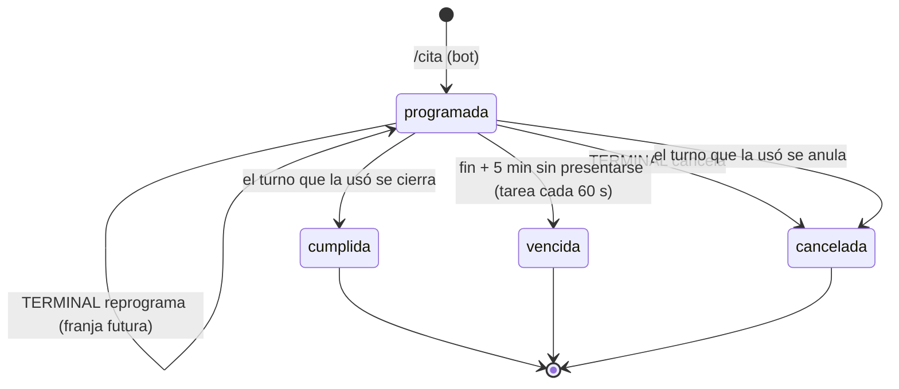

# Citas y control de ventana

SPECS §11 · §14.5 · A11 · ROADMAP Etapa 11.

La cita se pide **solo** por el canal de mensajería (`/cita`, ver `docs/mensajeria.md`). La web no tiene ningún endpoint que cree citas: TERMINAL solo cancela, reprograma y bloquea franjas. Una prueba (`test_ninguna_ruta_de_la_plataforma_crea_citas`) lo verifica, porque es parte de la barrera 🔴 4.

## 1. Reglas (§11.1)

| Regla | Dónde se aplica |
|---|---|
| Franjas de 15 min | `web/modelos/cita.py` (`fin_de_franja`, `franja_valida`: `HH:MM` múltiplo de 15) |
| Máximo 2 citas **programadas** por franja | `RepositorioCitas.reservar` (bot) y `reprogramar` (TERMINAL), dentro de `BEGIN IMMEDIATE` |
| Solo contenedores con levante otorgado | `contenedores_citables` y la revalidación de la reserva |
| Una sola cita vigente por contenedor | Índice `ix_cita_programada_por_manifiesto` más la revalidación |
| Franja llena o bloqueada no se ofrece | `franjas_ofrecibles` |
| Ventana = inicio de franja … fin + 5 min | `esta_dentro_de_ventana` (garita) y `ventana_cerrada` (vencimiento) |
| Fuera de ventana → RT04 | `ServicioGarita._autorizar` |
| Cumplimiento registrado por cita | `cita.cumplida_en_ventana` |

Todas las horas de franja son de la terminal (UTC-6, sin horario de verano). Las marcas guardadas son UTC.

## 2. Ciclo de vida (§11.2, A11)

- **Al presentarse en garita** se registra `cumplida_en_ventana` (1 si llegó dentro de la ventana, 0 si no). Desde ese momento la cita queda **en uso**: no vence y TERMINAL ya no la puede cancelar ni reprogramar (`409 CITA_EN_USO`). Su desenlace lo decide el turno.
- **Vencimiento:** tarea periódica de `portus-web` (`vencimiento-citas`, cada 60 s). La cita programada que ningún turno usó y cuya ventana cerró pasa a `vencida` con `cumplida_en_ventana = 0`, y se publica `cita.vencida` en `portus/srv/cita`. No es uno de los 9 avisos al transportista; `/miscitas` ya muestra el estado.
- **Turno anulado** (Anular o *Rechazar*): la cita pasa a `cancelada` y conserva su `cumplida_en_ventana`.

## 3. Decisiones [DEC]

| Tema | Decisión | Motivo |
|---|---|---|
| A11: estado final de la cita con llegada fuera de ventana | `cumplida_en_ventana = 0`; el estado lo decide el turno (cumplida al cerrarse, cancelada al anularse) | Recomendación de §11.2 |
| Llegada tarde con la cita ya **vencida** el mismo día | La garita la acepta con **RT04**; la cita sigue `vencida` | §11.1 regla 7: fuera de ventana es RT04, no rechazo. Si no, el resultado dependería de si la tarea de vencimiento ya pasó |
| Cita vencida de un día anterior | Rechazo `SIN_CITA`; el transportista pide otra con `/cita` | Una vencida no es vigente (`/cita` vuelve a ofrecer el contenedor) |
| Turno anulado | Cita `cancelada` | La operación no se completó y la cita no puede quedar `programada` para siempre |
| Reprogramar | Solo a una franja futura, bien formada, no bloqueada y con capacidad; borra el recordatorio enviado | La ventana nueva recibe su propio aviso 4 |
| Bloquear franja | Se puede bloquear una franja sin citas (se crea bloqueada) | Las franjas nacen al reservarse; sin esto no se podía impedir la primera cita |

## 4. Indicador del día y métrica 7

- **Indicador de la pestaña Citas (§14.5):** citas del día con cumplimiento registrado (se presentaron o vencieron). Las programadas por llegar y las canceladas antes de presentarse no tienen resultado y no cuentan.
- **Métrica 7 del reporte (§16.1):** el mismo criterio sobre las citas cuya **franja empieza** dentro del periodo. Antes se contaba por la fecha de alta de la cita. El periodo llega en UTC y la franja en hora local, así que la comparación se hace entre instantes con zona.

## 5. Pestaña Citas (§14.5)

Por franja se ve la ocupación (solo cuentan las programadas), el estado de cada cita (`programada`, `en terminal`, `cumplida · en ventana`, `vencida · fuera de ventana`, `cancelada`…) y los botones *Cancelar* y *Reprogramar* solo donde proceden. Un formulario permite bloquear cualquier franja del día elegido, tenga citas o no.

## 6. Hito H3 retirado

El sustituto temporal para crear citas sin el bot era `herramientas/crear_operacion_demo.py`, y ahora **no crea citas por omisión**. `--con-cita` las escribe directo en la base con un aviso de que es solo para desarrollo. Esa opción **no se usa en la evaluación**: la cita se pide con `/cita` (barrera 4).
