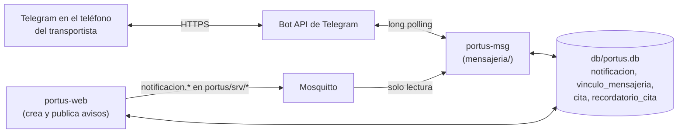

# Canal de mensajería: bot de Telegram (`portus-msg`)

SPECS §15 · ROADMAP Etapa 10 · CODESTYLE PY-4, I-4, S-1, S-2.

El transportista opera **solo** por este canal: se vincula, pide citas, consulta su carga y recibe los 9 avisos automáticos. Es el único componente con salida a internet (HTTPS hacia la Bot API). El resto de la plataforma sigue en la red local.



## 1. Alta del bot (una sola vez)

1. En Telegram, abrir **@BotFather** y enviar `/newbot`.
2. Nombre visible: p. ej. `PORTUS Terminal`. Usuario: debe terminar en `bot` (p. ej. `portus_g7_bot`).
3. BotFather entrega el **token**. Copiarlo **solo** en `config/portus.env`:
   ```
   TELEGRAM_BOT_TOKEN=123456789:AA...
   ```
   `config/portus.env` está en `.gitignore`. Si el token se filtra (captura, commit, chat), revocarlo con `/revoke` en @BotFather y pegar el nuevo.
4. El menú de comandos **no** hace falta cargarlo a mano. Al arrancar, el servicio llama a `setMyCommands` con los 7 comandos y a `deleteWebhook` (long polling y webhook no conviven, §15.4).

## 2. Configuración y arranque

Claves de `config/portus.env` (ver `config/portus.env.ejemplo`):

| Clave | Uso |
|---|---|
| `TELEGRAM_BOT_TOKEN` | Obligatoria. Sin ella el servicio no arranca |
| `MSG_MQTT_USUARIO` / `MSG_MQTT_CONTRASENA` | Usuario propio del bot en Mosquitto (`portus-msg`, solo lectura de `portus/srv/*`) |
| `NOMBRE_TERMINAL` | Nombre que muestra `/inicio` |
| `RUTA_BD`, `MQTT_HOST`, `MQTT_PUERTO`, `NIVEL_REGISTRO` | Compartidas con los demás servicios |
| `TELEGRAM_URL_API` | Solo para pruebas locales contra una Bot API falsa |

Usuario del broker (una vez):

```bash
sudo mosquitto_passwd -b /opt/portus/config/passwd_mosquitto portus-msg <contrasena-msg>
```

Arranque:

- **Desarrollo:** `venv/bin/python -m mensajeria --config config/portus.env`, con `portus-web` ya corriendo, porque la web aplica las migraciones de la base y el bot la abre sin reaplicarlas.
- **SBC:** la unidad `config/systemd/portus-msg.service` arranca en el orden de §19.2 (mosquitto → portus-web → portus-bridge → portus-msg):
  ```bash
  sudo cp config/systemd/portus-msg.service /etc/systemd/system/
  sudo systemctl daemon-reload && sudo systemctl enable --now portus-msg
  journalctl -u portus-msg -f
  ```

El registro **nunca** muestra el token: `httpx` (que escribe la URL de cada llamada, token incluido) queda en nivel WARNING.

## 3. Procedimiento de vinculación (§15.1)

1. TERMINAL entra a la web, pestaña **Citas**, panel **Vinculación de transportistas**, y pulsa *Generar código* junto al transportista.
2. La web muestra un código de **6 caracteres** (sin `0/O/1/I/L`), de **un solo uso**, que vence a los **60 min**. Generar otro invalida el anterior.
3. El transportista abre el bot en su teléfono y escribe `/vincular CODIGO` (acepta minúsculas y espacios). Como alternativa, el enlace `https://t.me/<usuario_del_bot>?start=CODIGO` hace lo mismo.
4. El bot confirma con el **nombre del transportista**. El panel de la web pasa a mostrarlo como vinculado.

Reglas:

- Cuenta **no vinculada**: cualquier comando que no sea `/vincular` recibe **siempre la misma respuesta** con la instrucción de vinculación. Esto incluye `/start`, `/inicio` y el texto libre.
- Una cuenta ↔ un transportista. Vincular el chat con otro código reemplaza el vínculo anterior.
- Tope de **5 intentos de `/vincular` cada 15 min por chat**, para frenar la prueba de códigos al azar.

## 4. Comandos (§15.2)

| Comando | Respuesta |
|---|---|
| `/inicio` (y `/start`) | Saludo con el nombre del transportista y de la terminal, y la lista de los 7 comandos |
| `/vincular CODIGO` | Confirmación con el nombre del transportista, o «código inválido o vencido» |
| `/cita` | Botones con los contenedores **propios con levante y sin cita**. Luego las **4 próximas franjas con capacidad**, desde el siguiente múltiplo de 15 min y sin llenas ni bloqueadas. Al elegir, confirma contenedor, fecha, inicio y fin |
| `/miscitas` | Citas de hoy en adelante, más las programadas atrasadas: contenedor, fecha, franja con su ventana (fin + 5 min) y estado |
| `/estado CONTENEDOR` | ID, estado actual (turno y estación, en patio, o estado operativo), ubicación y permanencia en h y min si está en patio, autorización y canal. Si no es suyo: «No tienes carga asociada a ese identificador» |
| `/misturnos` | Por turno activo: vehículo, contenedor, tipo de operación, estado y estación. Si está retenido, también la plaza |
| `/ayuda` | La lista completa |
| Otro texto o comando | «Comando no reconocido» con `/ayuda`. Ningún mensaje queda sin respuesta, ni siquiera ante un error interno |

`/cita` es una conversación de dos pasos (`esperando_contenedor` → `esperando_franja`):

- Vence tras 10 min sin actividad y se cancela si llega otro comando.
- Solo acepta botones que el bot ofreció en esa conversación.
- Al confirmar, la reserva vuelve a validar propiedad, levante, cita única y capacidad dentro de una transacción `BEGIN IMMEDIATE`. Si la franja se llenó mientras el transportista elegía, se ofrecen otras.

Aislamiento: el `transportista_id` sale del **vínculo del chat**, nunca de lo que escribe el usuario. Cada consulta lo aplica en el SQL (`web/repositorios/repositorio_consultas_transportista.py`, `repositorio_citas.py`).

## 5. Las 9 notificaciones (§15.3)

| # | Evento | Quién lo genera | Contenido |
|---|---|---|---|
| 1 | Levante otorgado | Web (AUTORIDAD otorga) | Contenedor, canal. En rojo, aviso de verificación |
| 2 | Levante retenido | Web (AUTORIDAD retiene) | Contenedor y motivo |
| 3 | Cita asignada | Bot (confirmación de `/cita`) | Contenedor, fecha, inicio y fin |
| 4 | Recordatorio 1 h antes | Bot (planificador cada 30 s) | Contenedor y ventana |
| 5 | Vehículo retenido | Web (retención abierta) | Vehículo, contenedor, causa. En RT01/RT02: declarado, medido y diferencia |
| 6 | Retención resuelta | Web | Vehículo, contenedor, resolución. Si es Corregir, nuevo peso. Si es Rechazar, motivo |
| 7 | Cita cancelada o reprogramada | Web (TERMINAL en Citas) | Contenedor y situación. Si se reprogramó, la ventana nueva |
| 8 | Turno cerrado | Web (salida confirmada) | Vehículo, contenedor, tipo de operación y tiempo total en la terminal |
| 9 | Turno anulado | Web (anulación o Rechazar) | Vehículo, contenedor y causa |

Formato MQTT de cada aviso: `docs/topicos_mqtt.md` §9.

**Entrega robusta (§15.4):**

- La fila de `notificacion` es la fuente de verdad. El MQTT solo dispara la entrega. Cada minuto, un **barrido** vuelve a encolar las pendientes de transportistas vinculados.
- Cola única con ≥ 1 s entre mensajes al mismo chat y ~30/s en total. Ante un `429` espera exactamente `retry_after`.
- **Sin internet:** el fallo se anota en `entrega_notificacion.ultimo_error` **sin gastar reintentos** y el aviso sale cuando vuelve la conexión.
- **Rechazo permanente** (el usuario bloqueó al bot o el chat no existe): se deja de intentar al tercer rechazo.
- **Idempotencia:** se descarta un envoltorio MQTT con `id` repetido, la misma fila no entra dos veces a la cola y una fila `entregado = 1` no se reenvía.
- Texto plano, sin `parse_mode`: un `<` en un motivo no rompe el mensaje. Tope de 4096 caracteres; las listas muestran como máximo 15 elementos y resumen el resto.

## 6. Decisiones [DEC]

| Tema | Decisión | Motivo |
|---|---|---|
| `/start` e `/inicio` sin vincular | Misma respuesta que cualquier comando (lectura literal de §15.1 regla 5). `/start CODIGO` vincula | §15.4 lo propone; confirmar con el auxiliar |
| Avisos anteriores al vínculo | No se envían al vincular | El transportista aún no tenía cuenta; evita una ráfaga de avisos viejos |
| Aviso 3 | Es la confirmación de `/cita`, guardada como entregada | Mandar además un segundo mensaje igual solo duplicaría |
| Recordatorio de una cita pedida con menos de 1 h | Sale en la primera pasada | El aviso 4 siempre ocurre y puede demostrarse. Con las 4 franjas ofrecidas, toda cita cae dentro de la hora |
| Reprogramar | Borra la marca de recordatorio | La ventana nueva recibe su propio aviso 4 |
| Tópico de los avisos de levante | `portus/srv/cita` | El levante habilita la cita (§11.1 regla 3); el espacio de tópicos de §5.3 no tiene uno documental |
| Estado de la conversación de `/cita` | En memoria del proceso | Si portus-msg se reinicia, basta volver a escribir `/cita`; la cita solo existe al confirmarse en la BD |
| Chats de grupo | Responde «solo chats privados» | Nunca muestra carga en un grupo |

## 7. Demostración desde el teléfono (§15.4, entregable)

| Dato | Valor |
|---|---|
| Usuario del bot | `@__________` |
| Cuenta de Telegram de `transportista01` | `__________` (teléfono 1) |
| Cuenta de Telegram de `transportista02` | `__________` (teléfono 2, o Telegram Web/Desktop) |

Guion corto (E03, E04 y E12):

1. TERMINAL genera los códigos. Cada teléfono escribe `/vincular CODIGO`.
2. AUTORIDAD retiene el levante de un contenedor de `transportista01`. El teléfono 1 recibe el aviso 2 con el motivo (E03).
3. AUTORIDAD otorga canal verde a otro. El teléfono 1 recibe el aviso 1, escribe `/cita` y elige contenedor y franja. La cita aparece en la pestaña *Citas* (E04).
4. Desde el teléfono 2, `/estado <contenedor de transportista01>` responde «No tienes carga asociada a ese identificador» (E12).
5. Durante la operación llegan los avisos 5 a 9 según el caso. `/misturnos` muestra la estación en curso.

El SBC necesita salida a internet (Wi-Fi o hotspot como plan B). Sin ella, el bot no recibe comandos, pero **ningún aviso se pierde**: todos quedan pendientes en la base.

## 8. Pruebas

- `pruebas/test_bot_comandos.py`: vinculación (respuesta única, un solo uso, 60 min, deep link, tope de intentos) y los 7 comandos con aislamiento entre los dos transportistas.
- `pruebas/test_bot_cita.py`: ofrecimiento de franjas (llenas, bloqueadas, medianoche), la conversación completa, la revalidación de capacidad y los botones fabricados.
- `pruebas/test_bot_avisos.py`: generación de los avisos en la web, cola de envío (429, sin red, rechazo permanente, ritmo, idempotencia), escucha MQTT, recordatorios y traducción de errores de la Bot API.
